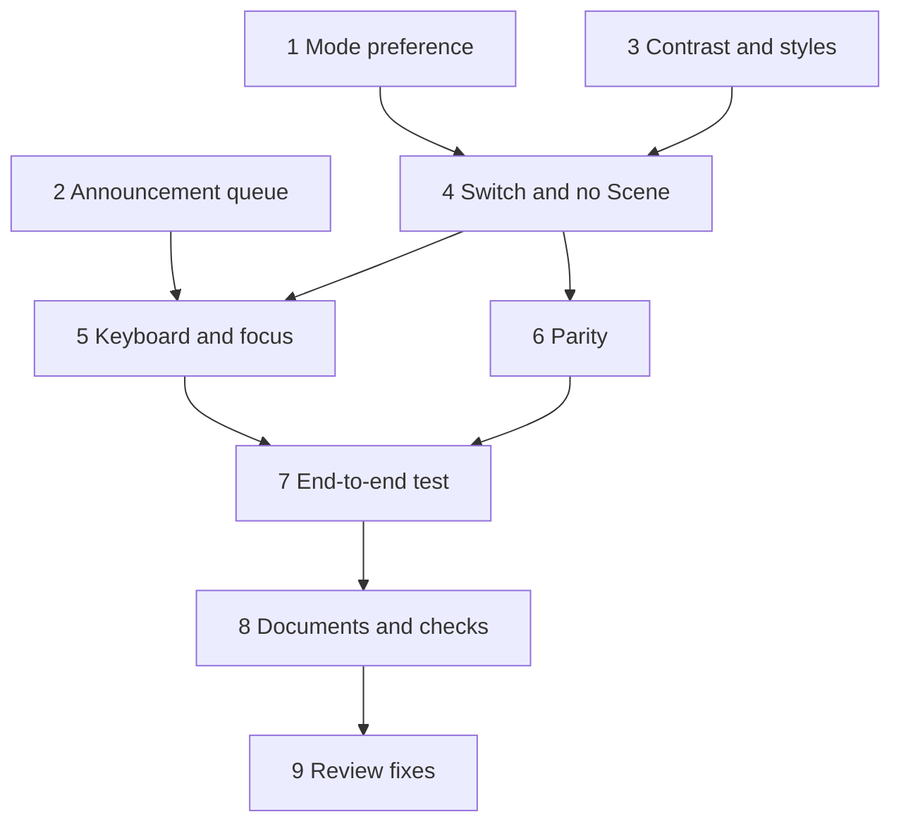

# Implementation Plan: accessible-mode

## Overview

Add a page-level accessible mode: a pure mode resolver and a defensive saved choice, a switch and a skip link, no Scene in the mode, a table-first structure with focus handling, one calm announcement queue in front of the existing live region, motion, contrast and status marks that follow the rules, and an end-to-end test. It is 8 top-level tasks. Each task ships with its tests. Property tests are their own sub-tasks, marked `*`, and carry the comment `// Feature: accessible-mode, Property N`. Unit and property tests run in Vitest with jsdom; only task 7 needs a browser.

## Tasks

- [x] 1. Mode preference
  - [x] 1.1 Add `a11y/mode.ts` (`resolveMode`, `parseModeParam`, `parseSavedChoice`, `STORAGE_KEY`) and `a11y/storage.ts` (`readSavedChoice`, `writeSavedChoice`), both total
    - _Requirements: 1.2, 1.3, 1.5, 1.6_
  - [x] 1.2 Add `a11y/useAccessibleMode.ts`: resolve once, re-resolve on a Reduced motion change when nothing else decides, `toggle` that saves, `mode=scene` that never writes on load
    - _Requirements: 1.2, 1.3, 1.4, 1.7_
  - [x] 1.3 Unit tests: precedence cases, saved `off` beating Reduced motion, URL beating the saved choice without overwriting it, bad JSON, wrong shape, blocked and throwing storage, a failing write, runtime Reduced motion change
    - _Requirements: 1.2, 1.3, 1.4, 1.5, 1.6, 1.7_
  - [x]* 1.4 Property test: mode resolution follows the precedence (Property 1)
    - _Requirements: 1.2, 1.3, 1.4, 1.7_
  - [x]* 1.5 Property test: reading the saved choice never throws (Property 2)
    - _Requirements: 1.5, 1.6_

- [x] 2. Announcement queue and sentences
  - [x] 2.1 Add `a11y/announcement-queue.ts` (`createQueue`, `enqueue`, `release`, constants), pure and non-mutating
    - _Requirements: 5.3, 5.4, 5.5, 5.6_
  - [x] 2.2 Add `announcementsFor(prev, next)` in `LiveAnnouncer.tsx` with the missing sentences (dark, recovered, hunt started, each step, diagnosis ready, proposal opened with its kind, merged, deployed, failed with a short reason) and drive the queue from a hook with one cleaned-up timer; keep the single `polite` region; do not speak the first state
    - _Requirements: 5.1, 5.2, 5.6, 5.7_
  - [x] 2.3 Unit tests: one sentence per listed change, no second live region in the document, first render silent, burst of equal sentences spoken once, 2 s spacing with fake timers, cap of 5 drops the oldest, timer cleared on unmount
    - _Requirements: 5.1, 5.2, 5.3, 5.4, 5.5, 5.6, 5.7_
  - [x]* 2.4 Property test: the announcement queue is calm, ordered and bounded (Property 3)
    - _Requirements: 5.3, 5.4, 5.5, 5.6_

- [x] 3. Contrast, status marks, motion and focus styles
  - [x] 3.1 Add `a11y/contrast.ts` (`parseHex`, `relativeLuminance`, `contrastRatio`) and `a11y/status-marks.ts` (`statusMark` with label and symbol for the haunt, connection, deploy and proposal groups); show the marks in the table, the header and the proposal view with `aria-hidden` symbols
    - _Requirements: 7.1, 7.3, 7.4_
  - [x] 3.2 Update `styles.css`: colours as named custom properties, the `.room-button:focus-visible` outline, the skip link, the shared motion rule for `prefers-reduced-motion` and `:root[data-a11y='on']`; fix any pair that fails
    - _Requirements: 4.2, 6.1, 6.2, 7.5_
  - [x] 3.3 Tests: known contrast values, the explicit table of pairs read from `styles.css` (4.5 for text, 3 for UI, both modes), the guard against uncovered colour literals, the motion rule covering every `animation` and `transition`, status marks
    - _Requirements: 6.1, 7.1, 7.2, 7.4, 7.5_
  - [x]* 3.4 Property test: contrast pairs hold and the function is sound (Property 5)
    - _Requirements: 7.1, 7.2, 7.5_
  - [x]* 3.5 Property test: statuses have distinct marks (Property 6)
    - _Requirements: 7.3, 7.4_
  - [x] 3.6 Test the flashing rule on the animator constants, and add the no-shake assertion for the page
    - _Requirements: 6.3, 6.4_
  - [x]* 3.7 Property test: the Scene never flashes above 3 per second (Property 9)
    - _Requirements: 6.3_

- [x] 4. Switch, skip link and no Scene in the mode
  - [x] 4.1 Add `AccessibleSwitch` and `SkipLink`; in `App.tsx` add the landmarks (`header`, `main`, `section#services`), the `h1`, the heading order, `data-a11y` on the root element, and render `SceneMount` only when the mode is off
    - _Requirements: 1.1, 2.1, 2.2, 2.5, 3.1, 3.2, 6.2_
  - [x] 4.2 Table structure: caption, `scope` on column and row headers, `aria-current` on the selected row, stable row keys and `data-row`
    - _Requirements: 3.3, 4.4_
  - [x] 4.3 Unit tests: the switch is first after the skip link and has `aria-pressed`, the loader spy (`loadCanvas`) is not called and no canvas exists in Accessible mode, toggling off mounts the Scene once, toggling on unmounts it and cancels its frames and timers, landmarks and headings, skip link moves focus, `mode=accessible&demo=1` shows the demo table with no Scene
    - _Requirements: 1.1, 2.1, 2.2, 2.3, 3.1, 3.2, 3.3, 8.2, 8.3_
  - [x]* 4.4 Property test: Accessible mode never loads or leaves the Scene (Property 8)
    - _Requirements: 2.1, 2.2, 2.3_

- [x] 5. Keyboard, focus and deep link
  - [x] 5.1 Add `a11y/focus.ts` (`useFocusAnchor`, `focusRow`): record the focused row, restore it after a render when focus fell to `body`, fall back to the table region, store the opener row for the detail
    - _Requirements: 4.4, 4.5_
  - [x] 5.2 Escape closes the detail and returns focus to the opener row; the `/hunts/<id>` deep link selects, focuses the row and opens the detail in Accessible mode; check there is no keyboard trap and every control (rows, hunt start, proposal actions and links, detail close) is reachable
    - _Requirements: 4.1, 4.3, 4.6, 8.1_
  - [x] 5.3 Unit tests: focus restored after an SSE-style re-render, focus on the table region when the row is gone, Escape returns focus, the deep link, tab order through the page, the room buttons keep an outline on focus
    - _Requirements: 4.1, 4.2, 4.3, 4.4, 4.5, 4.6, 8.1_
  - [x]* 5.4 Property test: focus survives re-renders (Property 7)
    - _Requirements: 4.3, 4.4, 4.5_

- [x] 6. Parity in Accessible mode
  - [x] 6.1 Extend `parity.property.test.tsx` and `hunt-parity.property.test.tsx` so that, for generated states, every Scene fact appears as text in Accessible mode (status, error ratio, latency, last deploy, hunt steps, diagnosis with culprit deploy and short commit, proposal status, kind, link name, checks, failure reason); add any missing text to the table or the detail
    - _Requirements: 3.4, 3.5, 3.6_
  - [x]* 6.2 Property test: every Scene fact appears as text (Property 4)
    - _Requirements: 3.4, 3.5, 3.6, 8.2_

- [x] 7. End-to-end test
  - [x] 7.1 Add `apps/web/e2e/accessible.spec.ts`: `/?mode=accessible` with demo data has no scene chunk request and no `<canvas>`; keyboard-only Tab reaches the Switch, every row and the detail; the Switch off shows the canvas and on removes it; `prefers-reduced-motion: reduce` emulation turns the mode on with no saved choice
    - _Requirements: 9.3_

- [x] 8. Documents, bundle and checks
  - [x] 8.1 Update `README.md` and `docs/DEV.md` (how to turn it on, what it guarantees, a manual screen-reader checklist) and the lines of `.kiro/steering/a11y-perf.md` that this spec makes concrete
    - _Requirements: 9.1, 9.2_
  - [x] 8.2 Run `node scripts/check-scene-bundle.mjs` after a build; record the entry and Scene sizes before and after in the Notes; the entry grows by at most 3 KiB
    - _Requirements: 2.4_
  - [x] 8.3 Run `pnpm typecheck`, `pnpm lint`, `pnpm test` twice, `pnpm test:scripts`, the e2e suite, `pnpm check:build`, `pnpm --filter @haunted-ops/api db:drift` and the spec validator; confirm no dependency, API, Prisma or shared type changed and no existing assertion was weakened; add one `docs/KIRO_USAGE.md` line per finished top-level task
    - _Requirements: 9.4, 9.5_

- [x] 9. Review fixes
  - [x] 9.1 One live region in the whole app: remove `role="status"` and `aria-live` from the Header, the stale notice and the Scene fallback; the Announcer says connection changes, stale and fresh again, and the fallback through the same queue; update the tests that found them by role; add an app-level test that counts one live region in both modes and with the fallback shown
    - _Requirements: 5.1, 5.2, 5.7_
  - [x] 9.2 Use the WCAG sRGB threshold 0.04045 in `contrast.ts`; test the reference values (21 to 1, `#777777` and `#767676` on white)
    - _Requirements: 7.1_
  - [x] 9.3 Drop a deep-link focus request made in scene mode; test that a later switch keeps focus on the Switch
    - _Requirements: 4.6, 8.1_
  - [x] 9.4 Make every released sentence a DOM change (a keyed text node); test the same sentence 11 s apart with DOM mutations
    - _Requirements: 5.3, 5.4_
  - [x] 9.5 Replace the level 3 position shake of the animator with a slow dip of the light; test room offset 0 and at most 3 luminance changes per second at every level and mode; update the `scene-engine` text
    - _Requirements: 6.3, 6.4_
  - [x] 9.6 Fix the two flaky tests at their cause (the renderer is made after the canvas shows, so wait for it; fresh state per property run); run the web tests 5 times in a row
    - _Requirements: 9.4_
  - [x] 9.7 Extend the parity property test: status symbol, proposal kind and status, each check name and result, GitHub-only links, the AI failure reason
    - _Requirements: 3.4, 3.5, 3.6_
## Task Dependency Graph



```json
{
  "waves": [
    { "id": 0, "tasks": ["1", "2", "3"] },
    { "id": 1, "tasks": ["4"] },
    { "id": 2, "tasks": ["5", "6"] },
    { "id": 3, "tasks": ["7"] },
    { "id": 4, "tasks": ["8"] },
    { "id": 5, "tasks": ["9"] }
  ]
}
```

## Notes

- Sub-tasks marked `*` are property-based tests. They are required for this spec: every correctness property has one.
- Properties 1 to 3, 5, 6 and 9 need no DOM; Properties 4, 7 and 8 use jsdom and Testing Library. The Playwright test and the bundle check are not part of `pnpm test`.
- The scene stays unchanged. Accessible mode removes `SceneMount` from the tree, so the existing unmount cleanup stops the loop and destroys the renderer.
- The Announcer stays the only live region (`scene-engine` requirement 8). The queue sits in front of it.
- The saved choice key `haunted-ops.a11y.v1` is the only `localStorage` use in the Web.
- Bundle baseline, 15 Nov 2026, before any change: entry 88.1 KiB gzip (2 files, budget 92 KiB), SceneCanvas file 97.3 KiB (budget 119 KiB), scene with static imports 158.6 KiB in 6 files (budget 180 KiB), 15.8 KiB on demand. The result after task 8.2 is recorded below it.
- Out of scope: sound (`spatial-audio`), the deploy (`deploy-demo`), a second live region, a new theme, any API change.
- Bundle result after task 8.2, 15 Nov 2026: entry 89.7 KiB gzip (was 88.1, growth 1.6 KiB, budget 92 KiB), SceneCanvas file 97.3 KiB (was 97.3), scene with static imports 158.6 KiB (was 158.6).
- The existing hunt announcer test now advances the fake clock by the 2 s gap between two sentences; its expected sentences are unchanged. Task 9 removed the `role="status"` of the Header, the stale notice and the Scene fallback: the Announcer is the only live region of the app.
