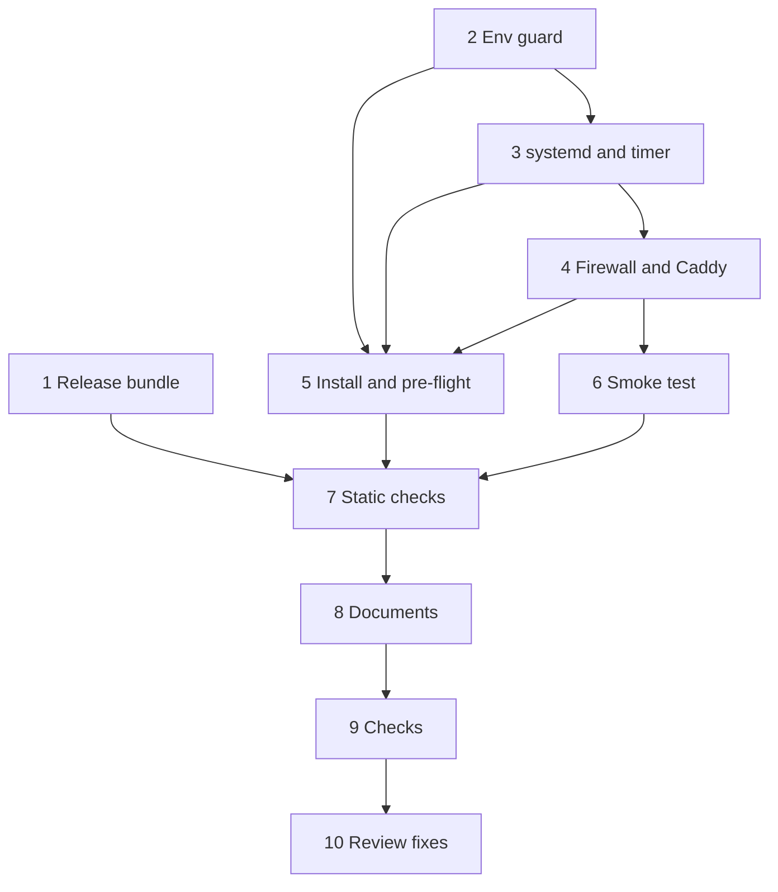

# Implementation Plan: deploy-demo
## Overview
Write the files that turn a bare Debian instance into the Demo server, and the local tests that keep them honest: a release bundle with a check, an environment guard, systemd units and a timer, a firewall, Caddy, an install script, a smoke test and a pre-flight, and the documents. It is 10 top-level tasks (task 10 holds the fixes found by the check and the review). Each task ships with its tests. Property tests are their own sub-tasks, marked `*`, and carry the comment `// Feature: deploy-demo, Property N`. Nothing here touches AWS, a server, GitHub or the real `kiro-cli`.
## Tasks
- [x] 1. Release bundle
  - [x] 1.1 Add `scripts/release-check.mjs` (`checkTree`, a CLI): native binaries, `.env` files, `spike/`, `spikes/`, `.agents/`, source maps, `.vite/`, home paths and token patterns; findings hold a path and a kind, never the matched text
    - _Requirements: 1.4, 1.5_
  - [x] 1.2 Add `deploy/build-release.sh` (dirty-tree refusal, demo-mode build, stage, check, tarball and `.sha256`, `RELEASE-INFO`) and git-ignore `deploy/out/`
    - _Requirements: 1.1, 1.2, 1.3, 1.6_
  - [x] 1.3 Unit tests: a clean tree, each forbidden kind in a fixture tree, the `.example` exemption, a symlink, an unreadable text rule that does not print the match
    - _Requirements: 1.4, 1.5_
  - [x]* 1.4 Property test: the Release check refuses every forbidden item and nothing clean (Property 3)
    - _Requirements: 1.4, 1.5_
- [x] 2. Env guard and examples
  - [x] 2.1 Add `scripts/demo-env-check.mjs` (`parseEnvText`, `checkEnv`, a CLI with the `api` and `lab` profiles)
    - _Requirements: 6.1, 6.2, 6.3_
  - [x] 2.2 Add `deploy/server/env/api.env.example` and `lab.env.example` with names, safe defaults and placeholders
    - _Requirements: 6.4_
  - [x] 2.3 Unit tests: every refusal case, a valid file for each profile, parsing (quotes, comments, duplicates, a bad line), exit codes, no value in any output
    - _Requirements: 6.1, 6.2, 6.3, 9.2_
  - [x]* 2.4 Property test: the Env guard accepts only maps that satisfy every rule (Property 1)
    - _Requirements: 6.1, 9.3_
  - [x]* 2.5 Property test: the Env guard never prints a value (Property 2)
    - _Requirements: 6.3, 9.3_
- [x] 3. systemd, timer and service settings
  - [x] 3.1 Add `haunted-api.service`, `haunted-lab.service`, `haunted-scenario.service`, `haunted-scenario.timer` and `deploy/server/scenario.sh`
    - _Requirements: 3.1, 3.2, 3.4, 3.5, 3.6_
  - [x] 3.2 Add the drop-ins for Prometheus and Caddy, `postgres/haunted.conf`, `prometheus/prometheus.yml` and `prometheus/targets/lab.json`
    - _Requirements: 3.3_
- [x] 4. Firewall and Caddy
  - [x] 4.1 Add `deploy/server/nftables.conf` with a comment on every rule
    - _Requirements: 4.1, 4.2, 4.3_
  - [x] 4.2 Add `deploy/server/Caddyfile`: method block, SSE proxy, static fallback, security headers, log without queries
    - _Requirements: 5.1, 5.2, 5.3, 5.4, 5.5, 5.6_
- [x] 5. Install, rollback and pre-flight
  - [x] 5.1 Add `deploy/server/versions.env`, `prisma.config.mjs`, `seed.mjs` and `install.sh` (idempotent stages, sha256 check, generated secrets only when missing, guard before start)
    - _Requirements: 2.1, 2.2, 2.3, 2.4, 2.5, 2.6, 2.8, 6.5_
  - [x] 5.2 Add `deploy/server/rollback.sh` and `deploy/server/preflight.sh`
    - _Requirements: 2.7, 7.3_
- [x] 6. Smoke test
  - [x] 6.1 Add `scripts/demo-smoke.mjs` (`runSmoke`, `formatTable`, a CLI)
    - _Requirements: 7.1, 7.2_
  - [x] 6.2 Unit tests against a local fake HTTP server: all checks pass, and each check fails when its answer is wrong (redirect, wrong status, wrong type, no stream, a writable method, the manifest, a missing header)
    - _Requirements: 7.1, 7.2, 9.2_
- [x] 7. Static checks of the deploy files
  - [x] 7.1 Add `scripts/deploy-files.test.mjs`: units, timer (three fires a day), Caddyfile, nftables, env examples, `bash -n` and `shellcheck` when installed, no forbidden string or home path in the deploy files; add every new test file to `test:scripts`
    - _Requirements: 3.6, 4.1, 4.2, 5.2, 5.3, 5.4, 6.4, 9.1, 9.2, 9.4, 9.5_
- [x] 8. Documents and steering
  - [x] 8.1 Write `docs/DEPLOY.md` (cost, runbook, daily check, Kill switch layers, rollback, teardown, what is not on the server)
    - _Requirements: 8.1, 8.2_
  - [x] 8.2 Update `.kiro/steering/security.md`, `.kiro/steering/structure.md`, `README.md` and the two sentences of `docs/DEV.md`
    - _Requirements: 8.3, 8.4_
- [x] 9. Checks
  - [x] 9.1 Run `pnpm typecheck`, `pnpm lint`, `pnpm test` twice, `pnpm test:scripts`, `pnpm check:build`, `pnpm --filter @haunted-ops/api db:drift`, `node scripts/check-scene-bundle.mjs` and the spec validator; confirm no dependency or `apps/` code changed; run `deploy/build-release.sh` on a clean tree if one exists; add one `docs/KIRO_USAGE.md` line per finished task
    - _Requirements: 8.5, 9.5, 9.6_
- [x] 10. Review fixes
  - [x] 10.1 Pinned, script-free installs: pnpm from its registry tarball checked against `PNPM_SHA256` in `deploy/server/versions.env` (no `npm install -g`, no `npx`, no pipe into a shell), the Prisma CLI of the lockfile through the workspace install as `hops`, every install with `--ignore-scripts` except the named `@prisma/engines` postinstall (documented in `docs/DEPLOY.md`); static test: no `npm`, `npx` or `curl | sh`, every download checked against a pinned sha256 before use
    - _Requirements: 2.2, 2.4, 9.4_
  - [x] 10.2 Release file modes: `deploy/pack-release.sh` (folders 0755, files 0644, `deploy/server/*.sh` 0755, owner 0/0, sorted names, commit time, same sha256 for two builds); `install.sh` unpacks with `--no-same-owner` and sets `root:hops` read-only; test on a fixture stage with 0600 and 0700 entries
    - _Requirements: 1.7, 2.4, 9.2_
  - [x] 10.3 Demo mode check that does not depend on the minifier: the script sets `VITE_DEMO_MODE=true` itself and `scripts/check-demo-build.mjs` reads every script of the build; test on real `vite build` output
    - _Requirements: 1.3, 9.2_
  - [x] 10.4 Install only what the server runs: `pnpm install --frozen-lockfile --ignore-scripts --filter @haunted-ops/api...`, no `prisma generate` (the client is in `apps/api/dist`, stated in `docs/DEPLOY.md`), `prisma migrate deploy` as `hops` with the workspace `prisma`
    - _Requirements: 2.4, 9.2_
  - [x] 10.5 `policy-rc.d` removed by the exit trap when `apt` fails
    - _Requirements: 2.4, 9.2_
  - [x] 10.6 IPv6: the firewall accepts the DHCPv6 reply from `fe80::/10` (and keeps ICMPv6 neighbour discovery), documented in `docs/DEPLOY.md`
    - _Requirements: 4.1, 9.2_
  - [x] 10.7 Flaky script test: the smoke tests no longer depend on wall-clock speed (generous limits where a check must pass, a short one only where it must time out, a closed port instead of a guess); the other new script tests have no timers
    - _Requirements: 9.1, 9.7_
  - [x] 10.8 Fake token text built at run time from parts in `scripts/demo-env-check.test.mjs`
    - _Requirements: 9.5, 9.7_
## Task Dependency Graph

```json
{
  "waves": [
    { "id": 0, "tasks": ["1", "2"] },
    { "id": 1, "tasks": ["3"] },
    { "id": 2, "tasks": ["4"] },
    { "id": 3, "tasks": ["5", "6"] },
    { "id": 4, "tasks": ["7"] },
    { "id": 5, "tasks": ["8"] },
    { "id": 6, "tasks": ["9"] },
    { "id": 7, "tasks": ["10"] }
  ]
}
```
## Notes
- Sub-tasks marked `*` are property-based tests. They are required for this spec: every correctness property has one.
- The scripts under `scripts/` use Node built-ins only. The properties use `fast-check`, already a root development dependency. No dependency of `apps/` changes.
- The release holds `.kiro/agents/exorcist.json` (the API reads it from the release root), `packages/shared` and `packages/exorcist-mcp` (workspace dependencies of the API) and the two server-side scripts, which the brief's list does not name. They are needed to start the API and its guard.
- The server runs the Prisma CLI of the lockfile, installed by the workspace install of the API (`--filter @haunted-ops/api...`, development dependencies included because `prisma` is one), as `hops`; the compiled client is already in `apps/api/dist`, so there is no `prisma generate` on the server (task 10.1, 10.4).
- Node 26 does not bundle corepack, so pnpm is the registry tarball of the version of `packageManager`, checked against a sha256 in `deploy/server/versions.env` (task 10.1). There is no `npm` in the install script.
- The `hops` user may resolve names (UDP and TCP 53) besides loopback and TCP 443, because `kiro-cli` needs DNS. All other outbound traffic of `hops` is dropped.
- The orchestrator runs `caddy validate`, `nft -c` and `systemd-analyze verify` on the server (none exists on the Mac), then the Install script, the Pre-flight and the Smoke test.
- Bundle, 15 Nov 2026: entry 90.0 KiB gzip before and after (the same file `index-DXy91ZIp.js`, budget 92 KiB), SceneCanvas file 97.3 KiB, scene 158.6 KiB. The deploy adds no web code.
- `deploy/build-release.sh` was run once and stopped at the clean-tree check, as designed: the work of this spec is not committed (no commit was allowed), so no clean tree existed. The release check was run on the built `dist` folders, the server files and the root files that go into the release, with no finding (the `.vite/` folder of the web build is found, and the script removes it before the check).
- Out of scope: the fixer and fix deploys on the server, a GitHub token, containers, backups, a CDN, CI, any change to the API or the Web.
