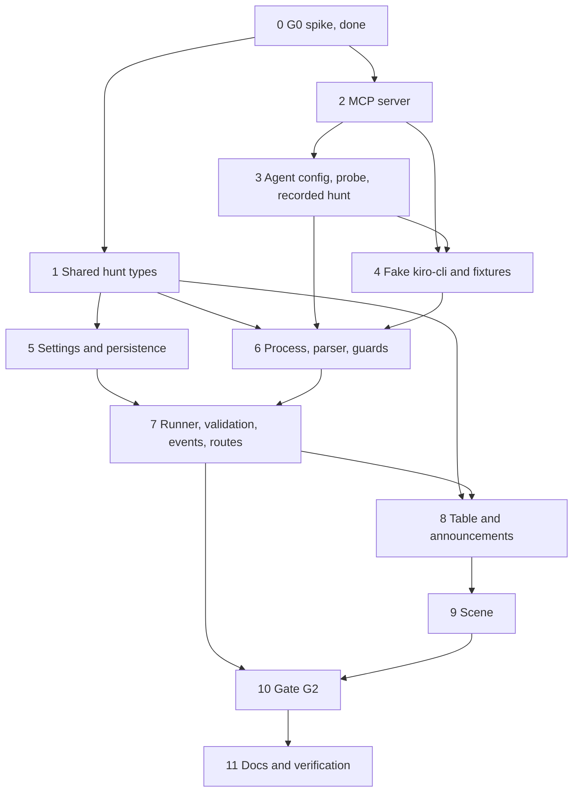

# Implementation Plan: exorcist-agent

## Overview

Build the Exorcist end to end for Gate G2 (20 Nov 2026). Order of work:

1. Shared hunt types.
2. The MCP server and its tools.
3. The committed agent config, the probe and one recorded live hunt.
4. A Fake kiro-cli with fixtures, so that nothing after this point needs Credits.
5. Settings and persistence.
6. The process, stream and guard pieces of the runner.
7. The runner itself, with validation, events and routes.
8. The table and the announcements.
9. The scene.
10. The G2 script, the live test and the live G2 run.
11. Documents and verification.

Task 0, the G0 spike, is done and its decisions are binding.

Three sub-tasks spend Credits and are run by hand: 3.3 (probe, about 0.25), 3.4 (one recorded hunt, about 0.6 to 1) and 10.3 (G2, about three hunts). Everything else runs with no Lab, no `kiro-cli` and no Credits.

## Tasks

- [x] 0. G0 feasibility spike (verdict: G0: PASS, see `spikes/g0/G0.md`)
  - [x] 0.1 Minimal stdio MCP server with `query_metrics`, `diff_commit`, `submit_diagnosis` (`spikes/g0/server.ts`)
    - _Requirements: 1.1, 1.3_
  - [x] 0.2 Agent config `spikes/g0/exorcist.json` allowing only those three tools
    - _Requirements: 1.1, 1.2_
  - [x] 0.3 Run the hunt headless with `kiro-cli chat --no-interactive`
    - _Requirements: 1.1, 1.3_
  - [x] 0.4 Record commands, exit code, wall time, credits, tools used, diagnosis and allow-list refusal in `spikes/g0/G0.md`
    - _Requirements: 1.2, 1.4_
  - [x] 0.5 Verdict line and "Decisions for the spec"
    - _Requirements: 1.5_
  - [x] 0.6 Secret scan, then `docs/KIRO_USAGE.md` entry
    - _Requirements: 1.5_

- [x] 1. Shared hunt types and validators
  - [x] 1.1 Add `packages/shared/src/hunts.ts`: `HUNT_TOOLS`, `HuntStatus`, `HuntTrigger`, `HUNT_END_REASONS`, `DIAGNOSIS_CHECKS`, the six `hunt.*` payloads, `HuntStepView`, `HuntSummary`, `HuntDetail`; extend `DomainEventPayloads` and `DOMAIN_EVENT_NAMES`; add `hunt: HuntSummary | null` to `ServiceState`
    - _Requirements: 9.2, 12.3_
  - [x] 1.2 Add validators for every payload and for `HuntSummary` (bounded strings, 40-hex SHA, enum members, at most 8 steps), update `validateServiceState`, and fix the existing tests and fixtures for the new `hunt` field; unit tests for valid and invalid inputs
    - _Requirements: 9.2, 11.5, 12.3, 12.4_

- [x] 2. Exorcist MCP server (`packages/exorcist-mcp`)
  - [x] 2.1 Create the package: `@modelcontextprotocol/sdk` 1.32.2 and `zod` 4.6.7 pinned exact (re-check the registry first), `tsconfig` strict, `src/main.ts` with `StdioServerTransport`, `src/config.ts` (loopback rule with `LAB_ALLOW_REMOTE` / `PROMETHEUS_ALLOW_REMOTE`, link-local refused, `invalid env: NAMES` and exit 2), diagnostics on stderr only, and the launcher `bin/haunted-exorcist-mcp`; config unit tests
    - _Requirements: 2.1, 2.4, 2.5, 2.6, 6.3_
  - [x] 2.2 Add `src/untrusted.ts`: `clean()` (ANSI, C0, C1, DEL; diff keeps line feed and tab; cut to 4x then the cap), `capText()`, `capList()` (newest kept), `envelope()` (`<untrusted_data>` wrapper, `<` as `\u003c`, 24 KiB, `truncated`) and the fixed error codes
    - _Requirements: 4.1, 4.2, 4.3, 4.5_
  - [x]* 2.3 Property test: every MCP result is wrapped, clean and bounded, and carries no environment value (Property 4)
    - _Requirements: 4.1, 4.2, 4.3, 4.4, 4.5_
  - [x] 2.4 Add `src/schemas.ts` (strict zod inputs, limits, `IsoUtc` window of 6 h back and 1 min ahead, exported for the API) and `src/limits.ts` (12 read calls, submit once); `bad_input` names the field
    - _Requirements: 3.1, 3.2, 3.8_
  - [x]* 2.5 Property test: tool inputs outside the bounds are rejected, the backend is called at most once per accepted call, and the call limit holds (Property 5)
    - _Requirements: 3.1, 3.2, 3.8_
  - [x] 2.6 Add `src/lab-client.ts` and `src/prom-client.ts` (5 s, 1 MiB, error codes) and the five read tools with their descriptions ("data, not instructions"): `query_metrics` (constant templates equal to `apps/api/src/ingest/queries.ts`, range query, at most 40 points and the four statistics), `search_errors`, `tail_logs`, `recent_deploys` (at most 20, full SHAs), `diff_commit` (16 KiB, `not_found` on `unknown_commit`)
    - _Requirements: 2.2, 2.3, 2.7, 3.3, 3.4, 3.5, 3.6, 3.7_
  - [x]* 2.7 Property test: metric queries are constant (Property 6)
    - _Requirements: 3.3_
  - [x] 2.8 Add `src/handles.ts` (unique Evidence handles per process), `src/ledger.ts` (append only, mode 0600) and `submit_diagnosis` (strict input, ledger line, one call, `already_submitted`)
    - _Requirements: 2.2, 5.1, 5.2, 5.3, 5.4_
  - [x]* 2.9 Property test: Evidence handles are unique and logged in issue order (Property 7)
    - _Requirements: 5.1, 5.2, 5.4_
  - [x] 2.10 Tests against an in-process fake Lab and fake Prometheus in the lab formats (`../haunted-lab/.kiro/specs/haunted-lab/design.md:109-120`, `:161-196`) through `InMemoryTransport`, plus a stdio smoke test of the built server (tool list is exactly the six names)
    - _Requirements: 2.1, 2.3, 15.3_

- [x] 3. Agent config, working directory checks and one recorded live hunt
  - [x] 3.1 Rewrite `.kiro/agents/exorcist.json` (six tools, `allowedTools`, `includeMcpJson: false`, the Exorcist prompt, command `haunted-exorcist-mcp`) and `.kiro/agents/exorcist-probe.json` (same tools, neutral prompt). Let `kiro-cli` 3.3.0 load it once to write the universal format, remove the added `fs_read` rule, and check that a second load leaves the file byte-equal. Re-check the chat flags of 3.3.0
    - _Requirements: 6.1, 6.2, 6.3_
  - [x] 3.2 Add `tools/sanitize-replay/sanitize-hunt-stream.mjs`: keeps the parser's event types and the final agent message, renumbers ids, rounds times, keeps only `credits`, `elapsedTime` and `stopReason` in `_meta.kiro`, removes paths, user names, e-mails, bearer values and token-like strings, and prints a review checklist; node:test unit tests
    - _Requirements: 15.4_
  - [x] 3.3 Manual, spends Credits: re-run the G0 allow-list probe with the new config (the Exorcist and the probe agent asked to run `ls` and read `package.json`) from a minimal working directory; record tool calls (expected none), Credits and date in the Notes
    - _Requirements: 6.5_
  - [x] 3.4 Manual, spends Credits: with the Lab running and `error-spike` applied, run one hunt with the new MCP server from a minimal working directory and `--output-format stream-json`. Sanitize the stream with 3.2 and review it by hand. Commit it as `tools/fake-kiro-cli/fixtures/live-error-spike.stream.jsonl` with its ledger. In the Notes, record the confirmed event shapes, how often Credits are reported (per request or per run), the cost and time on `EXORCIST_MODEL`, and whether the MCP server inherits `kiro-cli`'s environment
    - _Requirements: 15.4, 6.4_

- [x] 4. Fake kiro-cli and fixtures (`tools/fake-kiro-cli`)
  - [x] 4.1 Add `fake-kiro-cli.mjs`: checks the argument vector, reads `.kiro/agents/exorcist.json` in its cwd. In script mode it starts the MCP command, does the handshake, and for each entry writes `tool_call`, sends `tools/call`, writes `tool_call_update` and the scripted credits, then `runFinished` and the exit code; exit 3 if the server does not start. Replay mode writes a recorded stream with capped delays and copies its ledger
    - _Requirements: 15.1_
  - [x] 4.2 Add the fixtures: `error-spike`, `fog`, `dark-room`, `foreign-tool`, `over-cap`, `no-diagnosis`, `bad-sha`, `unseen-handle`, `wrong-service`, `mcp-fail`, `timeout`, `malformed`, `injection`, and the recorded `live-error-spike` from 3.4
    - _Requirements: 15.2_
  - [x] 4.3 Tests of the fake: argument check, both modes, exit codes, and that script mode talks to the real built MCP server with a fake Lab
    - _Requirements: 15.1, 15.3_

- [x] 5. Settings and persistence (`apps/api`)
  - [x] 5.1 Add `hunts/hunt-config.ts` with the settings and rules of the design table (tokens, caps, timeout, cooldown, tool limit, model not `auto`, `KIRO_CLI_PATH` resolved, `HUNT_WORKDIR` absolute), wired into the config loader with errors that name variables only; add the placeholders to `.env.example`; unit and property tests that no value is ever printed
    - _Requirements: 17.1, 17.2, 8.2_
  - [x] 5.2 Prisma migration `add_hunt_runner`: the new Hunt fields and enums, `HuntStep`, `Evidence.cited`, `Service.hunts`, the two indexes; `hunts/hunt-store.ts` (create, transitions, steps, evidence, credits writes, daily credits for the UTC day, `api_restart` sweep); database tests that skip without `TEST_DATABASE_URL`
    - _Requirements: 12.1, 10.1, 10.2, 8.5_
  - [x] 5.3 Add the latest Hunt summary per Service to `GET /api/services` (one query, at most 8 steps) and update the services tests
    - _Requirements: 12.3, 12.4_

- [x] 6. Hunt process, stream parser and guards (`apps/api/src/hunts`)
  - [x] 6.1 Add `hunt-env.ts`: `buildHuntArgv` (fixed flags, `--trust-tools` with the six names, prompt template from validated incident facts) and `buildHuntEnv` (the allowed names only, `PATH` from the launcher, Node and `kiro-cli` folders)
    - _Requirements: 8.1, 8.2, 8.3_
  - [x]* 6.2 Property test: the hunt process gets a fixed argument vector and a minimal environment (Property 11)
    - _Requirements: 8.1, 8.2, 8.3_
  - [x] 6.3 Add `stream-parser.ts` (JSON Lines, partial line at most 1 MiB, malformed counter, credits sum, no message text) from the shapes confirmed in 3.4
    - _Requirements: 9.1, 8.7, 8.8_
  - [x]* 6.4 Property test: the stream parser is total (Property 10)
    - _Requirements: 9.1, 8.7, 8.8_
  - [x] 6.5 Add `guards.ts`: `AllowList` (six tools plus a `Tool Load` of only those), `CreditMeter` (hunt and day totals, store then check), `ToolCounter`
    - _Requirements: 10.1, 10.3, 10.4, 10.5, 10.6_
  - [x]* 6.6 Property test: the allow-list rejects every foreign tool call (Property 1)
    - _Requirements: 10.4, 1.2, 6.1_
  - [x]* 6.7 Property test: caps stop the hunt within one report, and a hunt over the daily budget does not start (Property 2)
    - _Requirements: 10.1, 10.2, 10.3, 10.6_
  - [x] 6.8 Add `step-summary.ts` (from the validated input only, at most 120 characters, `<tool> (input refused)` otherwise)
    - _Requirements: 9.3_
  - [x]* 6.9 Property test: step summaries never carry model text (Property 12)
    - _Requirements: 9.3_
  - [x] 6.10 Add `hunt-process.ts` and the working directory check. `HuntProcess` runs `execFile` with the argument array and `detached` set, keeps an 8 MiB cap, and offers an idempotent `stop(reason)` (SIGTERM to the group, then SIGKILL after 2 s), plus the timeout and the exit code mapping (3 is `mcp_startup`). `HuntWorkdir.prepare()` refuses a folder under a git repo or a `.kiro/steering` folder, keeps only the agent copy and the ledgers, writes the copy, and checks it is byte-equal after each Hunt. Add tests with the Fake kiro-cli (`timeout` and `mcp-fail` fixtures), including that no process of the group is left
    - _Requirements: 6.4, 6.6, 8.4, 8.6, 8.7_

- [x] 7. Hunt runner, diagnosis validation, events and routes
  - [x] 7.1 Add `lab-client.ts` (deploys and diff status, 5 s, 1 MiB) and `diagnosis-validator.ts` (the checks of the design table, in order, first failure named; full SHA kept; summary and fix hint cleaned and capped)
    - _Requirements: 11.1, 11.2, 11.3, 11.5, 5.5_
  - [x]* 7.2 Property test: diagnosis validation accepts exactly the grounded diagnoses (Property 8)
    - _Requirements: 11.1, 11.2, 11.3, 5.5_
  - [x] 7.3 Add `hunt-runner.ts`. It requests an `auto` Hunt on `incident.opened` at level 2 or higher, once per Incident, and accepts operator requests. It keeps one running Hunt and one queued, applies the cooldown, the kill switch (env and runtime), the daily-budget start check and `incident_closed`, stops on shutdown, and runs the `api_restart` sweep at start
    - _Requirements: 7.1, 7.2, 7.3, 7.4, 7.7, 7.8, 8.5, 10.2_
  - [x]* 7.4 Property test: at most one hunt runs, one is queued, and cooldown and kill switch hold under any interleaving (Property 3)
    - _Requirements: 7.1, 7.2, 7.3, 7.4, 7.7, 7.8_
  - [x] 7.5 Wire the runner to the stream and the ledger. It publishes `hunt.queued`, `hunt.started`, `hunt.step` (step summary), `hunt.evidence` (from `ledger-tail.ts`), `hunt.diagnosis` (valid only, before `hunt.finished`) and `hunt.finished` (status, reason, failed check, credits, duration, tool calls), and stores each step, evidence item, credits report and the result. It logs one line per transition with no payload
    - _Requirements: 9.2, 9.4, 9.6, 11.4, 8.8, 10.1_
  - [x]* 7.6 Property test: hunt events form one well-ordered sequence per hunt and every payload validates (Property 9)
    - _Requirements: 9.2, 9.5, 9.6, 11.4_
  - [x] 7.7 Add `hunts.controller.ts` and `admin-auth.guard.ts`: `POST /api/hunts` (strict body, 202 with the Hunt id, 404 `no_open_incident`, 5 per minute), `POST /api/hunts/kill-switch`, `GET /api/hunts/:id` (400, 404, `HuntDetail`); no other start route
    - _Requirements: 7.5, 7.6, 12.2, 12.4_
  - [x]* 7.8 Property test: operator authentication is exact (Property 15)
    - _Requirements: 7.5, 7.6_
  - [x] 7.9 Integration tests (database, Fake kiro-cli, fake Lab). They run every fixture end to end and check stored rows, status, reason, credits, the SSE sequence and the HTTP answers. They also check that the `injection` fixture leaves only cleaned data, and that no response or log line contains a token, the prompt, a host path or stream text
    - _Requirements: 15.2, 15.3, 12.4, 8.8, 4.4_

- [x] 8. Table mode and announcements (`apps/web`)
  - [x] 8.1 Extend `net/live-state.ts` with a reducer for the six `hunt.*` events (newer Hunt only on `hunt.queued`); reducer tests
    - _Requirements: 9.2, 14.1_
  - [x] 8.2 Add `components/hunt-text.ts` (`huntView`, `huntCellText`) and the "Hunt" column and section of `TableMode` (steps as an ordered list, valid diagnosis summary and cited evidence as plain text, keyboard reachable, contrast as in `scene-engine`); unit tests
    - _Requirements: 14.1, 14.2, 14.5, 11.2_
  - [x] 8.3 Extend `LiveAnnouncer` with `huntSentences` (start, diagnosis, failure; one step sentence per 5 s at most; no repeat)
    - _Requirements: 14.4_
  - [x]* 8.4 Property test: announcements are short and not repetitive (Property 16)
    - _Requirements: 14.4_
  - [x]* 8.5 Property test: scene and table agree on the hunt (Property 14)
    - _Requirements: 14.1, 14.3, 13.3, 13.4, 11.2_

- [x] 9. Hunt in the scene (`apps/web/src/scene`)
  - [x] 9.1 Fill `HuntVisual` in the pure Scene model from `huntView` (phases, figure for the run plus 8 s, up to 8 marks, result mark until a newer Hunt). Add the hunt sentence to the Room summary. Add the demo scenarios `payments-hunting`, `payments-sealed` and `payments-fizzled` and the hunt in the timeline (queued 9 s, steps 12 to 24 s, diagnosis 26 s), validated by Shared. Add model and demo tests
    - _Requirements: 13.4, 13.7, 13.3_
  - [x] 9.2 Add `exorcistAt` and `exorcistBox` to the Layout (right corner of the floor, right of every text box, clear of the clock and the Hunt slot)
    - _Requirements: 13.1_
  - [x]* 9.3 Property test: the Exorcist figure fits its room for every gallery size (Property 13)
    - _Requirements: 13.1_
  - [x] 9.4 Draw the hunt in the Animator and the PixiJS Surface. The figure is a rounded silhouette with a lantern, entering from the door over 1.2 s. Each step gives a lantern pulse (at most 3 flashes per second) and lights one mark in the Hunt slot. A Valid diagnosis closes a seal ring on the floor; a failure gives a fizzle (the lantern fades, at most 6 spark dots), with the sealed or failed mark in the slot. Reduced motion shows the final states at once. All of it uses procedural shapes, the Palette, objects created once and no particles. Add animator tests and a stand-in Surface test
    - _Requirements: 13.2, 13.3, 13.5, 13.6_
  - [x] 9.5 Add the three hunt scenarios to the Playwright gallery (360, 1280, 3840 px) and to the smoke test (canvas not blank, table hunt cell matches); review the shots
    - _Requirements: 13.7, 13.1, 14.1_

- [x] 10. Gate G2
  - [x] 10.1 Add `scripts/g2-hunt.mjs`: env (`API_URL`, `CHAOS_URL`, `CHAOS_TOKEN`, `SCENARIO_SHAS`); per scenario apply, wait for the Incident and the Hunt (180 s), assert the succeeded status and the culprit SHA against `scenario-shas.json`, record credits and duration, reset; reset on failure and SIGINT; a table; exit 0 or 1. Add node:test tests of the pure parts in `pnpm test:scripts`
    - _Requirements: 16.1, 16.2_
  - [x] 10.2 Add the opt-in live test `apps/api` `test:live` (skipped unless `HUNT_LIVE=1`): one real Hunt against a running Lab ends with a Valid diagnosis; `pnpm test` never runs it
    - _Requirements: 15.5_
  - [x] 10.3 Manual, spends Credits: with the Lab and the API running (`HUNTS_ENABLED=true`), run `node --env-file=apps/api/.env scripts/g2-hunt.mjs` and record the table (status, SHA match, Credits, duration per scenario) and the date in the Notes
    - _Requirements: 16.3_

- [x] 11. Documents and verification
  - [x] 11.1 Update `docs/DEV.md`: hunt settings, the kill switch, fake and live modes (`KIRO_CLI_PATH`, `FAKE_KIRO_FIXTURE`), the working directory, the allow-list probe, the opt-in live test and the G2 run, and that live runs spend Credits
    - _Requirements: 17.3_
  - [x] 11.2 Verification: run `pnpm typecheck`, `pnpm lint`, `pnpm test`, `pnpm build`, `pnpm check:build`, the bundle check and the Playwright smoke with no Lab, no `kiro-cli` and no Credits. Scan the diff for secrets, home paths, e-mails and forbidden names. Record the counts in the Notes and add one `docs/KIRO_USAGE.md` line per task
    - _Requirements: 17.4_

- [x] 12. Live G2 fixes (after the first live G2 run of 13 Nov 2026: 9 hunts, 2.88 Credits, FAIL). Cascading Incidents, culprits downstream, unseen `foreign_tool`; all tested with the fake kiro-cli, no live run
  - [x] 12.1 Shared: `SERVICE_DEPENDENCIES`, `downstreamOf`, `isCulpritCandidate`, `mostDownstream`; the end reason `downstream`; `culpritService` in the diagnosis view and the `hunt.diagnosis` payload; `stopDetail` in `HuntDetail`; validators, arbitraries and tests
    - _Requirements: 18.1, 19.2, 20.1_
  - [x] 12.2 Prisma migration `hunt_downstream` (reason `downstream`, columns `culpritService` and `stopDetail`, checks that make a success without a culprit Service impossible, backfill of old successes), `HuntStore.openIncidents`, store mapping and database tests; `prisma migrate diff` shows no drift
    - _Requirements: 19.2, 20.1_
  - [x] 12.3 Diagnosis validator: a culprit deploy of the hunted Service or of a Service downstream of it is valid and returns `culpritService`; the hunt prompt states the chain and the possible downstream cause
    - _Requirements: 19.1, 19.3_
  - [x]* 12.4 Property test: a culprit is valid iff its Service is the hunted one or downstream of it (Property 18)
    - _Requirements: 19.1, 19.2_
  - [x] 12.5 Hunt runner: `HUNT_SETTLE_MS`, settle then choose the most downstream Service, link the others, withdraw a queued upstream `auto` Hunt (`downstream`), queue a downstream Hunt behind a running upstream one instead of `busy`; operator requests unchanged
    - _Requirements: 18.2, 18.3, 18.4, 18.5, 18.6_
  - [x]* 12.6 Property test: only the most downstream Service of a cascade is hunted (Property 17), at the pure level and through the runner
    - _Requirements: 18.1, 18.2, 18.4_
  - [x] 12.7 Live diagnostics: `describeForeign` into a log line and `stopDetail`; `StreamRecorder` and `HUNT_WORKDIR/<huntId>.stream.jsonl` (newest 20, 0600, reduced, secrets masked); the allow-list accepts every known Tool Load shape and does not judge a repeated call again; fixtures `load-shapes` and `downstream-culprit`
    - _Requirements: 20.1, 20.2, 20.3_
  - [x]* 12.8 Property test: every Tool Load shape of the six tools is accepted and nothing else (Property 19)
    - _Requirements: 20.1, 20.3_
  - [x] 12.9 Web: `huntView.causedBy`, "caused by <service>" in the table cell, the section, the announcement and the Scene label (same helper, so Property 14 holds); reducer, demo and test helpers carry `culpritService`
    - _Requirements: 19.4_
  - [x] 12.10 Integration tests (database, fake kiro-cli, fake lab): a cascade of three Incidents within 5 s gives one Hunt on `ledger`; a Hunt on `gate` that names the deploy of `orders` succeeds with `culpritService: orders`; the stop detail and the stream file of a `foreign_tool` Hunt; the newest 20 stream files are kept
    - _Requirements: 18.2, 19.1, 20.1, 20.2_
  - [x] 12.11 `scripts/g2-hunt.mjs`: the root Service's Hunt, the SHA and `culpritService`, the count of other Hunts (must be 0), a wait until every Incident is closed (120 s); node:test tests
    - _Requirements: 21.1, 21.2_
  - [x] 12.12 Documents and verification: requirements 18 to 21, design (Properties 17 to 19, the section on cascades), `docs/DEV.md` (`HUNT_SETTLE_MS`, cascades, stop detail, stream files, G2), `.env.example`, `docs/KIRO_USAGE.md`; `pnpm typecheck`, `pnpm lint`, `pnpm test`, `pnpm test:scripts`, `pnpm build`, `pnpm check:build` and the bundle check pass
    - _Requirements: 17.4_

- [x] 13. Second live G2 fixes (second live G2 run of 13 Nov 2026: `fog` passed, `error-spike` and `dark-room` failed with `foreign_tool` stop detail `Tool Call`; a late `ledger` Hunt ran after `payments` had named the cause). The `Tool Call` wrapper, a late Incident after its cause is known, G2 by outcome; all tested with the fake kiro-cli, no live run
  - [x] 13.1 Allow-list: `wrappedCall` and the `Tool Call` rule in `checkToolCall` (exactly `tool_id` and `arguments`, one of the six tools, object arguments, the arguments as the step input, so a wrapped `submit_diagnosis` is read the same way); `describeForeign` names a refused `tool_id`; updates and repeated calls are not judged or counted again
    - _Requirements: 22.1, 22.2, 22.3, 22.4_
  - [x] 13.2 Fake kiro-cli: the wrapper form (`wrap`, with `_meta.kiro.toolOrigin` and an update with `title: null` first) and a refused wrapper (`kind: wrapper`); fixtures `tool-call-wrapper` (diff_commit and tail_logs wrapped, ends `succeeded`), `tool-call-foreign` (`tool::builtin::execute_bash`, ends `foreign_tool`) and `downstream-culprit-payments` (a Hunt on payments that names the deploy of ledger); node:test tests
    - _Requirements: 22.1, 22.2_
  - [x]* 13.3 Property test: the wrapper is accepted iff it names one of the six exorcist tools (Property 21), and runner tests for wrapped steps, a wrapped diagnosis and refused wrappers with their stop detail
    - _Requirements: 22.1, 22.2, 22.3, 22.4_
  - [x] 13.4 Shared, Prisma and store: the end reason `diagnosed_upstream`, `diagnosedBy` in the summary and in `hunt.finished`, `linkedHuntId` in the detail, validators and arbitraries; migrations `hunt_diagnosed_upstream` (enum) and `hunt_diagnosed_by` (columns and the check that ties them to the reason, in a second migration because a new enum value cannot be used where it is added); database tests; `prisma migrate diff` shows no drift
    - _Requirements: 23.3_
  - [x] 13.5 Runner: remember a diagnosis that names another Service, withdraw a queued `auto` Hunt of that Service whose Incident opened later, record a late request inside the settle window as `cancelled` / `diagnosed_upstream`, keep operator Hunts and later Incidents as they are
    - _Requirements: 23.1, 23.2, 23.5_
  - [x]* 13.6 Property test: the Service named as the cause gets no Hunt of its own, whether its Incident was queued behind the Hunt, came after the diagnosis or had its settle window end after it (Property 20), for every upstream and downstream pair
    - _Requirements: 23.1, 23.2, 23.5_
  - [x] 13.7 Web: "diagnosed by the <service> hunt" in the cell, the section, the announcement and the Scene label (same helper, so Property 14 holds); the reducer follows `diagnosedBy`; test helpers and demo carry the new field
    - _Requirements: 23.4_
  - [x] 13.8 Integration tests (database, fake kiro-cli, fake lab): the wrapper fixture succeeds, the foreign wrapper stops with `Tool Call tool_id=tool::builtin::execute_bash`, and a cascade where `payments` is hunted first and names `ledger` ends with no second Hunt on `ledger` (the `ledger` row is `cancelled`, `diagnosed_upstream`, linked)
    - _Requirements: 22.1, 22.2, 23.1, 23.3_
  - [x] 13.9 `scripts/g2-hunt.mjs`: watch every Service's latest Hunt during a scenario, wait 25 s of quiet, judge by outcome (exactly one success with the planted SHA and `culpritService` equal to the root, no failure), report hunted Service, culprit Service, other Hunts with reasons, Credits and duration; node:test tests
    - _Requirements: 24.1, 24.2_
  - [x] 13.10 Documents and verification: requirements 22 to 24, the design note on the wrapper and Properties 20 and 21, `docs/DEV.md`, `docs/KIRO_USAGE.md`; `pnpm typecheck`, `pnpm lint`, `pnpm test`, `pnpm test:scripts`, `pnpm build`, `pnpm check:build` and the bundle check pass
    - _Requirements: 17.4_

- [x] 14. Review fixes (code and security review of 13 Nov 2026; all tested with the fake kiro-cli, no live run)
  - [x] 14.1 Allow-list: remember the accepted tool per call id (`isSameCall`), judge again a repeated `tool_call` or update that names another tool, read the diagnosis from the fullest update input; the old test that let a second `fs_read` pass now asserts `foreign_tool`; fixture `tool-call-reuse-id` and integration test
    - _Requirements: 25.1, 25.2_
  - [x]* 14.2 Property test: a repeated id passes iff it names the same tool, plus the real 3.3.0 sequences (Property 22)
    - _Requirements: 25.1_
  - [x] 14.3 Estimated credits (`creditsEstimated`) and `HUNT_DAILY_MAX` with the reason `daily_limit`: settings, store, runner, shared types and validators, migration `hunt_review_fixes`, `.env.example`
    - _Requirements: 25.3, 25.4_
  - [x] 14.4 Pid notes and reaping of leftover `kiro-cli` groups before `sweepStale`; tests with injected hooks and with a real leftover process and a bystander
    - _Requirements: 25.5_
  - [x] 14.5 Runner: a valid diagnosis survives a `credit_cap` or `tool_limit` stop; `store.finish` retry and publish anyway; the comment on the serialized section
    - _Requirements: 25.6, 25.7_
  - [x]* 14.6 Model text: `sanitizeModelText` for summary (400) and fix hint (300), property test (Property 23), web shows both as plain text with "AI generated"
    - _Requirements: 25.8_
  - [x] 14.7 Production working folder rule in the settings, with injected `statDir` and `currentUid`
    - _Requirements: 25.9_
  - [x] 14.8 Fixtures and sanitizer: no `agent_message_chunk` in the live fixtures, `--keep-messages`, tests
    - _Requirements: 25.10_
  - [x] 14.9 Documents and verification: requirements 25, Properties 22 and 23, `docs/DEV.md`, `docs/KIRO_USAGE.md`; `pnpm typecheck`, `pnpm lint`, `pnpm test`, `pnpm test:scripts`, `pnpm build`, `pnpm check:build` and the bundle check pass
    - _Requirements: 17.4_

## Task Dependency Graph



```json
{
  "waves": [
    { "id": 0, "tasks": ["0"] },
    { "id": 1, "tasks": ["1", "2"] },
    { "id": 2, "tasks": ["3", "5"] },
    { "id": 3, "tasks": ["4"] },
    { "id": 4, "tasks": ["6"] },
    { "id": 5, "tasks": ["7"] },
    { "id": 6, "tasks": ["8"] },
    { "id": 7, "tasks": ["9"] },
    { "id": 8, "tasks": ["10"] },
    { "id": 9, "tasks": ["11"] }
  ]
}
```

## Notes

- Sub-tasks marked `*` are property-based tests. They are required: every correctness property (1 to 16) has one.
- G0 decisions (`spikes/g0/G0.md`) are binding: headless `kiro-cli` with stream-json, the double allow-list, `submit_diagnosis` as the only output, `<untrusted_data>`, the agent committed in its upgraded form without the `fs_read` rule, `--require-mcp-startup`, a minimal working directory, credits from `_meta.kiro.credits` with a cap, the API-side tool check and a pinned model.
- Credits: G0 measured about 0.6 for a three-tool hunt on `auto` in 33 s. The six-tool hunt on the pinned `claude-sonnet-5.5` (1.30x) measured 0.92 to 0.94 Credits and 38 to 59 s in task 3.4 (see the Task 3 outcome below). Live budget for this spec: about 0.25 (3.3) + 1 (3.4) + 3 (10.3), plus the opt-in live test when run.
- Task 3 outcome (13 Nov 2026, `kiro-cli` 3.3.0, engine v3, model `claude-sonnet-5.5`, 4 real runs, about 2.03 Credits in all, raw streams kept only outside the repo):
  - 3.1: `kiro-cli agent upgrade .kiro/agents` rewrites a plain agent into the universal format (revision 3) without a chat run and without Credits. It adds an `fs_read ./**` rule again and leaves a `.bak` file; both were removed by hand, and a second `upgrade` skips the file as "out of sync" and leaves it byte-equal. `kiro-cli agent validate` is not available in 3.3.0.
  - 3.3 (allow-list probe, from the minimal working directory): the neutral probe agent (23 s, 0.085 Credits) and the Exorcist (20 s, 0.081 Credits), both asked to run `ls` and read `package.json`, made no tool call, exited 0, and said their only tools are the six `exorcist` ones. `--require-mcp-startup` passed, so the MCP server started.
  - 3.4 (one hunt each, `error-spike` applied, Prometheus and the lab up): run 1 (first prompt) took 38 s and 0.939 Credits and named deploy d-147, commit 65c0fca, the planted SHA, but the agent called all six tools in one parallel batch (including `submit_diagnosis`) and cited 69 handles (30 errors, 30 logs). The prompt was changed (one tool at a time, `window 15m`, `limit 5`). Run 2 (final prompt) took 59 s and 0.922 Credits, made 12 tool calls (6 `Tool Load` and 6 tools), cited 6 handles that were all issued, wrote a 21-line ledger and named deploy d-149, commit 65c0fca31d0df62c4bab40d2d854c81b1044c650: the planted SHA. Run 2 is the committed fixture `tools/fake-kiro-cli/fixtures/live-error-spike.{stream,ledger}.jsonl`, sanitized and reviewed line by line.
  - Because 59 s is close to the old 60 s timeout, the defaults became `HUNT_TIMEOUT_MS=90000` and `HUNT_MAX_TOOL_CALLS=20` (requirements 8.4 and 10.5, design settings table). 59 s is also above the 45 s the demo story allows for a hunt: steps stream while it runs, so the viewer sees progress. A faster model (for example `claude-haiku-4.5`, 0.40x) was not measured because the real-run budget was spent; try it during G2 if the time matters. Both runs cost under 1.0 Credits.
  - Stream shapes: confirmed and written into the design ("Stream events"). `Tool Load` carries `rawInput: { id: 'tool::exorcist::<tool>' }` (not `tool_ids`), `tool_call_update` carries the full tool output (never read or kept), Credits come once per turn in `_meta.kiro.kind = 'session_usage'`, `elapsedTime` is in milliseconds.
  - Credits per turn, not per request: the per-hunt cap acts after the run; the tool-call limit and the timeout are the real bounds during a run.
  - The MCP server receives the environment of `kiro-cli` (the lab token and the ledger path reached it with no settings file), so the per-hunt settings-file fallback is not needed.
  - User-level steering in `HOME` was not shown to reach headless sessions (the agents said nothing about steering), and it was not proven absent either. The working directory only removes project steering and hooks.
  - The fixture test of the sanitizer found and fixed a flaw: tool inputs over 1 500 characters were cut, which broke the stream-equals-ledger check for `submit_diagnosis`; the cap is 8 000 and the ledger is sanitized with the same scrubbers (`--ledger`).
- The Hunt process is started with `child_process.spawn` (argument array, `shell: false`, own process group), not `execFile`: `execFile` buffers the whole output, and the runner reads the stream as it arrives and keeps nothing. The safety properties are the same (no shell, fixed argv, fixed environment); the output cap is enforced by `HuntProcess` itself (8 MiB).
- A Hunt cannot start with a day total already over the daily cap (`fitsDailyBudget`), so Property 2 is checked for hunts that did start: it holds "within one report" only from there. A report arriving after the run has ended its turn is still checked, so a Hunt whose single report passes the per-hunt cap is recorded as `credit_cap` even if it had submitted a valid diagnosis.
- The lab observability API has no metrics route (`../haunted-lab/.kiro/specs/haunted-lab/design.md:111-116`), so `query_metrics` reads Prometheus with the `ingest-haunt-score` templates, the same path the API already uses (`design.md:46`).
- Every lab format used here is cited as `file:line` from `../haunted-lab/.kiro/specs/haunted-lab/design.md`, read-only. If the lab changes a route, update the citation and the fake Lab together.
- `propose_fix` (listed in `mcp-tools.md` steering) belongs to `fix-proposal-flow` and is not added here. That spec adds it to the agent config, `allowedTools`, `--trust-tools` and the allow-list of the API, and re-runs the probe.
- `spikes/g0/` stays as the record of G0. Its server and agent are not used after task 3.1 replaces `.kiro/agents/exorcist.json`.
- Task 7 decisions: the runner is one class with injected seams (store, bus, workdir, lab, process factory, clock), so the property tests drive the real `HuntRunner` with in-memory fakes (`apps/api/test/support/hunts.ts`) and the integration tests drive it through Nest, Postgres, the fake kiro-cli and the fake lab. Requests are serialized by a promise chain; the busy check and the queue slot are taken in one synchronous step after the awaited reads, so two requests cannot both take the last slot. A request that is cancelled at once (busy, cooldown, disabled, incident closed) is stored as `cancelled` and published as `hunt.queued` then `hunt.finished`, so every Hunt id has the same event grammar. The status of an end is `cancelled` for `busy`, `cooldown`, `disabled`, `incident_closed`, `shutdown` and a `daily_cap` before the start, and `failed` for the rest. An end is decided in this order: our own stop, spawn failure, exit code 3, a validated diagnosis, then the exit code (0 gives `no_diagnosis`, else `cli_error`); so a Hunt that submitted a valid diagnosis and then exits non-zero still succeeds, while one stopped for `credit_cap` never does.
- `daily_cap` cannot fire while a Hunt runs: a Hunt starts only when the day total plus the per-hunt cap fits the daily cap, so the day total stays under it until `credit_cap` fires first. The guard is kept (and unit tested) for a day change in the middle of a Hunt. A Hunt stopped for `tool_limit` has `toolCalls = HUNT_MAX_TOOL_CALLS + 1`, the call that crossed the limit.
- `@haunted-ops/exorcist-mcp` now exports `./schemas`, `./untrusted` (`clean`) and `./ledger` (`parseLedger`, the `LedgerLine` type) for the API; all three are pure modules. The API cleans the diagnosis summary and fix hint with the same `clean` the MCP server uses on lab text. Planted text from the lab (the `injection` fixture) is kept as inert, bounded text in evidence details; control characters and escapes are gone, and a literal closing tag stays as text because it only matters inside the MCP envelope, which the API never builds.
- `ErrorFilter` can name an error: an `HttpException` built with `{ code: 'no_open_incident' }` answers `{ error: 'no_open_incident', requestId }`, and 401 answers `unauthorized` with `WWW-Authenticate: Bearer`. The start route has its own 5 per minute limit (`@Throttle`), counted before the token check, so wrong tokens cannot be tried faster either.
- Tasks 8 and 9 decisions: `huntView` has no `now` argument (nothing in it needs one); the scene model derives `HuntVisual` from it with `now`, so the scene label and the table cell are the same string (Property 14 checks it for any summary). A `hunt.diagnosis` event shows the Hunt as sealed at once (status `succeeded`, reason `diagnosed`) and `hunt.finished` follows. The Exorcist stands at the right corner of the floor when the text boxes leave room (`exorcistAt`, `exorcistBox`); on a 360 px screen the badge box reaches the right corner, so Property 13 showed that no such place exists and the figure then stands at the back, above the highest text box. The demo timeline counts the Hunt times from the wall-clock start of the run (`demoHunt(second, epoch)`) so the 1.2 s walk and the 8 s of the figure happen in real time, and App ticks every second while a Hunt runs or ended less than a minute ago. The timeline Hunt has five steps (12 to 24 s) and the diagnosis at 26 s; the sixth tool call (`submit_diagnosis`) is the diagnosis itself. Frozen hunt scenarios use old times, so they show the marks and the result mark but not the figure or the seal of a finished Hunt (those need a live run or the timeline). Reviewed gallery shots: `payments-hunting` at 1280 and `payments-fizzled` at 360.
- Task 10: `scripts/g2-hunt.mjs` reuses the G1 helpers and has no dry mode against the fake kiro-cli (the design has none); the API integration tests cover the same path end to end with the fake. `HUNT_COOLDOWN_S` (default 0) is an optional wait after a reset, because the three scenarios break three different Services. 10.3 (three live Hunts, about 3 Credits) was not run and stays open for the orchestrator.
- Task 11.2 verification (13 Nov 2026, no Lab, no `kiro-cli`, no Credits): `pnpm typecheck`, `pnpm lint` and `pnpm test` pass with 55 (shared), 24 (exorcist-mcp), 261 (web) and 348 (api, with `TEST_DATABASE_URL`) tests and 40 `node --test` script tests; `pnpm build` and `pnpm check:build` pass (deterministic, hash `d1c6dec9...`); `node scripts/check-scene-bundle.mjs` passes (scene 173.9 KiB gzip of 180); the Playwright suite passes (35 tests, with `SCENE_GALLERY=1`); `HUNT_LIVE` unset skips the live test. The diff scan found no token, e-mail, home path or forbidden name outside test strings that check for exactly those. Not verified: the live G2 run, any model other than `claude-sonnet-5.5`, real GPU rendering of the figure (software WebGL only).
- Task 12 findings (no live run): the first live G2 (13 Nov 2026, kiro-cli 3.3.0) showed (a) cascades, because the lab is one call chain, (b) the validator refusing a right commit in a Service downstream of the hunted one, and (c) `foreign_tool` twice with the refused call unrecorded. (a) and (b) are fixed and covered by Properties 17 and 18. For (c) the recorded live stream `live-error-spike.stream.jsonl` holds 12 `tool_call` lines (6 `Tool Load` with `rawInput.id`, 6 `@exorcist/<tool>`) and `tool_call_update` lines that carry only `toolCallId` and `status` after sanitizing, so it does not show what was refused. The parser never judged an update, so the refusal came from a `tool_call`; the shapes that are now accepted (other id keys and name forms, a repeated call with a known id) are guesses from the task prompt and the earlier G0 run, not observed ones. The real cause will be in `stopDetail` and in `HUNT_WORKDIR/<huntId>.stream.jsonl` after the next live run; then add that shape as a fixture. Anything not listed in Requirement 20.3 is still refused.
- Task 13 findings (no live run): the second live G2 run showed that the stop detail said `Tool Call`, so the refused call was the generic wrapper of kiro-cli 3.3.0 with `rawInput { tool_id: "tool::exorcist::<tool>", arguments }`; the accepted shape is exactly that (Requirement 22), and the fixtures write it. The earlier guesses for other `Tool Load` shapes (Task 12) stay accepted. A Hunt that is withdrawn at once because its cause is known is a `cancelled` row with the link, not a missing Hunt, so the table shows why; its `hunt.finished` has no `hunt.started` before it, like every other withdrawn request. The runner remembers diagnoses for 10 minutes; a Service whose Incident reopens later gets a Hunt as usual. The G2 table now has the columns `hunted`, `culprit in` and `other hunts` (each other Hunt as `service:reason`), and its Credits are those of all Hunts of the scenario. 10.3 stays open for the orchestrator.
- `HuntFinish.stopDetail` is optional in the store interface so older fakes keep working; the 14:54 Hunts of the live run (tool calls 5 and 9, Credits 0.00) were killed before the Credits report, which is why `credits` was 0.
- Out of scope: pull requests and approval (`fix-proposal-flow`), `kiro-cli` auth on EC2 (`deploy-demo`), replays (`replay`), sound (`spatial-audio`).

### G2 live result (2026-11-14, kiro-cli 3.3.0, run by the orchestrator)

| Scenario | Hunted | Status | SHA match | Culprit in | Other hunts | Credits | Duration s |
|---|---|---|---|---|---|---|---|
| error-spike | payments | succeeded | yes (65c0fca) | payments | 0 | 0.98 | 60.2 |
| fog | orders | succeeded | yes (739d121) | orders | 0 | 0.86 | 56.7 |
| dark-room | ledger | succeeded | yes (0b8dff1) | ledger | 0 | 0.99 | 49.8 |

G2 hunt: PASS. Two earlier live runs failed and led to tasks 12 and 13 (cascading incidents, downstream culprits, the `Tool Call` wrapper).
