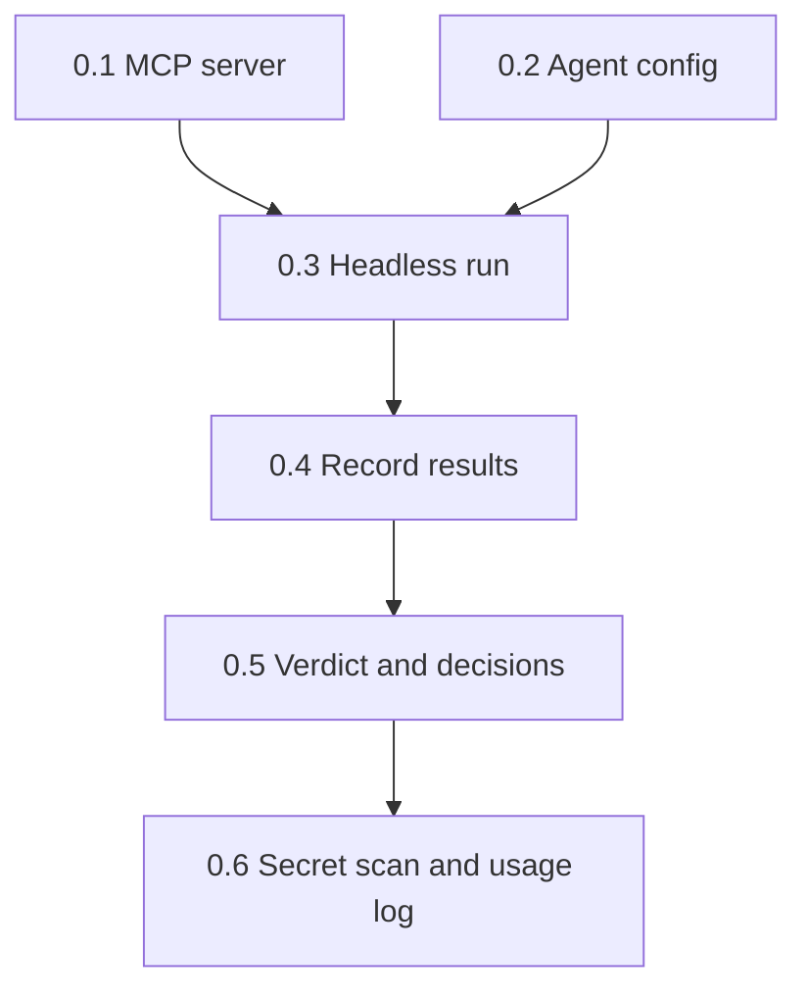

# Implementation Plan: exorcist-agent

## Overview

Only task 0, the G0 feasibility spike, is planned so far. It proves that one headless Exorcist hunt works end to end and measures its cost. The remaining tasks are written after G0.

## Tasks

- [x] 0. G0 feasibility spike (verdict: G0: PASS, see `spikes/g0/G0.md`)
  - [x] 0.1 Minimal stdio MCP server with `query_metrics`, `diff_commit`, `submit_diagnosis` (`spikes/g0/server.ts`)
    - _Requirements: 1.1, 1.3_
  - [x] 0.2 Agent config `spikes/g0/exorcist.json` allowing only those three tools
    - _Requirements: 1.1, 1.2_
  - [x] 0.3 Run the hunt headless with `kiro-cli chat --no-interactive`
    - _Requirements: 1.1, 1.3_
  - [x] 0.4 Record commands, exit code, wall time, credits, tools used, diagnosis and allow-list refusal in `spikes/g0/G0.md`
    - _Requirements: 1.2, 1.4_
  - [x] 0.5 Verdict line and "Decisions for the spec"
    - _Requirements: 1.5_
  - [x] 0.6 Secret scan, then `docs/KIRO_USAGE.md` entry
    - _Requirements: 1.5_

## Task Dependency Graph



```json
{
  "waves": [
    { "id": 0, "tasks": ["0.1", "0.2"] },
    { "id": 1, "tasks": ["0.3"] },
    { "id": 2, "tasks": ["0.4"] },
    { "id": 3, "tasks": ["0.5"] },
    { "id": 4, "tasks": ["0.6"] }
  ]
}
```

## Notes

- Task 0 is ticked only when `spikes/g0/G0.md` exists with a verdict.
- The remaining tasks are written after G0, using the "Decisions for the spec" in `spikes/g0/G0.md`.
- Spike code in `spikes/g0/` is throwaway; product code is rewritten through this spec.
