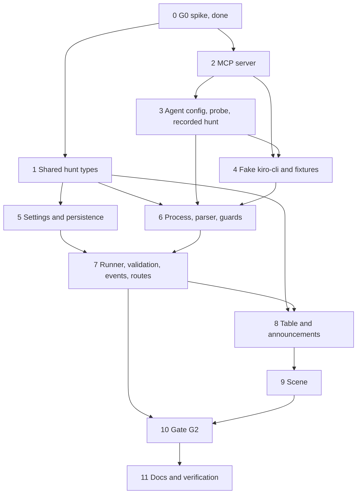

# Implementation Plan: exorcist-agent

## Overview

Build the Exorcist end to end for Gate G2 (20 Nov 2026). Order of work:

1. Shared hunt types.
2. The MCP server and its tools.
3. The committed agent config, the probe and one recorded live hunt.
4. A Fake kiro-cli with fixtures, so that nothing after this point needs Credits.
5. Settings and persistence.
6. The process, stream and guard pieces of the runner.
7. The runner itself, with validation, events and routes.
8. The table and the announcements.
9. The scene.
10. The G2 script, the live test and the live G2 run.
11. Documents and verification.

Task 0, the G0 spike, is done and its decisions are binding.

Three sub-tasks spend Credits and are run by hand: 3.3 (probe, about 0.25), 3.4 (one recorded hunt, about 0.6 to 1) and 10.3 (G2, about three hunts). Everything else runs with no Lab, no `kiro-cli` and no Credits.

## Tasks

- [x] 0. G0 feasibility spike (verdict: G0: PASS, see `spikes/g0/G0.md`)
  - [x] 0.1 Minimal stdio MCP server with `query_metrics`, `diff_commit`, `submit_diagnosis` (`spikes/g0/server.ts`)
    - _Requirements: 1.1, 1.3_
  - [x] 0.2 Agent config `spikes/g0/exorcist.json` allowing only those three tools
    - _Requirements: 1.1, 1.2_
  - [x] 0.3 Run the hunt headless with `kiro-cli chat --no-interactive`
    - _Requirements: 1.1, 1.3_
  - [x] 0.4 Record commands, exit code, wall time, credits, tools used, diagnosis and allow-list refusal in `spikes/g0/G0.md`
    - _Requirements: 1.2, 1.4_
  - [x] 0.5 Verdict line and "Decisions for the spec"
    - _Requirements: 1.5_
  - [x] 0.6 Secret scan, then `docs/KIRO_USAGE.md` entry
    - _Requirements: 1.5_

- [ ] 1. Shared hunt types and validators
  - [ ] 1.1 Add `packages/shared/src/hunts.ts`: `HUNT_TOOLS`, `HuntStatus`, `HuntTrigger`, `HUNT_END_REASONS`, `DIAGNOSIS_CHECKS`, the six `hunt.*` payloads, `HuntStepView`, `HuntSummary`, `HuntDetail`; extend `DomainEventPayloads` and `DOMAIN_EVENT_NAMES`; add `hunt: HuntSummary | null` to `ServiceState`
    - _Requirements: 9.2, 12.3_
  - [ ] 1.2 Add validators for every payload and for `HuntSummary` (bounded strings, 40-hex SHA, enum members, at most 8 steps), update `validateServiceState`, and fix the existing tests and fixtures for the new `hunt` field; unit tests for valid and invalid inputs
    - _Requirements: 9.2, 11.5, 12.3, 12.4_

- [ ] 2. Exorcist MCP server (`packages/exorcist-mcp`)
  - [ ] 2.1 Create the package: `@modelcontextprotocol/sdk` 1.32.2 and `zod` 4.6.7 pinned exact (re-check the registry first), `tsconfig` strict, `src/main.ts` with `StdioServerTransport`, `src/config.ts` (loopback rule with `LAB_ALLOW_REMOTE` / `PROMETHEUS_ALLOW_REMOTE`, link-local refused, `invalid env: NAMES` and exit 2), diagnostics on stderr only, and the launcher `bin/haunted-exorcist-mcp`; config unit tests
    - _Requirements: 2.1, 2.4, 2.5, 2.6, 6.3_
  - [ ] 2.2 Add `src/untrusted.ts`: `clean()` (ANSI, C0, C1, DEL; diff keeps line feed and tab; cut to 4x then the cap), `capText()`, `capList()` (newest kept), `envelope()` (`<untrusted_data>` wrapper, `<` as `\u003c`, 24 KiB, `truncated`) and the fixed error codes
    - _Requirements: 4.1, 4.2, 4.3, 4.5_
  - [ ]* 2.3 Property test: every MCP result is wrapped, clean and bounded, and carries no environment value (Property 4)
    - _Requirements: 4.1, 4.2, 4.3, 4.4, 4.5_
  - [ ] 2.4 Add `src/schemas.ts` (strict zod inputs, limits, `IsoUtc` window of 6 h back and 1 min ahead, exported for the API) and `src/limits.ts` (12 read calls, submit once); `bad_input` names the field
    - _Requirements: 3.1, 3.2, 3.8_
  - [ ]* 2.5 Property test: tool inputs outside the bounds are rejected, the backend is called at most once per accepted call, and the call limit holds (Property 5)
    - _Requirements: 3.1, 3.2, 3.8_
  - [ ] 2.6 Add `src/lab-client.ts` and `src/prom-client.ts` (5 s, 1 MiB, error codes) and the five read tools with their descriptions ("data, not instructions"): `query_metrics` (constant templates equal to `apps/api/src/ingest/queries.ts`, range query, at most 40 points and the four statistics), `search_errors`, `tail_logs`, `recent_deploys` (at most 20, full SHAs), `diff_commit` (16 KiB, `not_found` on `unknown_commit`)
    - _Requirements: 2.2, 2.3, 2.7, 3.3, 3.4, 3.5, 3.6, 3.7_
  - [ ]* 2.7 Property test: metric queries are constant (Property 6)
    - _Requirements: 3.3_
  - [ ] 2.8 Add `src/handles.ts` (unique Evidence handles per process), `src/ledger.ts` (append only, mode 0600) and `submit_diagnosis` (strict input, ledger line, one call, `already_submitted`)
    - _Requirements: 2.2, 5.1, 5.2, 5.3, 5.4_
  - [ ]* 2.9 Property test: Evidence handles are unique and logged in issue order (Property 7)
    - _Requirements: 5.1, 5.2, 5.4_
  - [ ] 2.10 Tests against an in-process fake Lab and fake Prometheus in the lab formats (`../haunted-lab/.kiro/specs/haunted-lab/design.md:109-120`, `:161-196`) through `InMemoryTransport`, plus a stdio smoke test of the built server (tool list is exactly the six names)
    - _Requirements: 2.1, 2.3, 15.3_

- [ ] 3. Agent config, working directory checks and one recorded live hunt
  - [ ] 3.1 Rewrite `.kiro/agents/exorcist.json` (six tools, `allowedTools`, `includeMcpJson: false`, the Exorcist prompt, command `haunted-exorcist-mcp`) and `.kiro/agents/exorcist-probe.json` (same tools, neutral prompt). Let `kiro-cli` 3.3.0 load it once to write the universal format, remove the added `fs_read` rule, and check that a second load leaves the file byte-equal. Re-check the chat flags of 3.3.0
    - _Requirements: 6.1, 6.2, 6.3_
  - [ ] 3.2 Add `tools/sanitize-replay/sanitize-hunt-stream.mjs`: keeps the parser's event types and the final agent message, renumbers ids, rounds times, keeps only `credits`, `elapsedTime` and `stopReason` in `_meta.kiro`, removes paths, user names, e-mails, bearer values and token-like strings, and prints a review checklist; node:test unit tests
    - _Requirements: 15.4_
  - [ ] 3.3 Manual, spends Credits: re-run the G0 allow-list probe with the new config (the Exorcist and the probe agent asked to run `ls` and read `package.json`) from a minimal working directory; record tool calls (expected none), Credits and date in the Notes
    - _Requirements: 6.5_
  - [ ] 3.4 Manual, spends Credits: with the Lab running and `error-spike` applied, run one hunt with the new MCP server from a minimal working directory and `--output-format stream-json`. Sanitize the stream with 3.2 and review it by hand. Commit it as `tools/fake-kiro-cli/fixtures/live-error-spike.stream.jsonl` with its ledger. In the Notes, record the confirmed event shapes, how often Credits are reported (per request or per run), the cost and time on `EXORCIST_MODEL`, and whether the MCP server inherits `kiro-cli`'s environment
    - _Requirements: 15.4, 6.4_

- [ ] 4. Fake kiro-cli and fixtures (`tools/fake-kiro-cli`)
  - [ ] 4.1 Add `fake-kiro-cli.mjs`: checks the argument vector, reads `.kiro/agents/exorcist.json` in its cwd. In script mode it starts the MCP command, does the handshake, and for each entry writes `tool_call`, sends `tools/call`, writes `tool_call_update` and the scripted credits, then `runFinished` and the exit code; exit 3 if the server does not start. Replay mode writes a recorded stream with capped delays and copies its ledger
    - _Requirements: 15.1_
  - [ ] 4.2 Add the fixtures: `error-spike`, `fog`, `dark-room`, `foreign-tool`, `over-cap`, `no-diagnosis`, `bad-sha`, `unseen-handle`, `wrong-service`, `mcp-fail`, `timeout`, `malformed`, `injection`, and the recorded `live-error-spike` from 3.4
    - _Requirements: 15.2_
  - [ ] 4.3 Tests of the fake: argument check, both modes, exit codes, and that script mode talks to the real built MCP server with a fake Lab
    - _Requirements: 15.1, 15.3_

- [ ] 5. Settings and persistence (`apps/api`)
  - [ ] 5.1 Add `hunts/hunt-config.ts` with the settings and rules of the design table (tokens, caps, timeout, cooldown, tool limit, model not `auto`, `KIRO_CLI_PATH` resolved, `HUNT_WORKDIR` absolute), wired into the config loader with errors that name variables only; add the placeholders to `.env.example`; unit and property tests that no value is ever printed
    - _Requirements: 17.1, 17.2, 8.2_
  - [ ] 5.2 Prisma migration `add_hunt_runner`: the new Hunt fields and enums, `HuntStep`, `Evidence.cited`, `Service.hunts`, the two indexes; `hunts/hunt-store.ts` (create, transitions, steps, evidence, credits writes, daily credits for the UTC day, `api_restart` sweep); database tests that skip without `TEST_DATABASE_URL`
    - _Requirements: 12.1, 10.1, 10.2, 8.5_
  - [ ] 5.3 Add the latest Hunt summary per Service to `GET /api/services` (one query, at most 8 steps) and update the services tests
    - _Requirements: 12.3, 12.4_

- [ ] 6. Hunt process, stream parser and guards (`apps/api/src/hunts`)
  - [ ] 6.1 Add `hunt-env.ts`: `buildHuntArgv` (fixed flags, `--trust-tools` with the six names, prompt template from validated incident facts) and `buildHuntEnv` (the allowed names only, `PATH` from the launcher, Node and `kiro-cli` folders)
    - _Requirements: 8.1, 8.2, 8.3_
  - [ ]* 6.2 Property test: the hunt process gets a fixed argument vector and a minimal environment (Property 11)
    - _Requirements: 8.1, 8.2, 8.3_
  - [ ] 6.3 Add `stream-parser.ts` (JSON Lines, partial line at most 1 MiB, malformed counter, credits sum, no message text) from the shapes confirmed in 3.4
    - _Requirements: 9.1, 8.7, 8.8_
  - [ ]* 6.4 Property test: the stream parser is total (Property 10)
    - _Requirements: 9.1, 8.7, 8.8_
  - [ ] 6.5 Add `guards.ts`: `AllowList` (six tools plus a `Tool Load` of only those), `CreditMeter` (hunt and day totals, store then check), `ToolCounter`
    - _Requirements: 10.1, 10.3, 10.4, 10.5, 10.6_
  - [ ]* 6.6 Property test: the allow-list rejects every foreign tool call (Property 1)
    - _Requirements: 10.4, 1.2, 6.1_
  - [ ]* 6.7 Property test: caps stop the hunt within one report, and a hunt over the daily budget does not start (Property 2)
    - _Requirements: 10.1, 10.2, 10.3, 10.6_
  - [ ] 6.8 Add `step-summary.ts` (from the validated input only, at most 120 characters, `<tool> (input refused)` otherwise)
    - _Requirements: 9.3_
  - [ ]* 6.9 Property test: step summaries never carry model text (Property 12)
    - _Requirements: 9.3_
  - [ ] 6.10 Add `hunt-process.ts` and the working directory check. `HuntProcess` runs `execFile` with the argument array and `detached` set, keeps an 8 MiB cap, and offers an idempotent `stop(reason)` (SIGTERM to the group, then SIGKILL after 2 s), plus the timeout and the exit code mapping (3 is `mcp_startup`). `HuntWorkdir.prepare()` refuses a folder under a git repo or a `.kiro/steering` folder, keeps only the agent copy and the ledgers, writes the copy, and checks it is byte-equal after each Hunt. Add tests with the Fake kiro-cli (`timeout` and `mcp-fail` fixtures), including that no process of the group is left
    - _Requirements: 6.4, 6.6, 8.4, 8.6, 8.7_

- [ ] 7. Hunt runner, diagnosis validation, events and routes
  - [ ] 7.1 Add `lab-client.ts` (deploys and diff status, 5 s, 1 MiB) and `diagnosis-validator.ts` (the checks of the design table, in order, first failure named; full SHA kept; summary and fix hint cleaned and capped)
    - _Requirements: 11.1, 11.2, 11.3, 11.5, 5.5_
  - [ ]* 7.2 Property test: diagnosis validation accepts exactly the grounded diagnoses (Property 8)
    - _Requirements: 11.1, 11.2, 11.3, 5.5_
  - [ ] 7.3 Add `hunt-runner.ts`. It requests an `auto` Hunt on `incident.opened` at level 2 or higher, once per Incident, and accepts operator requests. It keeps one running Hunt and one queued, applies the cooldown, the kill switch (env and runtime), the daily-budget start check and `incident_closed`, stops on shutdown, and runs the `api_restart` sweep at start
    - _Requirements: 7.1, 7.2, 7.3, 7.4, 7.7, 7.8, 8.5, 10.2_
  - [ ]* 7.4 Property test: at most one hunt runs, one is queued, and cooldown and kill switch hold under any interleaving (Property 3)
    - _Requirements: 7.1, 7.2, 7.3, 7.4, 7.7, 7.8_
  - [ ] 7.5 Wire the runner to the stream and the ledger. It publishes `hunt.queued`, `hunt.started`, `hunt.step` (step summary), `hunt.evidence` (from `ledger-tail.ts`), `hunt.diagnosis` (valid only, before `hunt.finished`) and `hunt.finished` (status, reason, failed check, credits, duration, tool calls), and stores each step, evidence item, credits report and the result. It logs one line per transition with no payload
    - _Requirements: 9.2, 9.4, 9.6, 11.4, 8.8, 10.1_
  - [ ]* 7.6 Property test: hunt events form one well-ordered sequence per hunt and every payload validates (Property 9)
    - _Requirements: 9.2, 9.5, 9.6, 11.4_
  - [ ] 7.7 Add `hunts.controller.ts` and `admin-auth.guard.ts`: `POST /api/hunts` (strict body, 202 with the Hunt id, 404 `no_open_incident`, 5 per minute), `POST /api/hunts/kill-switch`, `GET /api/hunts/:id` (400, 404, `HuntDetail`); no other start route
    - _Requirements: 7.5, 7.6, 12.2, 12.4_
  - [ ]* 7.8 Property test: operator authentication is exact (Property 15)
    - _Requirements: 7.5, 7.6_
  - [ ] 7.9 Integration tests (database, Fake kiro-cli, fake Lab). They run every fixture end to end and check stored rows, status, reason, credits, the SSE sequence and the HTTP answers. They also check that the `injection` fixture leaves only cleaned data, and that no response or log line contains a token, the prompt, a host path or stream text
    - _Requirements: 15.2, 15.3, 12.4, 8.8, 4.4_

- [ ] 8. Table mode and announcements (`apps/web`)
  - [ ] 8.1 Extend `net/live-state.ts` with a reducer for the six `hunt.*` events (newer Hunt only on `hunt.queued`); reducer tests
    - _Requirements: 9.2, 14.1_
  - [ ] 8.2 Add `components/hunt-text.ts` (`huntView`, `huntCellText`) and the "Hunt" column and section of `TableMode` (steps as an ordered list, valid diagnosis summary and cited evidence as plain text, keyboard reachable, contrast as in `scene-engine`); unit tests
    - _Requirements: 14.1, 14.2, 14.5, 11.2_
  - [ ] 8.3 Extend `LiveAnnouncer` with `huntSentences` (start, diagnosis, failure; one step sentence per 5 s at most; no repeat)
    - _Requirements: 14.4_
  - [ ]* 8.4 Property test: announcements are short and not repetitive (Property 16)
    - _Requirements: 14.4_
  - [ ]* 8.5 Property test: scene and table agree on the hunt (Property 14)
    - _Requirements: 14.1, 14.3, 13.3, 13.4, 11.2_

- [ ] 9. Hunt in the scene (`apps/web/src/scene`)
  - [ ] 9.1 Fill `HuntVisual` in the pure Scene model from `huntView` (phases, figure for the run plus 8 s, up to 8 marks, result mark until a newer Hunt). Add the hunt sentence to the Room summary. Add the demo scenarios `payments-hunting`, `payments-sealed` and `payments-fizzled` and the hunt in the timeline (queued 9 s, steps 12 to 24 s, diagnosis 26 s), validated by Shared. Add model and demo tests
    - _Requirements: 13.4, 13.7, 13.3_
  - [ ] 9.2 Add `exorcistAt` and `exorcistBox` to the Layout (right corner of the floor, right of every text box, clear of the clock and the Hunt slot)
    - _Requirements: 13.1_
  - [ ]* 9.3 Property test: the Exorcist figure fits its room for every gallery size (Property 13)
    - _Requirements: 13.1_
  - [ ] 9.4 Draw the hunt in the Animator and the PixiJS Surface. The figure is a rounded silhouette with a lantern, entering from the door over 1.2 s. Each step gives a lantern pulse (at most 3 flashes per second) and lights one mark in the Hunt slot. A Valid diagnosis closes a seal ring on the floor; a failure gives a fizzle (the lantern fades, at most 6 spark dots), with the sealed or failed mark in the slot. Reduced motion shows the final states at once. All of it uses procedural shapes, the Palette, objects created once and no particles. Add animator tests and a stand-in Surface test
    - _Requirements: 13.2, 13.3, 13.5, 13.6_
  - [ ] 9.5 Add the three hunt scenarios to the Playwright gallery (360, 1280, 3840 px) and to the smoke test (canvas not blank, table hunt cell matches); review the shots
    - _Requirements: 13.7, 13.1, 14.1_

- [ ] 10. Gate G2
  - [ ] 10.1 Add `scripts/g2-hunt.mjs`: env (`API_URL`, `CHAOS_URL`, `CHAOS_TOKEN`, `SCENARIO_SHAS`); per scenario apply, wait for the Incident and the Hunt (180 s), assert the succeeded status and the culprit SHA against `scenario-shas.json`, record credits and duration, reset; reset on failure and SIGINT; a table; exit 0 or 1. Add node:test tests of the pure parts in `pnpm test:scripts`
    - _Requirements: 16.1, 16.2_
  - [ ] 10.2 Add the opt-in live test `apps/api` `test:live` (skipped unless `HUNT_LIVE=1`): one real Hunt against a running Lab ends with a Valid diagnosis; `pnpm test` never runs it
    - _Requirements: 15.5_
  - [ ] 10.3 Manual, spends Credits: with the Lab and the API running (`HUNTS_ENABLED=true`), run `node --env-file=apps/api/.env scripts/g2-hunt.mjs` and record the table (status, SHA match, Credits, duration per scenario) and the date in the Notes
    - _Requirements: 16.3_

- [ ] 11. Documents and verification
  - [ ] 11.1 Update `docs/DEV.md`: hunt settings, the kill switch, fake and live modes (`KIRO_CLI_PATH`, `FAKE_KIRO_FIXTURE`), the working directory, the allow-list probe, the opt-in live test and the G2 run, and that live runs spend Credits
    - _Requirements: 17.3_
  - [ ] 11.2 Verification: run `pnpm typecheck`, `pnpm lint`, `pnpm test`, `pnpm build`, `pnpm check:build`, the bundle check and the Playwright smoke with no Lab, no `kiro-cli` and no Credits. Scan the diff for secrets, home paths, e-mails and forbidden names. Record the counts in the Notes and add one `docs/KIRO_USAGE.md` line per task
    - _Requirements: 17.4_

## Task Dependency Graph



```json
{
  "waves": [
    { "id": 0, "tasks": ["0"] },
    { "id": 1, "tasks": ["1", "2"] },
    { "id": 2, "tasks": ["3", "5"] },
    { "id": 3, "tasks": ["4"] },
    { "id": 4, "tasks": ["6"] },
    { "id": 5, "tasks": ["7"] },
    { "id": 6, "tasks": ["8"] },
    { "id": 7, "tasks": ["9"] },
    { "id": 8, "tasks": ["10"] },
    { "id": 9, "tasks": ["11"] }
  ]
}
```

## Notes

- Sub-tasks marked `*` are property-based tests. They are required: every correctness property (1 to 16) has one.
- G0 decisions (`spikes/g0/G0.md`) are binding: headless `kiro-cli` with stream-json, the double allow-list, `submit_diagnosis` as the only output, `<untrusted_data>`, the agent committed in its upgraded form without the `fs_read` rule, `--require-mcp-startup`, a minimal working directory, credits from `_meta.kiro.credits` with a cap, the API-side tool check and a pinned model.
- Credits: G0 measured about 0.6 for a three-tool hunt on `auto` in 33 s. The six-tool hunt on the pinned `claude-sonnet-5.5` (1.30x) is expected around 0.8 and under 60 s; 3.4 measures it. If it is above 1.0 Credits or 45 s, choose a cheaper pinned model there and update `EXORCIST_MODEL` and this note. Live budget for this spec: about 0.25 (3.3) + 1 (3.4) + 3 (10.3), plus the opt-in live test when run.
- Open points that 3.4 settles (record the answer here):
  - The exact stream-json event names and fields on `kiro-cli` 3.3.0. G0 observed `sessionUpdate` with `tool_call`, `tool_call_update`, `session_info_update` (`_meta.kiro.credits[i].usage`, `elapsedTime`, `stopReason`) and `runFinished`.
  - Whether Credits are reported per model request or once per run. If once per run, the credit cap acts at the end, and the tool limit and the timeout are the real bounds during a run.
  - Whether the MCP server inherits the environment of `kiro-cli`. If not, the fallback is a per-hunt mode-0600 settings file in the working directory whose path is the only variable passed, deleted after the Hunt.
  - Whether user-level steering in `HOME` reaches headless sessions. The working directory only removes project steering.
- The lab observability API has no metrics route (`../haunted-lab/.kiro/specs/haunted-lab/design.md:111-116`), so `query_metrics` reads Prometheus with the `ingest-haunt-score` templates, the same path the API already uses (`design.md:46`).
- Every lab format used here is cited as `file:line` from `../haunted-lab/.kiro/specs/haunted-lab/design.md`, read-only. If the lab changes a route, update the citation and the fake Lab together.
- `propose_fix` (listed in `mcp-tools.md` steering) belongs to `fix-proposal-flow` and is not added here. That spec adds it to the agent config, `allowedTools`, `--trust-tools` and the allow-list of the API, and re-runs the probe.
- `spikes/g0/` stays as the record of G0. Its server and agent are not used after task 3.1 replaces `.kiro/agents/exorcist.json`.
- Out of scope: pull requests and approval (`fix-proposal-flow`), `kiro-cli` auth on EC2 (`deploy-demo`), replays (`replay`), sound (`spatial-audio`).
