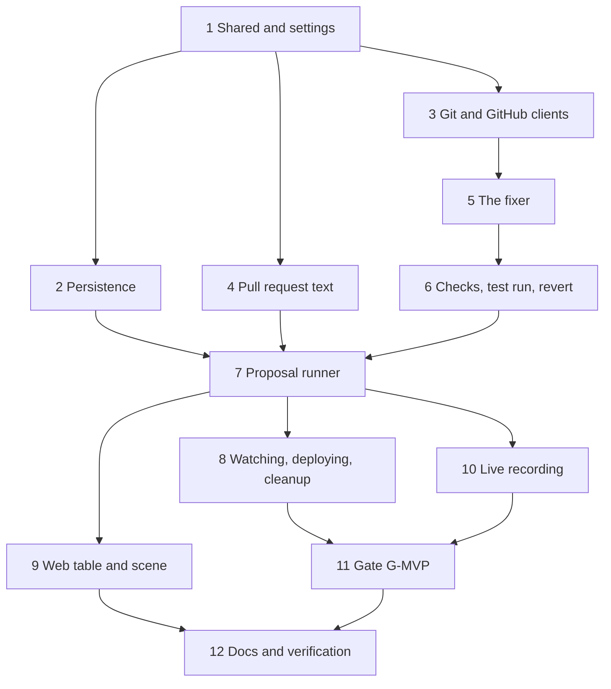

# Implementation Plan: fix-proposal-flow

## Overview

Build the fix flow for gate G-MVP (25 Nov 2026): break, hunt, AI fix pull request on GitHub, a human merges it, the lab deploys it, the house is clean again. Order of work:

1. Shared types, settings and the branch-name helpers.
2. Persistence: the new `Proposal` model, migrations and the guarded status graph.
3. The git client and the GitHub client, with the token rules.
4. Pull request text and its sanitizer.
5. The fixer: agent file, working folder, prompt, process, stream guard, and the Fake kiro-cli in fixer mode.
6. Patch reading and Checks, the isolated test run, and the revert.
7. The proposal runner, routes and events, recovery, and the leak scan.
8. The PR watcher, the lab deploy call with the fake lab route, and the branch cleanup.
9. The table and the scene.
10. Live recording of the fixer (at most 2 runs) and the opt-in live test.
11. The gate script `scripts/gmvp-fix.mjs` and the live gate.
12. Documents, steering and verification.

Everything up to and including task 9 runs with no Lab, no `kiro-cli`, no real GitHub and no Credits. Three sub-tasks spend Credits or touch the real lab repo and are run by the orchestrator: 10.1 (at most 2 real fixer runs, about 1 Credit each), 10.2 (the opt-in live test, about 1 Credit, opens and closes one pull request) and 11.3 (the live gate, about 2.5 Credits and a human merge). The lab side of the deploy is the separate spec `fix-deploy` in `haunted-lab`; here tests use a fake route.

## Tasks

- [ ] 1. Shared types, settings and branch helpers
  - [ ] 1.1 `packages/shared/src/proposals.ts`: statuses, kinds, the status graph and `canMove`, AI fail reasons, Fail reasons, `ProposalCheck`, `ProposalSummary`, `ProposalView`, the seven event payloads with validators in the `Result<T>` style, `incidentBranch` and `fixBranch` (throw on a non-CUID), arbitraries and unit tests
    - _Requirements: 2.3, 13.2, 14.3, 14.4_
  - [ ]* 1.2 Property test: branch names come only from a valid CUID (Property 2), for the pure helpers
    - _Requirements: 2.1, 2.3, 2.4_
  - [ ] 1.3 `apps/api/src/fix/fix-config.ts`: `parseFixConfig` with the variables, bounds and defaults of the design, the fine-grained token form, loopback rule for `CHAOS_URL`, the requirements when `FIX_ENABLED=true`, errors that name variables only; `.env.example` lines with placeholders; wire into `loadConfig`
    - _Requirements: 1.1, 1.2, 1.3_
  - [ ]* 1.4 Property test: only a fine-grained token is accepted and errors name variables, never values (Property 15)
    - _Requirements: 1.1, 1.2, 1.3_

- [ ] 2. Persistence
  - [ ] 2.1 Prisma: `ProposalStatus` and `ProposalKind`, the new `Proposal` columns (no `approvedBy`), migration `fix_proposal_flow` with the value mapping (`draft` to `drafting`, `approved` to `open`), a second migration with the CHECK constraints and the partial unique index `proposal_one_active`; `prisma migrate diff` shows no drift
    - _Requirements: 13.1, 13.3, 13.5_
  - [ ] 2.2 `ProposalStore` (Prisma and in-memory): create with `attempt`, guarded `UPDATE … WHERE status = from`, active-uniqueness, `fixerStartsToday`, Credits per day; `HuntStore` daily budget sums Hunt and Proposal Credits
    - _Requirements: 8.2, 8.3, 13.2, 13.4_
  - [ ]* 2.3 Property test: a status only moves forward along the graph, a stale writer changes nothing (Property 5)
    - _Requirements: 13.2, 13.3, 14.3_
  - [ ] 2.4 Database tests: the constraints, the migration mapping from old rows, one active Proposal per Hunt, a retry as a new attempt, cascade with the Hunt
    - _Requirements: 13.3, 13.4, 13.5_

- [ ] 3. Git and GitHub clients
  - [ ] 3.1 `git-client.ts`: `execFile` with arrays, the fixed environment and `-c` options, the fixed commit identity, the token only in `GIT_CONFIG_*` of `push` and `fetch`, the remote URL as an argument and injectable for tests, refs only from `branch-names.ts`, never force or delete; tests against temporary local repositories and an injected `execFile` that records argv and environment
    - _Requirements: 2.4, 2.6, 9.1, 9.2_
  - [ ] 3.2 `github-client.ts`: `fetch` to `https://api.github.com` only, `redirect: 'error'`, timeout, body cap, headers, ETag, retry on 403 and 429 with a bound, fixed error codes, validated answers; tests against the fake GitHub server
    - _Requirements: 1.4, 9.3, 9.4, 9.6_
  - [ ] 3.3 Startup check when `FIX_ENABLED=true` (`GET /repos`, push right, labels created, `git --version`, days left before expiry logged); nothing is called when `FIX_ENABLED=false`
    - _Requirements: 1.4, 1.5_
  - [ ] 3.4 Branch creation wrappers: refuse when either branch exists on the remote (`branch_exists`), push the Incident branch at D and the Fix branch, never touch `main` or `scenario/*`
    - _Requirements: 2.1, 2.4, 2.5_
  - [ ]* 3.5 Property test: the token appears only in the environment of `git push` and `git fetch`, never in argv, logs or error text, and a refused ref starts no process (Properties 2 and 3, git and GitHub part)
    - _Requirements: 2.4, 9.2, 9.5, 9.6_

- [ ] 4. Pull request text
  - [ ] 4.1 `pr-text.ts`: title, body template, `sanitizePrText` (on top of `sanitizeModelText`: `@` followed by a zero-width space, `#` before a digit broken, backticks removed, caps), `validatePrBody`
    - _Requirements: 10.1, 10.2, 10.3, 10.4_
  - [ ]* 4.2 Property test: sanitized text has no HTML, mention, image or foreign link, and the title and body respect their limits (Property 4)
    - _Requirements: 10.1, 10.2, 10.3, 10.4_
  - [ ] 4.3 Pull request creation request: labels `exorcist` and the kind, no reviewers, no auto-merge, `draft: false`, `maintainer_can_modify: false`; tested with the fake GitHub server
    - _Requirements: 10.5_

- [ ] 5. The fixer
  - [ ] 5.1 `.kiro/agents/exorcist-fixer.json`: write, run `kiro-cli agent upgrade`, remove any rule broader than `fs_read ./**` and `fs_write ./services/*/src/**`, commit the upgraded form; a test checks the tools, the copy to the folder is byte-equal and a changed copy fails the run
    - _Requirements: 3.1, 3.2_
  - [ ] 5.2 `fix-env.ts`: `buildFixEnv` (exact names), `buildFixArgv` (fixed order, `--trust-tools=fs_read,fs_write`), `fixerPrompt` from the fixed template with checked data, untrusted blocks, the 64 KiB diff cut
    - _Requirements: 3.2, 3.6, 4.3, 4.4_
  - [ ] 5.3 `fixer-workdir.ts`: folder outside every repository, `git archive` export with a checked listing (no links, no unsafe paths), `lab-common` read-only, the Export next to the work folder, deletion when the run ends
    - _Requirements: 4.1, 4.2, 4.5_
  - [ ] 5.4 `fixer-guard.ts` and `fixer-process.ts`: reuse `HuntProcess` options (own group, output cap, pid note by proposal id), the allow-list with the id memory and the path rule, Credits from the stream (estimated at the cap without a report), the limits `FIX_CREDIT_CAP`, `FIX_TIMEOUT_MS`, `FIX_MAX_TOOL_CALLS`, the agent text dropped
    - _Requirements: 3.3, 3.4, 3.5, 3.7, 8.1_
  - [ ]* 5.5 Property test: only the two file tools inside the folder are accepted, a repeated id passes only for the same tool and path (Property 6)
    - _Requirements: 3.2, 3.3, 3.4_
  - [ ] 5.6 Fake kiro-cli fixer mode: a `write` step edits files in its working directory; fixtures `fixer-good`, `fixer-big`, `fixer-scope`, `fixer-forbidden`, `fixer-breaks-tests`, `fixer-no-change`, `fixer-foreign-tool`, `fixer-path-escape`, `fixer-symlink`, `fixer-timeout`, `fixer-injection`; node:test tests
    - _Requirements: 3.3, 3.5, 3.7_

- [ ] 6. Checks, test run and revert
  - [ ] 6.1 `readPatch`: `lstat` walk, symlinks, special files, hard links, binary, invalid UTF-8, unsafe names and big files are `forbidden_file`; changed, added and deleted lists compared byte for byte with the Export
    - _Requirements: 5.1_
  - [ ] 6.2 `judgePatch`: `non_empty`, `scope`, `forbidden_file`, `size` (numstat in a fresh clone), `syntax`, `tests`, the informational `touches_culprit_files`, the ordered record `{ name, ok }`, the AI fail reason of the first failure
    - _Requirements: 5.2, 5.3, 5.4, 5.5, 5.6, 5.7_
  - [ ]* 6.3 Property test: a patch is accepted if and only if every Check passes (Property 1)
    - _Requirements: 5.2, 5.3, 5.4, 5.5, 5.6_
  - [ ] 6.4 `check-run.ts`: the fixed `node --permission` command line, test files listed by the API, environment `{ PATH }`, own process group, timeout with group kill, output cap, counts only, `FIX_REQUIRE_TESTS`; the design and tests state the Mac limits; one `runChecks` function so that `deploy-demo` can replace the launcher
    - _Requirements: 5.5, 6.1, 6.2, 6.3, 6.4_
  - [ ]* 6.5 Property test: the Check run argv and environment are fixed and bounded for any service and path (Property 12)
    - _Requirements: 6.1, 6.2, 6.3_
  - [ ] 6.6 `revert.ts`: one parent, ancestor of D, clean apply, only `services/<S>/`, regular text files, the same tests, the fixed message by amend; `revert_unavailable` and `revert_conflict`
    - _Requirements: 7.1, 7.2, 7.3, 7.4_

- [ ] 7. The proposal runner
  - [ ] 7.1 `proposal-runner.ts`: the flow of the design (create, resolve D, base check, AI path decision, fixer, Checks, revert fallback, push, pull request, `open`), one active drafting at a time, `hunt.finished` hook and the operator trigger
    - _Requirements: 2.1, 2.2, 7.1, 8.2, 8.3, 13.4_
  - [ ]* 7.2 Property test: the kind follows the Checks and a failing candidate is never proposed (Property 7)
    - _Requirements: 5.6, 7.1, 7.2, 7.3, 7.4_
  - [ ] 7.3 Credits and limits: estimated Credits, daily budget and `HUNT_DAILY_MAX` including Proposals, revert with `budget` or `daily_limit`, Kill switch behaviour
    - _Requirements: 8.1, 8.2, 8.3, 8.4_
  - [ ]* 7.4 Property test: the fixer never starts over budget or over the daily limit (Property 9)
    - _Requirements: 8.1, 8.2, 8.3, 8.4_
  - [ ] 7.5 `fix.controller.ts`: `GET /api/proposals/:id`, `POST /api/hunts/:id/proposal`, the seven SSE events on the bus, `proposal` in `GET /api/hunts/:id` and `GET /api/services`, rate limit and error filter, 404 when `FIX_ENABLED=false`
    - _Requirements: 1.5, 14.1, 14.2, 14.3, 14.4, 14.5_
  - [ ] 7.6 `recover()` at start: `drafting` to `failed` / `api_restart`, restart the watch of `open`, continue `merged`; fixer pid notes reaped first
    - _Requirements: 3.5, 11.5_
  - [ ]* 7.7 Property test: a restart resumes what can be resumed and fails what cannot (Property 14)
    - _Requirements: 3.5, 11.5_
  - [ ] 7.8 Integration tests (database, fake kiro-cli fixer, fake GitHub, local bare repository): a good AI patch opens a pull request; each Patch failure falls back to a revert; a failing revert ends `checks_failed`; budget, daily limit and Kill switch; the operator retry makes attempt 2 and a second call while one is active answers 409; the SSE order follows the graph
    - _Requirements: 7.1, 7.4, 8.2, 8.3, 8.4, 13.4, 14.2, 14.3_
  - [ ]* 7.9 Property test and integration leak scan: a sentinel token never appears in any argv, log, event, answer, fixture or pull request text, nor in the fixer or test environment (Property 3, whole flow)
    - _Requirements: 3.6, 9.5_

- [ ] 8. Watching, deploying and cleaning up
  - [ ] 8.1 `pr-watcher.ts`: poll with ETag every `FIX_POLL_MS`, closed without merge is `rejected`, merged compares `head.sha` with the pushed `headSha` (`head_changed`), reads M and the merger login, slows down on rate limits
    - _Requirements: 11.1, 11.2, 11.3, 11.4_
  - [ ] 8.2 `lab-deploy-client.ts`: fetch the Incident branch, check the head equals M (`ref_moved`), `merge_scope`, `POST /chaos/deploy-fix` with exactly `{ service, ref, sha }`, bounded retries, confirmation by the Deploy Record (`actor` exorcist) within 60 s, `deployed`; the Incident is not touched; the fake lab route in `fake-lab.mjs`
    - _Requirements: 12.1, 12.2, 12.3, 12.4, 12.5_
  - [ ]* 8.3 Property test: only the reviewed commit is deployed (Property 8)
    - _Requirements: 11.2, 11.3, 11.4, 12.1, 12.2, 12.3, 12.4_
  - [ ]* 8.4 Property test: the chaos deploy contract accepts a head whose chain is clean (Property 11), on `deployFixAllowed`
    - _Requirements: 12.2, 12.4_
  - [ ] 8.5 `branch-cleanup.ts`: at start and every hour, exact name pattern, TTL, no open pull request, final or missing Proposal, one `DELETE` at a time, counts only in the log
    - _Requirements: 15.1, 15.2, 15.3_
  - [ ]* 8.6 Property test: cleanup deletes only old, final, unreferenced proposal branches (Property 10)
    - _Requirements: 15.1, 15.2, 15.3_
  - [ ] 8.7 Integration tests: merge to `deployed`; closed to `rejected`; `head_changed`; `ref_moved`; `merge_scope`; the lab refusing with 401, 409, 422, 503 and a record that never appears; a restart between `merged` and `deployed`
    - _Requirements: 11.2, 11.3, 11.4, 11.5, 12.1, 12.3, 12.4, 12.5_

- [ ] 9. Web: table and scene
  - [ ] 9.1 Reducer for the seven events, `ServiceState.proposal`, `proposal-text.ts` (`proposalView`, one helper for cell, announcement and Scene label), test helpers and fixtures carry the new field
    - _Requirements: 14.4, 16.2, 17.3_
  - [ ] 9.2 Table proposal row (kind, status, Checks in words, the GitHub link with `rel`, "merged by @login"), announcer sentences, keyboard and focus, and the `/hunts/<id>` entry that selects the Service
    - _Requirements: 16.1, 16.2_
  - [ ] 9.3 Scene: `HuntVisual.proposal` phases, the scroll while drafting, pinned on the door while open, the cleansing sweep on `deployed`, the fade on `rejected`, `failed` and `checks_failed`, reduced-motion static states, demo scenarios `payments-fixing`, `payments-fix-open`, `payments-fix-deployed`
    - _Requirements: 17.1, 17.2, 17.3_
  - [ ]* 9.4 Property test: table and scene read the proposal through one helper, the phase is a function of the status, link and "merged by" rules hold (Property 13)
    - _Requirements: 16.1, 16.2, 17.1, 17.2, 17.3_
  - [ ] 9.5 Gallery shots for the three scenarios at 360, 1280 and 3840 px, and a reduced-motion shot; the bundle check still passes
    - _Requirements: 17.1, 17.2, 17.3_

- [ ] 10. Live recording and opt-in live test (spends Credits, run by the orchestrator)
  - [ ] 10.1 Record at most 2 real fixer runs on the `error-spike` scenario with `kiro-cli` 3.3.0 and the pinned model (about 1 Credit each): pin the title shapes and rules of `fs_read` and `fs_write`, write them into the design, keep one sanitized stream as `live-fixer-error-spike.stream.jsonl` (no agent messages), and check the Patch passes the Checks
    - _Requirements: 3.1, 3.2, 3.3_
  - [ ] 10.2 Opt-in live test `FIX_LIVE=1 pnpm --filter @haunted-ops/api test:live`: one real fixer, one real pull request on the lab repo, then the test closes the pull request and deletes its branches through its own REST helper; skipped without `FIX_LIVE=1`
    - _Requirements: 3.1, 8.1, 10.5_

- [ ] 11. Gate G-MVP
  - [ ] 11.1 `scripts/gmvp-fix.mjs`: apply the scenario, wait for the Hunt and the `open` Proposal, print the pull request URL, wait up to 15 minutes for a human merge (never merges), wait for `deployed` and the Incident close, print the table, reset the lab also on failure and Ctrl-C
    - _Requirements: 18.1, 18.2, 18.3_
  - [ ] 11.2 `node:test` tests of the pure parts (settings, phase judgement, timeouts, table), the chaos token only to the chaos URL and never printed
    - _Requirements: 18.4_
  - [ ] 11.3 Live gate run by the orchestrator with a human merging (needs the lab `fix-deploy` route); result written into the Notes
    - _Requirements: 18.1, 18.2, 18.3_

- [ ] 12. Documents, steering and verification
  - [ ] 12.1 `docs/DEV.md`: the fine-grained token (one repository, Contents and Pull requests read and write, a short expiry, a ruleset that blocks pushes to `main` and `scenario/*`), `FIX_ENABLED` and the caps, what runs where, the isolation limits of the test run on the Mac and on EC2, how to run the gate
    - _Requirements: 6.4, 19.1_
  - [ ] 12.2 `.kiro/steering/security.md` (GitHub token rules, fixer boundaries, the `propose_fix` line replaced), `.kiro/steering/structure.md` (new folders), a note in `.kiro/steering/tech.md` on `propose_fix`
    - _Requirements: 19.2_
  - [ ] 12.3 `docs/KIRO_USAGE.md`: one line per finished task
    - _Requirements: 19.3_
  - [ ] 12.4 `pnpm typecheck`, `pnpm lint`, `pnpm test`, `pnpm test:scripts`, `pnpm build`, `pnpm check:build` and the bundle check pass; `prisma migrate diff` shows no drift; a scan finds no secret, home path or forbidden word in any tracked file
    - _Requirements: 19.1, 19.3_

## Task Dependency Graph



```json
{
  "waves": [
    { "id": 0, "tasks": ["1"] },
    { "id": 1, "tasks": ["2", "3", "4"] },
    { "id": 2, "tasks": ["5"] },
    { "id": 3, "tasks": ["6"] },
    { "id": 4, "tasks": ["7"] },
    { "id": 5, "tasks": ["8", "9", "10"] },
    { "id": 6, "tasks": ["11"] },
    { "id": 7, "tasks": ["12"] }
  ]
}
```

## Notes

- Sub-tasks marked `*` are property-based tests. They are required: every correctness property (1 to 15) has one: Property 1 in 6.3, 2 in 1.2 and 3.5, 3 in 3.5 and 7.9, 4 in 4.2, 5 in 2.3, 6 in 5.5, 7 in 7.2, 8 in 8.3, 9 in 7.4, 10 in 8.6, 11 in 8.4, 12 in 6.5, 13 in 9.4, 14 in 7.7, 15 in 1.4.
- Binding decisions of the user: the fix is an AI patch with a revert fallback; human approval is the merge of the pull request on GitHub; nobody approves through the Haunted Ops API or UI, and the API never merges.
- The lab side (`POST /chaos/deploy-fix`, branch fetch, chain rule, Deploy Record with `actor: "exorcist"`) is the separate spec `fix-deploy` in `haunted-lab`. G-MVP needs it implemented before task 11.3. Until then every task here uses the fake route.
- The Check run needs tests in the lab services. If a lab service has none, the `tests` Check fails and the revert fails with it, so the Proposal ends `checks_failed`. Either the lab adds a small test per service (preferred), or the operator sets `FIX_REQUIRE_TESTS=false` for the demo and the pull request body says "no test ran".
- `propose_fix` in `tech.md` is not implemented: the patch is produced by a server-run agent and the Exorcist stays read-only with its six tools.
- Credits: the fixer uses the pinned model like a Hunt, so a run is expected to cost about 1 Credit (to be measured in 10.1). Live budget for this spec: up to about 2 (10.1) + 1 (10.2) + 2.5 (11.3), plus any re-run.
- The fixer allow-list reuses the lessons of `exorcist-agent` tasks 12 to 14: a repeated tool call id is judged again unless it names the same tool; refused calls are recorded with a short, cleaned stop detail; the real stream shapes are pinned from a recording, not guessed.
- Isolation on the Mac is an application fence (`node --permission`, an empty environment, a throwaway clone), not a boundary; the stronger version belongs to `deploy-demo` (separate OS user, no instance role, no instance metadata, no network).
