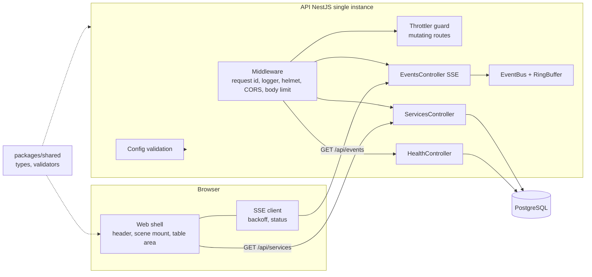

# Design Document

## Overview

`foundation` builds the base that the other specs extend: a pnpm workspace with three packages, a PostgreSQL schema, an API shell with an in-memory event bus and an SSE stream, and a web shell that connects to it.

Key decisions:

- One process, one store. State lives in PostgreSQL; fan-out lives in memory (`EventBus` plus a ring buffer). No Redis.
- SSE, not WebSocket. The stream is one-way, and resume uses the standard `Last-Event-ID`.
- `packages/shared` holds types and plain validators (no schema library) so API and Web agree on payloads.
- Web is a shell. The scene is an empty mount point; PixiJS arrives in `scene-engine`.
- Event ids are integers from an in-memory counter. They restart after an API restart, so a client whose id is greater than the latest id gets a `resync` event.

### Pinned versions

Checked against the npm registry on 12 Nov 2026.

| Package | Version | Note |
| --- | --- | --- |
| Node | 26 | `.nvmrc`, `engines` |
| pnpm | 11.7.0 | already in root `package.json` |
| `@nestjs/core`, `@nestjs/common`, `@nestjs/platform-express` | 12.5.0 | |
| `@nestjs/throttler` | 6.7.1 | rate limit guard |
| `helmet` | 8.3.0 | security headers |
| `prisma`, `@prisma/client` | 7.10.1 | latest stable; the `latest` tag currently points to 8.0.0-rc.33, a release candidate, so it is not used |
| `@prisma/adapter-pg` | 7.10.1 | Prisma 7 connects through a driver adapter |
| `vite` | 8.3.8 | |
| `@vitejs/plugin-react` | 6.3.0 | |
| `react`, `react-dom` | 19.3.1 | |
| `typescript` | 7.0.2 | see risk below |
| `vitest` | 5.1.0 | unit, property and integration tests |
| `fast-check` | 4.10.2 | property-based tests |
| `@testing-library/react` | 16.3.3 | web component tests |
| `eslint` | 10.14.0 | |
| `@types/node` | 26.6.6 | |

Other dev dependencies (for example the DOM test environment and the NestJS decorator transform for Vitest) are chosen in task 1 with a registry check, and pinned exactly.

Risks to confirm in task 1:

- NestJS needs `experimentalDecorators` and `emitDecoratorMetadata`. If TypeScript 7.0.2 does not support them, pin the newest stable TypeScript 6 release (checked against the registry) for `apps/api` and record it in the Notes of `tasks.md`.
- Vitest needs a decorator-metadata transform for the API unit tests. If it cannot be made to work, unit-test services as plain classes with manual construction.

## Architecture



Package layout:

```
packages/shared/src/        types.ts, validators.ts, events.ts, index.ts
apps/api/
  prisma/schema.prisma, migrations/, seed.ts
  prisma.config.ts
  src/main.ts, app.module.ts
  src/config/                 config.ts (parse + validate)
  src/prisma/                 prisma.service.ts
  src/health/                 health.controller.ts
  src/services/               services.controller.ts, services.service.ts
  src/events/                 event-bus.ts, ring-buffer.ts, sse.controller.ts, sse-format.ts
  src/security/               request-id.middleware.ts, logger.ts, redact.ts, cors.ts, rate-limit.guard.ts, error.filter.ts
  test/                       integration tests, db harness
apps/web/src/
  main.tsx, App.tsx
  components/                 Header.tsx, SceneMount.tsx, TableMode.tsx
  net/                        backoff.ts, status.ts, sse-client.ts, api.ts
packages/shared/              built first
```

## Components and Interfaces

### HTTP routes

| Route | Request | Success response | Errors |
| --- | --- | --- | --- |
| `GET /healthz` | none | `200 { "status": "ok", "db": "up" }` | `503 { "status": "degraded", "db": "down" }` if the DB check takes more than 2 s or fails |
| `GET /api/services` | none | `200 ServiceState[]` in room order | `500 { "error": "internal", "requestId": string }` |
| `GET /api/events` | optional header `Last-Event-ID: <int>` or query `lastEventId=<int>` | `200 text/event-stream` | `503` + `Retry-After: 5` when at `SSE_MAX_CLIENTS` |
| any unknown route | any | none | `404 { "error": "not_found", "requestId": string }` |
| any body over 32 KiB | any | none | `413 { "error": "payload_too_large", "requestId": string }` |
| mutating routes (none yet) | any | none | `429 { "error": "rate_limited", "requestId": string }` + `Retry-After` |

### Shared types (`packages/shared`)

```ts
export const SERVICE_NAMES = ['gate', 'orders', 'payments', 'ledger'] as const;
export type ServiceName = (typeof SERVICE_NAMES)[number];

export type HauntLevel = 0 | 1 | 2 | 3 | 4; // 0 calm ... 4 dark room
export type SignalKind = 'error_rate' | 'p95_ms' | 'up';

export interface ServiceState {
  name: ServiceName;
  room: { x: number; y: number };
  hauntLevel: HauntLevel;
  updatedAt: string; // ISO 8601
}

export type Result<T> = { ok: true; value: T } | { ok: false; errors: string[] }; // error paths
```

Validators: `validateServiceState(input: unknown): Result<ServiceState>`, `validateHauntLevel`, and `validateSseEvent(name, input)`. They never throw.

### SSE events

Wire format per Event: `id: <int>\nevent: <name>\ndata: <json>\n\n`.

| Event name | Has id | Payload |
| --- | --- | --- |
| `service.updated` | yes | `{ "service": ServiceState }` |
| `signal.recorded` | yes | `{ "service": ServiceName, "kind": SignalKind, "value": number, "at": string }` |
| `incident.opened` | yes | `{ "incidentId": string, "service": ServiceName, "openedAt": string }` |
| `incident.closed` | yes | `{ "incidentId": string, "service": ServiceName, "closedAt": string, "peakLevel": HauntLevel }` |
| `heartbeat` | no | `{ "at": string }` |
| `resync` | no | `{ "reason": "too_old" \| "ahead" \| "malformed" }` |

Hunt events are added by `exorcist-agent`. The union in Shared is open for extension.

### EventBus and RingBuffer

```ts
interface BusEvent { id: number; name: SseEventName; payload: unknown }

class RingBuffer {
  constructor(capacity = 500)
  push(e: BusEvent): void
  since(lastId: number): BusEvent[] | 'too_old' | 'ahead'
  oldestId(): number | null
  latestId(): number
}

class EventBus {
  publish(name: SseEventName, payload: unknown): BusEvent // assigns id = ++counter, stores, notifies
  subscribe(fn: (e: BusEvent) => void): () => void
  close(): void
}
```

`since(lastId)` rules: if `lastId > latestId` return `'ahead'`; if the buffer is non-empty and `lastId < oldestId - 1` return `'too_old'`; otherwise return the events with `id > lastId` in order. An empty buffer with `lastId === 0` returns `[]`.

### EventsController (SSE)

1. If open streams equal `SSE_MAX_CLIENTS`, respond 503 with `Retry-After: 5`.
2. Write headers and flush.
3. Parse the id from the `Last-Event-ID` header, else the `lastEventId` query. A non-integer or negative value is `malformed`.
4. Subscribe to the bus first and queue live events, then compute the replay with `since`, write the replay, then flush the queue skipping ids already sent. This closes the race between replay and live events.
5. Start a 15 s heartbeat timer.
6. On `close` of the request, unsubscribe and clear the timer. On module destroy, end all streams and call `bus.close()`.

### Config

`parseConfig(env: Record<string, string | undefined>): Config` returns a frozen object or throws `ConfigError` whose message lists variable names only. `main.ts` catches it, prints the message and exits with code 1 before `listen`.

```ts
interface Config { databaseUrl: string; port: number; webOrigin: string; sseMaxClients: number; rateLimitMax: number }
```

### Security components

- `requestId` middleware: `crypto.randomUUID()`, set on `req` and `X-Request-Id`. Any client-supplied id is ignored.
- Logger: one JSON line per request on response finish with `ts`, `level`, `requestId`, `method`, `path`, `status`, `durationMs`. `redact(obj)` replaces values of keys matching `/token|key|secret|password|authorization|cookie/i` with `[redacted]`, recursively.
- `isAllowedOrigin(origin, configured)`: exact string equality. CORS uses it; no wildcard.
- `helmet()` for headers. Body parsing uses `express.json({ limit: '32kb' })` and the built-in Nest body parser is disabled.
- `RateLimitGuard` built on `@nestjs/throttler`, registered as a global guard, with `skipIf` returning true for GET, HEAD and OPTIONS. Limit is `RATE_LIMIT_MAX` per 60 s per client address.
- `ErrorFilter`: maps known HTTP exceptions to `{ error, requestId }` and any other error to a generic 500, logging only the request id and error class name.

### Web components

- `Header`: product name and status text (`live`, `reconnecting`, `offline`) inside `role="status"` with `aria-live="polite"`; a shape icon plus text, not color alone.
- `SceneMount`: `<section id="scene-mount" aria-label="House scene">` with no children.
- `TableMode`: `<table>` with columns Service and Haunt level, rows from state.
- `backoff.ts`: `nextDelay(attempt, rand): number` with ceiling `min(30000, 1000 * 2^attempt)` and equal jitter, result in `[ceiling/2, ceiling]`.
- `status.ts`: pure reducer `reduce(state, action)` with actions `open`, `message`, `error`, `tick`, `online`, `offline`, returning `{ status, failures, lastActivityAt }`. `live` needs open and activity within 45 s; `offline` when the browser is offline or `failures >= 5`.
- `sse-client.ts`: wraps `EventSource` (injectable factory for tests). On error it closes and schedules a new connection after `nextDelay`, using `?lastEventId=<last id>` because a new `EventSource` cannot send the header. Handles `resync` and (re)connect by calling `fetchServices()`.
- `api.ts`: `fetchServices()` validates the response with Shared validators.

## Data Models

```prisma
generator client {
  provider = "prisma-client"
  output   = "../src/generated/prisma"
}

datasource db {
  provider = "postgresql"
}

enum SignalKind     { error_rate p95_ms up }
enum HuntStatus     { queued running succeeded failed cancelled }
enum EvidenceKind   { metric error log deploy commit }
enum ProposalStatus { draft open approved merged rejected }

model Service {
  id         String     @id @default(cuid())
  name       String     @unique
  roomX      Int
  roomY      Int
  hauntLevel Int        @default(0)
  updatedAt  DateTime   @updatedAt
  signals    Signal[]
  incidents  Incident[]
}

model Signal {
  id        BigInt     @id @default(autoincrement())
  serviceId String
  kind      SignalKind
  value     Float
  at        DateTime
  service   Service    @relation(fields: [serviceId], references: [id], onDelete: Cascade)

  @@index([serviceId, kind, at(sort: Desc)], map: "signal_latest_per_service")
}

model Incident {
  id        String    @id @default(cuid())
  serviceId String
  openedAt  DateTime  @default(now())
  closedAt  DateTime?
  peakLevel Int       @default(0)
  service   Service   @relation(fields: [serviceId], references: [id], onDelete: Cascade)
  hunts     Hunt[]

  @@index([serviceId, openedAt(sort: Desc)])
}

model Hunt {
  id         String      @id @default(cuid())
  incidentId String
  status     HuntStatus  @default(queued)
  credits    Float       @default(0)
  startedAt  DateTime?
  finishedAt DateTime?
  createdAt  DateTime    @default(now())
  incident   Incident    @relation(fields: [incidentId], references: [id], onDelete: Cascade)
  evidence   Evidence[]
  proposals  Proposal[]
}

model Evidence {
  id     String       @id @default(cuid())
  huntId String
  order  Int
  kind   EvidenceKind
  ref    String
  detail String
  hunt   Hunt         @relation(fields: [huntId], references: [id], onDelete: Cascade)

  @@unique([huntId, order])
}

model Proposal {
  id         String         @id @default(cuid())
  huntId     String
  prUrl      String?
  status     ProposalStatus @default(draft)
  approvedBy String?
  createdAt  DateTime       @default(now())
  updatedAt  DateTime       @updatedAt
  hunt       Hunt           @relation(fields: [huntId], references: [id], onDelete: Cascade)
}
```

Prisma cannot express a partial unique index, so the first migration adds this SQL by hand:

```sql
CREATE UNIQUE INDEX "incident_one_open_per_service"
  ON "Incident" ("serviceId") WHERE "closedAt" IS NULL;
```

Seed room positions (grid cells, fixed): `gate` (0,0), `orders` (1,0), `payments` (0,1), `ledger` (1,1). The seed uses `upsert` by `name` and sets only `roomX` and `roomY` on update, so it never resets a haunt level.

Prisma 7 reads the connection URL from `prisma.config.ts` and connects at runtime through `@prisma/adapter-pg`. The exact generator and config options are confirmed against the Prisma 7.10.1 docs in task 4 (Context7 or the registry docs), and the snippet above is adjusted if they differ.

## Correctness Properties

1. **Event ids strictly increase.** For any sequence of publishes, the ids assigned by `EventBus` are unique and strictly increasing, and heartbeat and resync events carry no id. *Validates: Requirements 6.2, 6.3*
2. **Ring buffer is bounded and keeps the newest.** For any number of pushes, the buffer holds at most 500 events and they are the last pushed ones in order. *Validates: Requirements 6.4*
3. **Resume neither skips nor repeats.** For any buffer content and any `lastId` within range, the replay is exactly the events with `id > lastId` in ascending order, and replay followed by live events contains each id once. *Validates: Requirements 6.5*
4. **Out-of-range ids resync.** For any `lastId` that is malformed, older than `oldestId - 1` or greater than `latestId`, the controller sends `resync` and replays nothing. *Validates: Requirements 6.6*
5. **Client cap holds.** For any interleaving of connects and disconnects, the number of open Streams never exceeds `SSE_MAX_CLIENTS`, and a disconnect always releases its slot and timer. *Validates: Requirements 6.7, 6.8*
6. **Config validation rejects bad input without echoing it.** For any environment where a required variable is missing or invalid, `parseConfig` throws, the message names that variable, and the message contains none of the supplied values; for any valid environment it returns the parsed values. *Validates: Requirements 4.1, 4.2, 4.3, 4.4, 4.5*
7. **Validators are total and exact.** For any input value, validators never throw; they accept an input if and only if it matches the type, and Haunt level accepts exactly the integers 0 to 4. *Validates: Requirements 2.2, 2.3, 2.5*
8. **SSE payloads round-trip.** For any valid event payload, formatting it to the wire and parsing it back gives an equal value that passes the validator. *Validates: Requirements 2.2, 6.2*
9. **Logs never leak secrets.** For any object with arbitrary nested keys, `redact` replaces the value of every key matching the secret pattern and leaves other values unchanged; for any request, the log line contains only the allowed fields. *Validates: Requirements 7.5, 7.6*
10. **Rate limit counts only mutating requests.** For any sequence of requests, GET, HEAD and OPTIONS never change the counter, and the (limit + 1)th mutating request within the window is rejected with 429. *Validates: Requirements 7.7*
11. **CORS is exact.** For any origin string, `isAllowedOrigin` is true if and only if it equals the configured origin. *Validates: Requirements 7.1*
12. **Backoff stays within bounds.** For any attempt number and random value in [0, 1), the delay is between 500 ms and 30 000 ms, never exceeds `min(30000, 1000 * 2^attempt)`, and the ceiling never decreases as attempts grow. *Validates: Requirements 8.4*
13. **Connection status is consistent.** For any sequence of actions, the reducer always yields one of the three statuses; `live` requires an open stream with recent activity; `offline` holds exactly when the browser is offline or 5 or more consecutive failures occurred; a successful open resets failures to 0. *Validates: Requirements 8.3, 8.4, 8.5*
14. **Seed is idempotent.** For any number of seed runs, exactly four Services exist with the fixed positions and unchanged haunt levels. *Validates: Requirements 3.4*
15. **At most one open Incident per Service.** For any sequence of open and close operations on the Test database, a second open Incident for the same Service is rejected and an open after a close succeeds. *Validates: Requirements 3.2, 3.5*
16. **Evidence order is unique per Hunt.** For any set of Evidence rows inserted for one Hunt, a repeated order number is rejected. *Validates: Requirements 3.6*

## Error Handling

- Config errors: print `Invalid configuration: <NAMES>` and exit 1 before listening. Values are never printed.
- Database down: `/healthz` returns 503 `degraded`; `/api/services` returns 500 with the generic body. The process stays up and the SSE stream keeps working because it does not touch the database.
- Unknown route 404, oversize body 413, rate limit 429 and unhandled error 500 all return `{ error, requestId }` JSON. Stack traces and internal messages go nowhere except a log line with the error class name and request id.
- SSE: a write to a closed socket removes the subscriber. Replay failures close the Stream so the client reconnects. Shutdown ends every Stream with a clean close.
- Web: a failed `GET /api/services` leaves the previous state in place and sets no new status; the next reconnect or `resync` retries. An invalid response (fails the Shared validator) is ignored and counted as a failed load.
- Integration tests refuse to run when `TEST_DATABASE_URL` equals `DATABASE_URL`.

## Testing Strategy

- **Unit tests** (Vitest, no database): config parsing, ring buffer, event bus, SSE formatting and parsing, `redact`, `isAllowedOrigin`, rate limit guard logic, validators in Shared, backoff, status reducer, Web components with Testing Library, SSE client with a fake `EventSource` and fake timers.
- **Property-based tests** (fast-check 4.10.2): one test per property above that does not need a database (1 to 13). Each uses at least 100 runs and a comment `// Feature: foundation, Property N`.
- **Integration tests** with `TEST_DATABASE_URL`: properties 14 to 16, the migration check, `GET /healthz`, `GET /api/services`, SSE end to end (connect, publish, drop, resume) and the 413, 404 and CORS behavior through a real Nest app on an ephemeral port. Setup applies migrations and truncates tables. A guard skips the suite with a visible message when the variable is unset, and refuses to run when it equals `DATABASE_URL`.
- **Build check**: a script runs `pnpm build` twice and compares a hash of the outputs.
- **Not covered here**: browser rendering of the scene (later spec) and real network loss on a phone.
