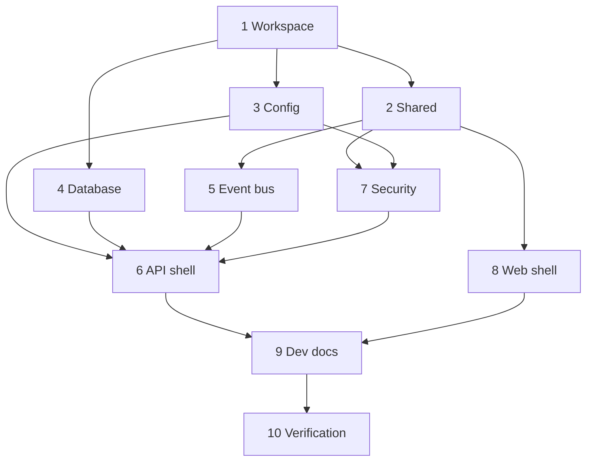

# Implementation Plan: foundation

## Overview

Build the workspace, shared package, database, API shell with SSE, security baseline, web shell and dev docs, in about 10 top-level tasks. Each task ships with its tests. Property tests are their own sub-tasks and carry the comment `// Feature: foundation, Property N`. Integration tests need `TEST_DATABASE_URL`; unit and property tests never do.

## Tasks

- [ ] 1. Workspace scaffolding and root scripts
  - [ ] 1.1 Add root `tsconfig.base.json` (strict), ESLint config, Vitest config and `.env.example` with names and placeholder values only
    - _Requirements: 1.1, 1.6, 9.2_
  - [ ] 1.2 Create `packages/shared`, `apps/api` and `apps/web` skeletons with exact-pinned dependencies from the design table; confirm the TypeScript 7 decorator risk and the Vitest decorator transform, and record the outcome in Notes
    - _Requirements: 1.1, 1.6_
  - [ ] 1.3 Wire root scripts `typecheck`, `lint`, `test`, `build` and make Shared build before dependents
    - _Requirements: 1.2, 1.3, 1.4, 1.5_
  - [ ] 1.4 Add `tools/check-build-determinism` script that runs `pnpm build` twice and compares output hashes
    - _Requirements: 1.5_
  - [ ] 1.5 Add a smoke test per package so `pnpm test` runs and passes with no database
    - _Requirements: 1.4, 9.3_

- [ ] 2. Shared types and validators
  - [ ] 2.1 Define `ServiceName`, `ServiceState`, `HauntLevel`, `SignalKind`, SSE event names and payload types, and `Result<T>`
    - _Requirements: 2.1_
  - [ ] 2.2 Implement total validators for Service state, Haunt level and each SSE payload, plus SSE wire format and parse helpers
    - _Requirements: 2.2, 2.3, 2.5_
  - [ ] 2.3 Export everything from `index.ts`; API and Web import from `@haunted-ops/shared` and define no local copies
    - _Requirements: 2.4_
  - [ ]* 2.4 Property test: validators are total and exact (Property 7)
    - _Requirements: 2.2, 2.3, 2.5_
  - [ ]* 2.5 Property test: SSE payloads round-trip (Property 8)
    - _Requirements: 2.2, 6.2_

- [ ] 3. API configuration
  - [ ] 3.1 Implement `parseConfig` and `ConfigError` for `DATABASE_URL`, `PORT`, `WEB_ORIGIN`, `SSE_MAX_CLIENTS`, `RATE_LIMIT_MAX` with defaults 100 and 30
    - _Requirements: 4.1, 4.3, 4.5_
  - [ ] 3.2 Make `main.ts` print the error with names only and exit 1 before `listen`; never print values
    - _Requirements: 4.2, 4.4_
  - [ ]* 3.3 Property test: config validation rejects every missing or invalid variable and never echoes values (Property 6)
    - _Requirements: 4.1, 4.2, 4.3, 4.4, 4.5_

- [ ] 4. Database schema, migrations, seed and test harness
  - [ ] 4.1 Write `schema.prisma` with the six models, enums, foreign keys, the latest-signals index and the unique `[huntId, order]`; add `prisma.config.ts` and the `PrismaService` using `@prisma/adapter-pg`
    - _Requirements: 3.1, 3.2, 3.6_
  - [ ] 4.2 Create and commit the first migration, with the hand-written partial unique index for one open Incident per Service
    - _Requirements: 3.2, 3.3, 3.5_
  - [ ] 4.3 Write the idempotent seed for `gate`, `orders`, `payments`, `ledger` with fixed room positions and a `pnpm --filter api db:seed` script
    - _Requirements: 3.4_
  - [ ] 4.4 Build the integration harness: skip with a visible message when `TEST_DATABASE_URL` is unset, refuse when equal to `DATABASE_URL`, apply migrations and truncate tables at start
    - _Requirements: 9.4, 9.5, 9.6_
  - [ ] 4.5 Integration test: `migrate deploy` on an empty Test database creates all six tables and both indexes
    - _Requirements: 3.3_
  - [ ]* 4.6 Property test with database: seed is idempotent (Property 14)
    - _Requirements: 3.4_
  - [ ]* 4.7 Property test with database: at most one open Incident per Service (Property 15)
    - _Requirements: 3.2, 3.5_
  - [ ]* 4.8 Property test with database: Evidence order is unique per Hunt (Property 16)
    - _Requirements: 3.6_

- [ ] 5. Event bus and ring buffer
  - [ ] 5.1 Implement `RingBuffer` (capacity 500, `since`, `oldestId`, `latestId`)
    - _Requirements: 6.4, 6.5, 6.6_
  - [ ] 5.2 Implement `EventBus` (`publish`, `subscribe`, `close`) with a monotonic integer counter
    - _Requirements: 6.2, 6.9_
  - [ ] 5.3 Implement SSE wire formatting in `sse-format.ts` using the Shared helpers
    - _Requirements: 6.2, 6.3_
  - [ ]* 5.4 Property test: event ids strictly increase and heartbeat or resync carry no id (Property 1)
    - _Requirements: 6.2, 6.3_
  - [ ]* 5.5 Property test: ring buffer is bounded and keeps the newest (Property 2)
    - _Requirements: 6.4_
  - [ ]* 5.6 Property test: resume neither skips nor repeats (Property 3)
    - _Requirements: 6.5_
  - [ ]* 5.7 Property test: out-of-range ids resync (Property 4)
    - _Requirements: 6.6_

- [ ] 6. API shell: routes and SSE controller
  - [ ] 6.1 Bootstrap Nest in `main.ts` and `app.module.ts` with the middleware order from the design, graceful shutdown hooks and a testable `createApp(config)` factory
    - _Requirements: 4.1, 6.9_
  - [ ] 6.2 Implement `GET /healthz` with a 2 s database timeout
    - _Requirements: 5.1, 5.2_
  - [ ] 6.3 Implement `GET /api/services` in room order, validated against the Shared validator in tests
    - _Requirements: 5.3, 5.4_
  - [ ] 6.4 Implement `EventsController`: headers, id parsing from header or `lastEventId`, subscribe before replay, replay, `resync`, 15 s heartbeat
    - _Requirements: 6.1, 6.2, 6.3, 6.5, 6.6_
  - [ ] 6.5 Enforce `SSE_MAX_CLIENTS` with 503 and `Retry-After`; clean up subscription and timer on disconnect
    - _Requirements: 6.7, 6.8_
  - [ ] 6.6 End all Streams and close the bus on shutdown
    - _Requirements: 6.9_
  - [ ] 6.7 Integration tests on an ephemeral port: health up and down, services shape, SSE headers, publish, drop and resume, resync, cap, shutdown
    - _Requirements: 5.1, 5.2, 5.3, 5.4, 6.1, 6.2, 6.5, 6.6, 6.7, 6.9_
  - [ ]* 6.8 Property test: client cap holds and disconnect releases its slot and timer (Property 5)
    - _Requirements: 6.7, 6.8_

- [ ] 7. Security baseline
  - [ ] 7.1 Add request id middleware, `X-Request-Id` header and the JSON logger with `redact`
    - _Requirements: 7.4, 7.5, 7.6_
  - [ ] 7.2 Add `helmet`, exact-origin CORS through `isAllowedOrigin`, and `express.json({ limit: '32kb' })` with the Nest body parser disabled
    - _Requirements: 7.1, 7.2, 7.3_
  - [ ] 7.3 Add the global `RateLimitGuard` on `@nestjs/throttler`, skipping GET, HEAD and OPTIONS, with a test-only mutating route to exercise it
    - _Requirements: 7.7_
  - [ ] 7.4 Add `ErrorFilter` for 404, 413, 429 and generic 500 bodies with no stack traces
    - _Requirements: 5.5, 7.3, 7.8_
  - [ ] 7.5 Integration tests: 404 body, 413 on a 33 KiB body, CORS allowed and denied origin, security headers present, 500 body is generic
    - _Requirements: 5.5, 7.1, 7.2, 7.3, 7.8_
  - [ ]* 7.6 Property test: logs never leak secrets (Property 9)
    - _Requirements: 7.5, 7.6_
  - [ ]* 7.7 Property test: rate limit counts only mutating requests (Property 10)
    - _Requirements: 7.7_
  - [ ]* 7.8 Property test: CORS is exact (Property 11)
    - _Requirements: 7.1_

- [ ] 8. Web shell and SSE client
  - [ ] 8.1 Scaffold Vite + React with `Header`, `SceneMount` (empty, labelled, no PixiJS) and `TableMode`; read `VITE_API_BASE_URL`
    - _Requirements: 8.1, 8.2, 8.8, 8.9_
  - [ ] 8.2 Implement `backoff.ts` (exponential, cap 30 s, equal jitter) and the `status.ts` reducer
    - _Requirements: 8.3, 8.4, 8.5_
  - [ ] 8.3 Implement `sse-client.ts` with injectable `EventSource`, reconnect using `?lastEventId=`, `resync` handling and `fetchServices()` on connect and resync
    - _Requirements: 8.3, 8.4, 8.5, 8.6, 8.7, 8.9_
  - [ ] 8.4 Render connection status in a polite live region with text and a shape icon; render Service name and Haunt level as table text
    - _Requirements: 8.1, 8.8_
  - [ ] 8.5 Component and client tests with Testing Library and fake timers: status transitions, `resync` refetch, last id sent on reconnect, only the two allowed endpoints called
    - _Requirements: 8.3, 8.5, 8.6, 8.7, 8.9_
  - [ ]* 8.6 Property test: backoff stays within bounds (Property 12)
    - _Requirements: 8.4_
  - [ ]* 8.7 Property test: connection status is consistent (Property 13)
    - _Requirements: 8.3, 8.4, 8.5_

- [ ] 9. Dev documentation
  - [ ] 9.1 Write `docs/DEV.md`: prerequisites, Homebrew `postgresql@17` start and stop, creating dev and test databases, environment variable names, migrate, seed, running API and Web, running unit and integration tests, skip and refuse behavior
    - _Requirements: 9.1, 9.3, 9.4, 9.5_
  - [ ] 9.2 Check that `.env.example` matches the variables the API reads and that `DEV.md` lists the same names
    - _Requirements: 9.1, 9.2_

- [ ] 10. Final verification
  - [ ] 10.1 Run `pnpm typecheck`, `pnpm lint`, `pnpm test` (without database) and, with a Test database, the integration suite; run the determinism check
    - _Requirements: 1.2, 1.3, 1.4, 1.5, 9.3, 9.4_
  - [ ] 10.2 Start API and Web locally and confirm the status goes `live`, `reconnecting` after stopping the API and `live` again after restart, with the table filled from `GET /api/services`
    - _Requirements: 8.3, 8.4, 8.6_
  - [ ] 10.3 Scan the repository for secrets and home paths, then add the finished-task line to `docs/KIRO_USAGE.md`
    - _Requirements: 4.4, 7.5_

## Task Dependency Graph



```json
{
  "waves": [
    { "id": 0, "tasks": ["1"] },
    { "id": 1, "tasks": ["2", "3", "4"] },
    { "id": 2, "tasks": ["5", "7", "8"] },
    { "id": 3, "tasks": ["6"] },
    { "id": 4, "tasks": ["9"] },
    { "id": 5, "tasks": ["10"] }
  ]
}
```

## Notes

- Sub-tasks marked `*` are property-based tests. They are required for this spec: every correctness property has one.
- Properties 14 to 16 need `TEST_DATABASE_URL`. They are skipped with a visible message when it is unset.
- Prisma is pinned to 7.10.1, the latest stable. Do not move to 8.0.0 release candidates.
- Task 1.2 records the TypeScript 7 and Vitest decorator outcome here before later tasks start.
- Out of scope: Prometheus polling and haunt score (`ingest-haunt-score`), PixiJS scene (`scene-engine`), MCP and hunts (`exorcist-agent`), pull requests (`fix-proposal-flow`), deploy (`deploy-demo`).
- Integration tests (4.5, 6.7, 7.5) are the only tests that touch the database.
