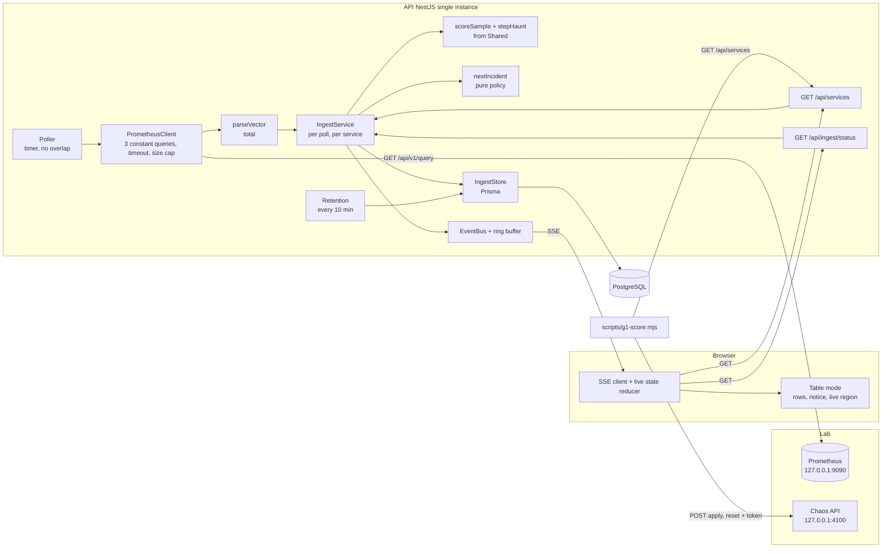
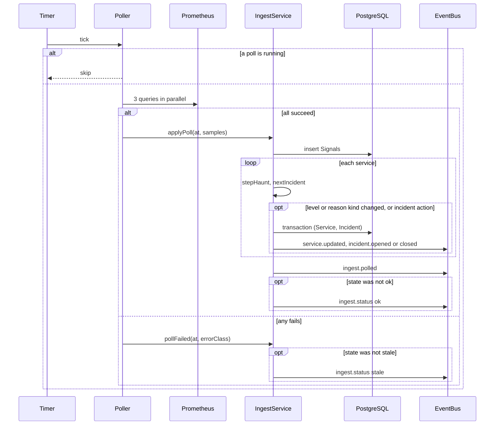

# Design Document

## Overview

`ingest-haunt-score` adds one pipeline to the `foundation` API and one view to the web shell:

```
Prometheus --poll--> Poller --Samples--> IngestService --score + hysteresis--> level, reason
                                              |--> Signal rows, Service row, Incident rows (PostgreSQL)
                                              '--> service.updated, incident.*, ingest.* (event bus, SSE)
Web table <--SSE + GET /api/services, GET /api/ingest/status
```

Key decisions:

- **Pure core in Shared.** `scoreSample` (Sample to Raw level and reason) and `stepHaunt` (hysteresis) live in `packages/shared`, have no I/O and no clock, and carry the correctness properties. The incident policy is a second pure function in the API. The poller and the database code are thin shells around them.
- **All-or-nothing polls.** Three queries per Poll, grouped by the `service` label, not twelve per-service queries. If any one fails, the whole Poll fails and nothing changes. A half-updated house would lie.
- **Few events for live numbers.** `service.updated` fires only when the level or the reason kind changes. A single `ingest.polled` event carries all four Samples, and it is sent at most every 30 s (and on the Poll that changes the ingest status), because every event goes to every public SSE client and into the 500-event ring buffer. That is 2 events a minute, not 12 (one per Poll) or 144 (`signal.recorded` per value). `GET /api/services` always has the latest Sample, so a reload is never older than the stream.
- **Prometheus is untrusted.** Only numbers and the four known service names are read from a response. No response text reaches a row, an event or a log line.
- **Queries are constants.** The three PromQL strings are module constants; the service label values come from the `service` label of the answer, matched against `SERVICE_NAMES`, never interpolated into a query.
- **In-memory hysteresis, durable level.** The streaks live in memory. The level, reason and open incident are in PostgreSQL. After a restart the level is kept and the streaks start again, which delays a change by at most 2 to 3 Polls. If a database write fails, the in-memory state still advances and the next Poll writes the level again (the stored level is compared with the in-memory one), so a failed write does not restart a streak.
- **Shutdown order.** Nest runs the hooks of one phase in parallel. The runner stops the Poller and waits for a Poll that is being applied in `onModuleDestroy`; `PrismaService` disconnects in `onApplicationShutdown`, which runs later. So nothing writes after the disconnect.
- **Windows of 30 s.** The error ratio and p95 use `[30s]` (6 scrapes at 5 s), so a fault shows after about 30 to 35 s and clears after about the same time plus 3 falling Polls. A `[1m]` window put the lab error-spike at 48 to 49 s of a 60 s limit.
- **No new dependency.** Polling uses the built-in `fetch` of Node 26. `fast-check` stays at 4.10.2 (checked against the npm registry on 13 Nov 2026, still the latest).

### Threshold table

| Level | Name | Error ratio | p95 | `up` (30 s average) |
| --- | --- | --- | --- | --- |
| 0 | calm | below 0.05 | below 500 ms | 0.5 or more |
| 1 | uneasy | 0.05 or more | 500 ms or more | |
| 2 | haunted | 0.2 or more | 1000 ms or more | |
| 3 | possessed | 0.5 or more | 3000 ms or more | |
| 4 | dark | | | below 0.5 |

The lab values (0.22, 2.2 s, `up == 0`) give levels 2, 2 and 4, so each Scenario opens an Incident.

## Architecture





## Components and Interfaces

### Configuration (`apps/api/src/config/config.ts`)

`Config` gains four fields; `parseConfig` validates them with the existing helpers, and `ConfigError` names the variable and never the value.

| Variable | Field | Rule | Default |
| --- | --- | --- | --- |
| `PROMETHEUS_URL` | `prometheusUrl` | `isOrigin` (http or https, host, optional port, no path, query, fragment or credentials) and `isPrometheusOrigin`: host `127.0.0.1`, `[::1]` or `localhost` unless `PROMETHEUS_ALLOW_REMOTE=true`; never a link-local host (`169.254.0.0/16`, `fe80::/10`, IPv4-mapped `::ffff:a9fe:`) | `http://127.0.0.1:9090` |
| `PROMETHEUS_ALLOW_REMOTE` | `prometheusAllowRemote` | exactly `true` or `false` | `false` |
| `POLL_INTERVAL_MS` | `pollIntervalMs` | integer 1000 to 60000 | 5000 |
| `POLL_TIMEOUT_MS` | `pollTimeoutMs` | integer 100 to 30000 and not above `pollIntervalMs` | `min(3000, pollIntervalMs)` |
| `SIGNAL_RETENTION_H` | `signalRetentionH` | integer 1 to 720 | 24 |

`isOrigin` already requires the canonical form (`url.origin === value`), which rejects a path, query, fragment and credentials.

### Constants in code (`apps/api/src/ingest/queries.ts`)

```ts
export const ERROR_RATIO_QUERY =
  '(sum by (service) (rate(http_requests_total{code=~"5.."}[30s]))' +
  ' or on(service) (0 * sum by (service) (rate(http_requests_total[30s]))))' +
  ' / sum by (service) (rate(http_requests_total[30s]))';

export const P95_MS_QUERY =
  '1000 * histogram_quantile(0.95, sum by (service, le) (rate(http_request_duration_seconds_bucket[30s])))';

export const UP_QUERY = 'avg_over_time(up{job="lab"}[30s])';

export const QUERIES = Object.freeze({ errorRate: ERROR_RATIO_QUERY, p95Ms: P95_MS_QUERY, up: UP_QUERY });
export const QUERY_PATH = '/api/v1/query';
export const MAX_BODY_BYTES = 1_048_576;
```

Notes on the PromQL:

- The `or on(service) (0 * ...)` branch gives a zero numerator for a service that has traffic but no 5xx series. The lab pre-initialises the 200 and 500 counters to 0, so this is a safety net, as asked.
- A service with no traffic in the window divides by zero and gives `NaN`; the parser turns that into `null`, so an idle service is not scored from this value.
- `histogram_quantile` returns `NaN` when there are no observations; also `null`.
- The job name `lab` matches `deploy/prometheus.yml` in the lab. The `service` label comes from the lab's file-based target discovery.

### Prometheus client and parser

```ts
export interface PrometheusClient {
  /** Runs the three constant queries in parallel. Rejects as a whole if any one fails. */
  poll(signal: AbortSignal): Promise<PollResult>;
}

export type PollResult = Record<ServiceName, Sample>;   // Sample from Shared

export class PollError extends Error {
  constructor(readonly code: 'timeout' | 'network' | 'status' | 'body' | 'too_large' | 'aborted') { super(code); }
}

/** Total. Never throws. Reads only `service` labels in SERVICE_NAMES and finite numbers. */
export function parseVector(body: unknown): Map<ServiceName, number>;
```

Request: `fetch(new URL(QUERY_PATH, prometheusUrl) + '?query=' + encodeURIComponent(q), { method: 'GET', redirect: 'error', signal: AbortSignal.any([timeout, shutdown]), headers: { accept: 'application/json' } })`. No credentials, no cookies, no body. The body is read as a stream with a running byte count and the read is cancelled past `MAX_BODY_BYTES`. `PollError.code` is the only thing that is logged.

`parseVector` accepts `{ status: 'success', data: { resultType: 'vector', result: [{ metric: { service }, value: [ts, "<number>"] }] } }`. A body of another shape makes the query fail with code `body` (one of the "not a Prometheus success result" cases). Inside a valid result, an entry with an unknown or missing `service`, a second entry for the same service, or a value that is not a finite number becomes `null`, never an exception.

### Poller (`apps/api/src/ingest/poller.ts`)

```ts
export interface PollerDeps {
  client: PrometheusClient;
  ingest: Pick<IngestService, 'applyPoll' | 'pollFailed'>;
  intervalMs: number;
  now: () => Date;
  setTimer / clearTimer;      // injectable for fake timers
  logger: JsonLogger;
}
export class Poller {
  start(): void;              // runs one poll now, then one per interval
  stop(): Promise<void>;      // clears the timer, aborts the request, waits for the poll in flight
  get running(): boolean;
}
```

- A `running` flag set before the poll and cleared in `finally` makes an overlapping tick a no-op. This is the only gate.
- `tick()` catches everything. A `PollError` goes to `ingest.pollFailed`; any other error is logged with its class name and treated as a failed Poll.
- The timer uses a self-correcting `setTimeout` chain is not needed: a `setInterval` with the `running` gate is enough, because a skipped tick only costs one interval.
- `stop()` sets `stopped`, so a tick after stop does nothing, and aborts the shared `AbortController`.

### IngestService (`apps/api/src/ingest/ingest.service.ts`)

```ts
export type IngestState = 'unknown' | 'ok' | 'stale';

export interface IngestStatus {                 // wire shape, also in Shared
  state: 'ok' | 'stale';
  at: string;                                   // time of the last change of state (boot time before the first Poll)
  lastSuccessAt: string | null;
}

export class IngestService {
  init(): Promise<void>;                        // loads Services, reasons and open Incidents
  applyPoll(at: Date, result: PollResult): Promise<void>;
  pollFailed(at: Date, code: PollError['code']): void;
  status(): IngestStatus;                       // 'unknown' is reported as 'stale'
  services(): Promise<ServiceState[]>;          // used by GET /api/services
}
```

`applyPoll`:

1. Insert the non-null values as `Signal` rows with `createMany` (`at` = poll time). A failure is logged and does not stop the rest; scoring still runs on the in-memory Samples.
2. For each Service in room order:
   1. `next = stepHaunt(state, sample)`. A No-data Sample returns the same state.
   2. `incident = nextIncident(incidentState, next.level, at)` (below).
   3. If the new level or reason kind differs from what the database holds (`persistedLevel`, `persistedKind`) or `incident.action.kind !== 'none'`, write one transaction: update `Service` (`hauntLevel`, `reasonKind`, `reasonValue`), and create, update or close the `Incident`. On success set the persisted values, then publish. On failure keep the new hysteresis state and the new calm count in memory (so the streak does not start again), leave the persisted values as they are, publish nothing, log the error class and go on with the next Service; the next Poll writes again.
   4. A Service with a No-data Sample is skipped, and its calm stretch is broken (`lastCalmAt = null`).
3. Publish `ingest.polled` with the four Samples if none was published in the last 30 s of Poll time, or if the ingest status is not `ok` yet.
4. If the ingest state was not `ok`, set it to `ok`, store `lastSuccessAt`, and publish `ingest.status`.

`pollFailed` changes nothing about levels or incidents, but it breaks every calm stretch (`lastCalmAt = null`), so the time of a failed Poll is never counted toward closing an Incident. If the ingest state was not `stale`, it sets `stale` and publishes `ingest.status`.

All DB writes for one Poll run in sequence, in the single async function started by the Poller, so there is no interleaving. Events are published only after the transaction of that Service committed.

### Shared: score and hysteresis (`packages/shared/src/haunt.ts`)

```ts
export const ERROR_RATE_THRESHOLDS = [0.05, 0.2, 0.5] as const;     // levels 1, 2, 3
export const P95_MS_THRESHOLDS = [500, 1000, 3000] as const;        // levels 1, 2, 3
export const UP_DOWN_BELOW = 0.5;                                    // level 4
export const RAISE_AFTER_POLLS = 2;
export const LOWER_AFTER_POLLS = 3;

export type HauntReasonKind = 'error_rate' | 'p95' | 'down';
export interface HauntReason { kind: HauntReasonKind; value: number }
export interface Sample { errorRate: number | null; p95Ms: number | null; up: number | null }
export interface Scored { level: HauntLevel; reason: HauntReason | null }

export function scoreSample(sample: Sample): Scored;     // pure, total

interface Pending { count: number; level: HauntLevel; reason: HauntReason | null }
export interface HauntState {
  level: HauntLevel;
  reason: HauntReason | null;
  higher: Pending | null;      // consecutive polls with raw level above `level`
  lower: Pending | null;       // consecutive polls with raw level below `level`
}

export function initialHauntState(level: HauntLevel, reason: HauntReason | null): HauntState;
export function isNoData(sample: Sample): boolean;
export function stepHaunt(state: HauntState, sample: Sample): HauntState;   // pure
export function hauntChanged(prev: HauntState, next: HauntState): boolean;  // level or reason kind differs
```

`scoreSample`: clean each value (`null` if not a finite number; negative error ratio or p95 becomes 0), compute the level of each signal, take the maximum, pick the reason by the order `down`, `error_rate`, `p95` among the signals at that maximum. A level of 0 gives reason `null`.

`stepHaunt`, given `raw = scoreSample(sample)`:

- No-data Sample: return `state` unchanged.
- `raw.level === state.level`: `{ level, reason: raw.reason, higher: null, lower: null }`.
- `raw.level > state.level`: `lower = null`; `higher = higher === null ? { count: 1, level: raw.level, reason: raw.reason } : { count: higher.count + 1, level: min(higher.level, raw.level), reason: raw.level <= higher.level ? raw.reason : higher.reason }`. When `higher.count` reaches `RAISE_AFTER_POLLS`, return `{ level: higher.level, reason: higher.reason, higher: null, lower: null }`.
- `raw.level < state.level`: the mirror image with `lower`, `max` and `LOWER_AFTER_POLLS`.

Taking the lowest Raw level of the rising streak and the highest of the falling streak means a change never overshoots what every Poll in the streak supported.

### Incident policy (`apps/api/src/ingest/incident-policy.ts`)

```ts
export const INCIDENT_OPEN_AT_LEVEL = 2;
export const INCIDENT_CLOSE_AFTER_MS = 30_000;

export interface IncidentState {
  open: { id: string; peakLevel: HauntLevel } | null;
  calmMs: number;                           // level-0 time counted so far
  lastCalmAt: number | null;                // epoch ms of the previous level-0 Poll with data; null when a failed or empty Poll broke the stretch
}
export type IncidentAction =
  | { kind: 'none' }
  | { kind: 'open'; peakLevel: HauntLevel }
  | { kind: 'raise_peak'; peakLevel: HauntLevel }
  | { kind: 'close'; peakLevel: HauntLevel };

export function nextIncident(state: IncidentState, level: HauntLevel, atMs: number): { calmMs: number; lastCalmAt: number | null; action: IncidentAction };
```

- No open Incident: `open` if `level >= 2`, otherwise `none`; the count is reset.
- Open Incident, `level > 0`: `calmMs = 0`, `lastCalmAt = null`; `raise_peak` if `level > peakLevel`, else `none`.
- Open Incident, `level === 0`: `calmMs += lastCalmAt === null ? 0 : max(0, atMs - lastCalmAt)`, `lastCalmAt = atMs`; `close` if `calmMs >= 30_000`, else `none`.

Only intervals between two consecutive level-0 Polls that both had data are counted. A failed Poll or a Poll without data for the Service never calls the policy; the service sets `lastCalmAt = null`, so the interval that follows is not counted, and the `calmMs` already reached is kept. After a restart, `calmMs` is 0, `lastCalmAt` is `null` and an open Incident is loaded from the database.

### Retention (`apps/api/src/ingest/retention.ts`)

```ts
export const RETENTION_INTERVAL_MS = 600_000;
export const RETENTION_BATCH = 5000;
export async function runRetention(prisma, now: Date, retentionH: number): Promise<number>;
```

Each batch runs `DELETE FROM "Signal" WHERE id IN (SELECT id FROM "Signal" WHERE "at" < $1 ORDER BY "at" LIMIT $2)` through `$executeRaw` with bound parameters (the order by `at` walks the `signal_at` index from the oldest row), until a batch returns fewer than `RETENTION_BATCH`, pausing 50 ms between two full batches. `$1` is `now - retentionH hours`. The first run is at start, then every 10 minutes; a failure is logged and the next run tries again. The timer is cleared on shutdown.

### HTTP routes (additions)

| Route | Request | Success response | Errors |
| --- | --- | --- | --- |
| `GET /api/services` | none | `200 ServiceState[]` in room order, now with `reason`, `metrics`, `openIncident` | `500 { "error": "internal", "requestId": string }` |
| `GET /api/ingest/status` | none | `200 IngestStatus` | none; it reads memory only |

`metrics` comes from the last Sample held in memory (set by every successful Poll, per Service). Before the first successful Poll after a start it is read from the Signals of the last 60 s (`SELECT DISTINCT ON ("serviceId", "kind") ... ORDER BY "serviceId", "kind", "at" DESC`, which the existing index serves), or is `null`. A null value in the latest Sample stays `null` and does not fall back to an older row.

### Events (Shared)

New names are added to `DOMAIN_EVENT_NAMES`, with validators in `payloadChecks`:

```ts
// service.updated and incident.opened gain fields (they prepare scene-engine and exorcist-agent)
'service.updated': { service: ServiceState; previousLevel: HauntLevel };   // level stored before this change
'incident.opened': {
  incidentId: string; service: ServiceName; openedAt: string;
  level: HauntLevel;                                                      // level at the open, equal to the first peak
  reason: HauntReason | null;                                             // reason at the open
};
// unchanged
'incident.closed': { incidentId: string; service: ServiceName; closedAt: string; peakLevel: HauntLevel };

// new
'ingest.polled': {
  at: string;                                   // ISO 8601 UTC, time of the Poll
  samples: Array<{ service: ServiceName; errorRate: number | null; p95Ms: number | null; up: number | null }>;
};
'ingest.status': { state: 'ok' | 'stale'; at: string; lastSuccessAt: string | null };
```

`ServiceState` (types.ts) becomes:

```ts
export interface ServiceState {
  name: ServiceName;
  room: RoomPosition;
  hauntLevel: HauntLevel;
  reason: HauntReason | null;
  metrics: { errorRate: number | null; p95Ms: number | null; up: number | null; at: string } | null;
  openIncident: { id: string; openedAt: string; peakLevel: HauntLevel } | null;
  updatedAt: string;
}
```

Publish order inside one Service step: `service.updated` (it already carries the new `openIncident`), then `incident.opened` or `incident.closed`. `signal.recorded` stays defined but is not published by ingest.

### Web

- `net/live-state.ts`: a pure reducer `applyLiveEvent(state, name, payload)` over `{ services: ServiceState[]; ingest: IngestStatus | null }`.
  - `service.updated`: replace the Service if `updatedAt` is not older than the stored one (foundation rule), keep room order.
  - `ingest.polled`: set `metrics` of each listed Service to the sample and `at`. Ignored if `at` is older than the stored `metrics.at`.
  - `incident.opened`: set `openIncident` to `{ id, openedAt, peakLevel: level }` (the level carried by the event, not the current level of the service) unless the same id is already set.
  - `incident.closed`: clear `openIncident` if its id matches.
  - `ingest.status`: set `ingest`.
  - Applying the same event twice gives the same state.
- `net/sse-client.ts`: also subscribes to the new events, validates them with `validateSseEvent`, applies `applyLiveEvent`, and loads `GET /api/ingest/status` together with `GET /api/services` on connect and on `resync`. The foundation race rule (an event that arrives during a snapshot fetch is not overwritten) stays.
- `components/TableMode.tsx`: columns Service, Haunt level, Reason, Error ratio, p95, Up, Incident. The Reason cell shows the kind of the reason with the current value from `metrics` (`formatReason(reason, metrics)`), because the stored reason value is the one at the last change of level or reason kind; it falls back to the stored value when the metric is `null`. The Haunt level cell reads `2 (haunted)` and starts with a marker glyph chosen per level and marked `aria-hidden`, so the text carries the meaning: calm `○`, uneasy `◔`, haunted `◑`, possessed `◕`, dark `●`. When `ingest.state === 'stale'`, a `role="status"` notice above the table reads "Metrics are stale. Last update 14:02:10." with the last success time.
- `components/LiveAnnouncer.tsx`: a visually hidden `aria-live="polite"` region. It keeps the previous level per Service and writes "payments: haunted" once per level change. It writes nothing on the first load.
- Formatting helpers (`format.ts`): `formatReason`, `formatErrorRatio` (`22%`), `formatP95` (`640 ms` below 1000, `2.2 s` from 1000), `formatUp` (`up` for 0.5 or more, `down` below, `no data` for null).

### G1 script (`scripts/g1-score.mjs`)

Plain Node 26 ESM, no dependency. Environment: `API_URL` (default `http://127.0.0.1:3000`), `CHAOS_URL` (default `http://127.0.0.1:4100`), `CHAOS_TOKEN` (required, sent only as `Authorization: Bearer` to `CHAOS_URL`).

| Scenario | Service | Expected reason kind | Expected level |
| --- | --- | --- | --- |
| `error-spike` | `payments` | `error_rate` | 2 or higher |
| `fog` | `orders` | `p95` | 2 or higher |
| `dark-room` | `ledger` | `down` | 4 |

Steps: wait up to 120 s for all four Services at level 0 with no Open Incident; for each Scenario, `POST /chaos/scenarios/<name>/apply`, poll `/api/services` every 1 s for up to 60 s until the Service meets the table row and has an Open Incident, then `POST /chaos/reset`, poll until the Service is at level 0 (up to 120 s). A `finally` block and the SIGINT and SIGTERM handlers send one more reset. The script prints a table (Scenario, Service, level, reason, detect s, recover s, result) and exits 0 or 1. The token is never printed.

With the 30 s windows a scenario shows after about 30 to 35 s (the lab runs measured 13 to 30 s for fog and dark-room before; error-spike was 48 to 49 s with `[1m]`) and clears after a similar time plus 3 falling Polls. The limits stay at 60 s to detect and 120 s to recover; the expected times are about 30 to 35 s and 40 to 70 s.

## Data Models

### Prisma change (`apps/api/prisma/schema.prisma`)

```prisma
enum HauntReasonKind {
  error_rate
  p95
  down
}

model Service {
  // existing fields unchanged
  reasonKind  HauntReasonKind?
  reasonValue Float?
}

model Signal {
  // existing fields unchanged
  @@index([serviceId, kind, at(sort: Desc)], map: "signal_latest_per_service")
  @@index([at], map: "signal_at")
}
```

### Migration `add_service_reason`

Created with `prisma migrate dev --name add_service_reason`, then edited by hand:

```sql
CREATE TYPE "HauntReasonKind" AS ENUM ('error_rate', 'p95', 'down');
ALTER TABLE "Service" ADD COLUMN "reasonKind" "HauntReasonKind", ADD COLUMN "reasonValue" DOUBLE PRECISION;
CREATE INDEX "signal_at" ON "Signal"("at");
-- hand-written: a reason has a kind and a value, or neither
ALTER TABLE "Service" ADD CONSTRAINT "service_reason_both_or_none"
  CHECK (("reasonKind" IS NULL) = ("reasonValue" IS NULL));
```

The migration must not touch the partial unique index `incident_one_open_per_service`. Because Prisma does not know that index, the generated SQL from `migrate dev` is read before it is committed, and an integration test asserts the index still exists after all migrations. Existing rows get `NULL` for both columns, which is valid.

### In-memory state

| State | Where | After restart |
| --- | --- | --- |
| `HauntState` per Service | `IngestService` | level and reason from `Service`; streaks empty |
| `IncidentState` per Service | `IngestService` | open Incident from the database; `calmMs` 0, `lastCalmAt` null |
| persisted level and reason kind per Service | `IngestService` | the stored `Service` row |
| last Sample per Service | `IngestService` | none; `metrics` from Signals of the last 60 s |
| ingest state, `lastSuccessAt` | `IngestService` | `unknown`; reported as `stale` until the first Poll |

## Correctness Properties

*A property is a statement that must hold for all valid inputs. Each one below is checked by a property-based test with fast-check, with at least 100 runs, and carries the comment `// Feature: ingest-haunt-score, Property N`.*

### Property 1: The score is monotonic

For any two Samples A and B where each value of B is at least as bad as the same value of A (error ratio and p95 not lower, `up` not higher, `null` counted as the best value), `scoreSample(B).level >= scoreSample(A).level`.

**Validates: Requirements 5.3, 5.4, 5.6**

### Property 2: The score is total and its reason explains the level

For any input, including `NaN`, infinities, negative numbers and `null`, `scoreSample` returns a level from 0 to 4 without throwing; the level is 0 if and only if the reason is `null`; and when the reason is set, its kind names a Signal whose own level equals the Raw level and its value is the cleaned value of that Signal.

**Validates: Requirements 5.1, 5.2, 5.3, 5.5, 5.7**

### Property 3: A single Poll never changes the level

For any state and any one Sample, `stepHaunt(state, sample).level === state.level`, whenever `state` has no pending streak; and for any state with a pending streak, one more Sample that goes against it leaves the level unchanged.

**Validates: Requirements 6.2, 6.3, 6.5**

### Property 4: Hysteresis never flickers and takes exactly 2 or 3 Polls

For any sequence of Samples: (a) a sequence that alternates between a worse and a better Raw level than the current one never changes the level; (b) N consecutive Samples with a Raw level above the level raise it exactly at the 2nd, to the lowest Raw level seen in those 2; (c) N consecutive Samples below the level lower it exactly at the 3rd, to the highest Raw level seen in those 3; (d) a No-data Sample anywhere in the sequence leaves the state unchanged; (e) the level always stays from 0 to 4.

**Validates: Requirements 6.2, 6.3, 6.4, 6.6, 6.7**

### Property 5: At most one Open Incident per Service, and the peak is the maximum

For any sequence of levels with increasing times, applying `nextIncident` (and mutating the state as the service does) never leaves more than one Open Incident, and the `peakLevel` at the close, or at any moment while open, equals the maximum level held since the open (and not less than 2). An open never happens at a level below 2, and level 1 neither opens nor closes.

**Validates: Requirements 8.1, 8.2, 8.3, 8.6**

### Property 6: An Incident closes only after 30 s at level 0

For any sequence of Polls (level and time) mixed with failed Polls and Polls without data, an Incident closes at a Poll only if the counted calm time reaches 30 s, where calm time is the sum of the intervals between consecutive level-0 Polls with data that no failed or empty Poll separated; a Poll with a level above 0 resets the count; the time of a failed or empty Poll is never counted; and a close happens at the first Poll that reaches 30 s.

**Validates: Requirements 8.4, 8.5, 8.7, 8.8**

### Property 7: Events are published exactly when the level or the reason kind changes

For any sequence of Samples, run through `IngestService` with a fake store and a recording bus, the number of `service.updated` events for a Service equals the number of steps in which `(level, reason kind)` differs from the previous step; no event is published for a step in which only a value changed; the last published `service.updated` of each Service matches the stored `hauntLevel` and reason kind; and `ingest.polled` is published for the first Poll and then at most once every 30 s.

**Validates: Requirements 7.1, 7.2, 7.3, 7.7**

### Property 8: Never two Polls in flight

For any schedule of ticks and poll durations, driven with fake timers, the Poller never has more than one Poll running, a tick during a Poll starts no new one, and after `stop()` no new Poll starts.

**Validates: Requirements 2.1, 2.5, 2.8**

### Property 9: A Prometheus failure never changes levels

For any interleaving of successful and failed Polls, a failed Poll leaves every Haunt state, reason and Open Incident exactly as it was, stores no Signal, publishes only `ingest.status` and only on a change of state, and the Samples of the successful Polls give the same final levels and the same `service.updated` events as the same Samples without the failures in between (Incident closes may come later, because a failed Poll breaks the calm count).

**Validates: Requirements 3.1, 3.2, 3.3, 3.4, 3.5, 7.5**

### Property 10: Retention deletes only older Signals

For any set of Signals with random times and any cut-off, a retention run (with a small test batch size) deletes exactly the rows with `at` strictly before the cut-off, keeps every other row, and leaves other tables unchanged. Needs `TEST_DATABASE_URL`.

**Validates: Requirements 4.3, 4.4**

### Property 11: The Prometheus parser is total

For any JSON value as a response body, `parseVector` does not throw; every key of its result is one of the four Service names; every value is a finite number; and a duplicate or non-numeric entry never appears in the result.

**Validates: Requirements 2.7, 12.1**

### Property 12: Config rejects every bad ingest variable without echoing it

For any environment where `PROMETHEUS_URL` (malformed, a remote host without `PROMETHEUS_ALLOW_REMOTE=true`, or a link-local host in any case), `PROMETHEUS_ALLOW_REMOTE`, `POLL_INTERVAL_MS`, `POLL_TIMEOUT_MS` or `SIGNAL_RETENTION_H` is out of its range or malformed, `parseConfig` throws a `ConfigError` that names exactly the bad variables and whose message contains none of their values; and for any valid environment it returns the documented defaults for the unset ones.

**Validates: Requirements 1.1, 1.2, 1.3, 1.4, 1.5, 1.7**

### Property 13: The live reducer is idempotent and keeps room order

For any sequence of valid events, applying each event twice gives the same state as applying it once; an event older than the stored `updatedAt` or `metrics.at` never overwrites newer data; and the Services stay in room order.

**Validates: Requirements 10.4, 10.7**

### Property 14: Every table row says the level and the cause in text

For any valid `ServiceState` (any level, any reason or `null`, any `metrics` including `null` values, with or without an Open Incident), the rendered row contains the level number and its text label, a marker, a reason text that matches the reason, the text "no data" for each `null` metric, and the text "none" or the incident details; none of this information depends on colour.

**Validates: Requirements 10.1, 10.2, 10.3**

## Error Handling

- **Prometheus down, slow or wrong.** A timeout, a refused connection, a non-200 status, a body that is not a Prometheus success vector, an oversize body or a redirect fails the whole Poll with a `PollError` code. Levels, reasons and Incidents stay; nothing is stored; `ingest.status` becomes `stale` once; the log has one line with the code. The next tick tries again. The Poll that succeeds afterwards continues from the old state, with the streaks as they were.
- **Idle service.** A `NaN` ratio or p95 becomes `null` and scores 0. If all three values of a Service are `null` (for example Prometheus has no series for it), the Sample is No-data and the Service keeps its state.
- **Down service.** A Service whose `up` average falls below 0.5 scores 4. A redeploy that blips `up` for a few seconds moves the 30 s average only a little and, in any case, a level needs 2 Polls to rise.
- **Database failure.** A failed Signal insert is logged and skipped; scoring continues. A failed Service/Incident transaction keeps the previous in-memory state of that Service, publishes nothing, and is retried by the next Poll with the next Sample. Neither marks ingest as stale. `GET /api/services` returns the generic 500 as before.
- **Duplicate open Incident.** A unique violation on `incident_one_open_per_service` is caught; the open Incident is loaded and used.
- **Restart.** The Poller starts once the Services and open Incidents are loaded. Levels survive; the streaks and the 30 s count start again.
- **Retention.** A failure is logged and retried at the next run. A run that finds nothing to delete does one cheap query.
- **Web.** A failed `GET /api/ingest/status` leaves the previous status. An event that fails its validator is dropped. After a `resync`, state is reloaded from both routes.
- **G1 script.** On any failure it prints the failing row, resets the lab, and exits 1. A missing `CHAOS_TOKEN` exits 1 before any request.
- **Secrets.** The Prometheus URL, response bodies and `CHAOS_TOKEN` are never logged or printed. Log fields are limited to error class, code and counts.

## Testing Strategy

- **Unit tests** (Vitest, no database, no network): `scoreSample` threshold edges (values exactly at 0.05, 0.2, 0.5, 500, 1000, 3000, `up` at 0.5 and just below), the lab values (0.22 gives 2, 2200 ms gives 2, `up` 0 gives 4); `stepHaunt` sequences from the requirements; `nextIncident` edges (29.999 s, 30 s); `parseVector` with real-looking Prometheus bodies; the three query constants are string-equal to the design (a test also checks they contain no `${`-style input); `PrometheusClient` with a fake `fetch` (timeout, redirect, oversize, bad JSON, non-200); `Poller` with fake timers; `IngestService` with a fake store and a recording bus (events, order, DB-failure path, restart state); config parsing; the web reducer, formatting helpers, `TableMode` and `LiveAnnouncer` with Testing Library.
- **Property-based tests** (fast-check 4.10.2): one test per property above, at least 100 runs, comment `// Feature: ingest-haunt-score, Property N`. Properties 1 to 9 and 11 to 14 need no database; property 10 needs one.
- **Integration tests** with `TEST_DATABASE_URL` (the foundation harness: skipped with a visible message when unset, refused when equal to `DATABASE_URL`): the migration on an empty database and on a foundation-migrated one, the partial unique index still present, the CHECK constraint, Signal insert and retention, the open/close Incident round trip with the unique index, `GET /api/services` and `GET /api/ingest/status` through a real Nest app, and one end-to-end run against a stub Prometheus HTTP server on an ephemeral loopback port that answers the three queries with scripted bodies (calm, error spike, outage of the stub itself) and checks the SSE events a client receives.
- **G1 check**: `scripts/g1-score.mjs` against the real lab. It needs Docker for Prometheus and so is not part of `pnpm test`. Its pure helpers (scenario table, wait loop with an injected clock and fetch) have unit tests.
- **Not covered here**: browser rendering in a real browser, and the PixiJS scene.
