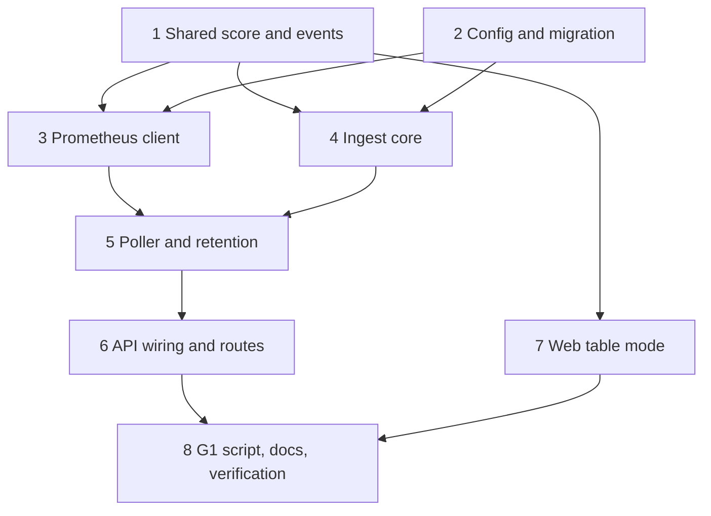

# Implementation Plan: ingest-haunt-score

## Overview

Poll the lab Prometheus, turn the Samples into a haunt level with hysteresis, open and close Incidents, publish the changes on the SSE bus, show the result in table mode and prove gate G1 with a script. It is 8 top-level tasks, sized for one day. Each task ships with its tests. Property tests are their own sub-tasks, marked `*`, and carry the comment `// Feature: ingest-haunt-score, Property N`. Integration tests need `TEST_DATABASE_URL`; unit and property tests (except Property 10) never do. No new dependency is added.

## Tasks

- [ ] 1. Shared types, score, hysteresis and events
  - [ ] 1.1 Extend `packages/shared` types: `Sample`, `HauntReasonKind`, `HauntReason`, `IngestStatus`, and `ServiceState` with `reason`, `metrics` and `openIncident`; add exact total validators for the new fields and update `checkServiceState`; fix every existing fixture and mapper in API and Web so they compile and import from Shared only
    - _Requirements: 9.1, 9.5_
  - [ ] 1.2 Add `packages/shared/src/haunt.ts` with the named threshold constants and `scoreSample` (pure, total, reason order `down`, `error_rate`, `p95`)
    - _Requirements: 5.1, 5.2, 5.3, 5.4, 5.5, 5.7_
  - [ ] 1.3 Add `initialHauntState`, `isNoData`, `stepHaunt` and `hauntChanged` (raise after 2, lower after 3, lowest and highest Raw level of the streak, reason from the Sample that set the level, No-data leaves the state unchanged)
    - _Requirements: 6.1, 6.2, 6.3, 6.4, 6.5, 6.6, 6.7, 6.8_
  - [ ] 1.4 Add the events `ingest.polled` and `ingest.status` to the Shared event maps, name lists and validators, and export all of it from `index.ts`
    - _Requirements: 7.4, 9.5_
  - [ ] 1.5 Unit tests: threshold edges (exactly at, and just below, each threshold), the lab values (0.22, 2200 ms, `up` 0), tie order of the reason, hysteresis sequences (2 up, 3 down, alternating, reset on equal, No-data), validators for the new payloads
    - _Requirements: 5.2, 5.3, 5.5, 6.2, 6.3, 6.4, 6.7, 7.4_
  - [ ]* 1.6 Property test: the score is monotonic (Property 1)
    - _Requirements: 5.3, 5.4, 5.6_
  - [ ]* 1.7 Property test: the score is total and its reason explains the level (Property 2)
    - _Requirements: 5.1, 5.2, 5.3, 5.5, 5.7_
  - [ ]* 1.8 Property test: a single Poll never changes the level (Property 3)
    - _Requirements: 6.2, 6.3, 6.5_
  - [ ]* 1.9 Property test: hysteresis never flickers and takes exactly 2 or 3 Polls (Property 4)
    - _Requirements: 6.2, 6.3, 6.4, 6.6, 6.7_

- [ ] 2. Configuration and database migration
  - [ ] 2.1 Extend `Config`, `OPTIONAL_VARS`, `DEFAULTS` and `parseConfig` with `PROMETHEUS_URL`, `POLL_INTERVAL_MS`, `POLL_TIMEOUT_MS` (not above the interval, default `min(3000, interval)`) and `SIGNAL_RETENTION_H`
    - _Requirements: 1.1, 1.2, 1.3, 1.4_
  - [ ] 2.2 Keep `main.ts` exiting 1 before `listen` with the names only for the new variables; add the four names with defaults and no real value to `.env.example`
    - _Requirements: 1.5, 1.6_
  - [ ] 2.3 Add `HauntReasonKind`, `Service.reasonKind`, `Service.reasonValue` and the `Signal.at` index to `schema.prisma`; create migration `add_service_reason`; hand-add the CHECK constraint; read the generated SQL to confirm it does not touch `incident_one_open_per_service`; regenerate the client
    - _Requirements: 4.6, 9.3_
  - [ ] 2.4 Integration test: all migrations apply to an empty Test database and to one migrated by `foundation` with existing rows; the partial unique index, the `signal_at` index and the CHECK constraint exist; the seed leaves `hauntLevel` 0 and a `null` reason for the four Services
    - _Requirements: 4.6, 9.3, 9.4_
  - [ ]* 2.5 Property test: config rejects every bad ingest variable without echoing it, and returns the defaults for unset ones (Property 12)
    - _Requirements: 1.1, 1.2, 1.3, 1.4, 1.5_

- [ ] 3. Prometheus client and parser
  - [ ] 3.1 Add `apps/api/src/ingest/queries.ts` with the three PromQL constants, the query path and the size limit
    - _Requirements: 2.2, 2.3, 2.4_
  - [ ] 3.2 Add the total `parseVector` that reads only `service` labels from `SERVICE_NAMES` and finite numbers
    - _Requirements: 2.7, 12.1_
  - [ ] 3.3 Add `PrometheusClient` and `PollError`: three parallel GETs, per-request timeout, shutdown signal, `redirect: 'error'`, streamed body with a 1 MiB cap, no credentials or request body, all-or-nothing result, error code only
    - _Requirements: 2.2, 2.6, 3.1, 12.3_
  - [ ] 3.4 Unit tests with a fake `fetch`: success, timeout, refused connection, status 500, redirect, `status: "error"` body, wrong `resultType`, oversize body, bad JSON, one of three queries failing, query strings equal to the constants and free of any interpolated input
    - _Requirements: 2.2, 2.3, 2.4, 2.6, 3.1, 12.3_
  - [ ]* 3.5 Property test: the Prometheus parser is total (Property 11)
    - _Requirements: 2.7, 12.1_

- [ ] 4. Ingest core: incident policy, store and service
  - [ ] 4.1 Add the pure `nextIncident` with the open at level 2, peak raise, the 30 s close and the restart rule
    - _Requirements: 8.1, 8.3, 8.4, 8.5, 8.6, 8.7_
  - [ ] 4.2 Add `IngestStore` (Prisma): insert Signals with `createMany`, load Services with reasons and open Incidents, one transaction per Service step (update Service, create, raise or close the Incident), catch the unique violation and reuse the open Incident, read the latest Signals of the last 60 s
    - _Requirements: 4.1, 4.2, 7.1, 8.2, 8.7_
  - [ ] 4.3 Add `IngestService`: `init`, `applyPoll`, `pollFailed`, `status`; per Service `stepHaunt` then `nextIncident`; persist then publish `service.updated`, then `incident.opened` or `incident.closed`; one `ingest.polled` per successful Poll; `ingest.status` only on a change of state; on a database failure keep the previous state and publish nothing; never publish `signal.recorded`
    - _Requirements: 3.2, 3.3, 3.4, 3.5, 4.1, 6.8, 7.1, 7.2, 7.3, 7.5, 7.6, 8.1, 8.4_
  - [ ] 4.4 Unit tests with a fake store and a recording bus: events and their order, no event when only a value changes, No-data Sample, database failure keeps state and does not mark stale, restart state (level kept, streaks empty, open Incident loaded, `zeroSince` null), stale then ok transitions
    - _Requirements: 3.2, 3.3, 3.4, 3.5, 6.8, 7.2, 7.3, 7.5, 7.6, 8.7_
  - [ ] 4.5 Integration test: open and close an Incident through the store against the Test database; a second open is rejected by the unique index and handled; Signals are inserted with the Poll time and none for a `null`
    - _Requirements: 4.1, 4.2, 8.1, 8.2, 8.4_
  - [ ]* 4.6 Property test: at most one Open Incident per Service and the peak is the maximum (Property 5)
    - _Requirements: 8.1, 8.2, 8.3, 8.6_
  - [ ]* 4.7 Property test: an Incident closes only after 30 s at level 0 (Property 6)
    - _Requirements: 8.4, 8.5, 8.7_
  - [ ]* 4.8 Property test: events are published exactly when the level or the reason kind changes (Property 7)
    - _Requirements: 7.1, 7.2, 7.3_
  - [ ]* 4.9 Property test: a Prometheus failure never changes levels (Property 9)
    - _Requirements: 3.1, 3.2, 3.3, 3.4, 3.5, 7.5_

- [ ] 5. Poller and retention
  - [ ] 5.1 Add `Poller`: immediate first Poll, interval, a `running` gate so a tick during a Poll is skipped, catch-all error handling that hands a failure to `pollFailed`, `stop()` that clears the timer, aborts the request and waits for the Poll in flight
    - _Requirements: 2.1, 2.5, 2.8, 3.1, 3.6_
  - [ ] 5.2 Add `runRetention` (batched bound-parameter delete of Signals strictly older than the cut-off) and the timer: at start, then every 10 minutes, failures logged and retried, cleared on shutdown
    - _Requirements: 4.3, 4.4, 4.5_
  - [ ] 5.3 Unit tests with fake timers and a fake client: first Poll at start, one per interval, skipped tick while a Poll runs, failure then success, `stop()` during a request, one log line per failed Poll with the code only, retention timer and failure path
    - _Requirements: 2.1, 2.5, 2.8, 3.6, 4.3, 4.5_
  - [ ] 5.4 Integration test: retention with a small batch size removes only the old rows, loops until a short batch, and leaves other tables alone
    - _Requirements: 4.3, 4.4_
  - [ ]* 5.5 Property test: never two Polls in flight (Property 8)
    - _Requirements: 2.1, 2.5, 2.8_
  - [ ]* 5.6 Property test: retention deletes only older Signals (Property 10)
    - _Requirements: 4.3, 4.4_

- [ ] 6. API wiring and routes
  - [ ] 6.1 Register the ingest providers in `AppModule`; in `main.ts` call `init`, then start the Poller and the retention timer after the config is valid and before or after `listen`, and stop both in the shutdown path; tests mount the app without the Poller
    - _Requirements: 2.1, 2.8, 4.3_
  - [ ] 6.2 Extend `ServicesService.list` and the mapper: `reason` from the Service columns, `metrics` from the last Sample (or Signals of the last 60 s, or `null`), `openIncident` from the Open Incident, in room order
    - _Requirements: 9.2_
  - [ ] 6.3 Add `GET /api/ingest/status` (`unknown` reported as `stale`)
    - _Requirements: 3.7_
  - [ ] 6.4 Logging: one line per failed Poll with error class and code; a test proves the Prometheus URL, a response body and tokens never reach a log line and that redaction still applies
    - _Requirements: 3.6, 12.2_
  - [ ] 6.5 Integration test: a real Nest app on an ephemeral port with a stub Prometheus server on loopback answering the three queries with scripted bodies (calm, error spike, outage of the stub, recovery); assert the Signals, `GET /api/services`, `GET /api/ingest/status`, and the SSE events a client receives (`service.updated`, `incident.opened`, `incident.closed`, `ingest.polled`, `ingest.status`); nothing from the response beyond numbers and service names reaches an event or a row
    - _Requirements: 3.3, 3.4, 3.7, 7.1, 7.3, 8.1, 8.4, 9.2, 12.1_

- [ ] 7. Web table mode
  - [ ] 7.1 Add `net/live-state.ts` (pure `applyLiveEvent` for `service.updated`, `ingest.polled`, `incident.opened`, `incident.closed`, `ingest.status`) and `format.ts` (`formatReason`, `formatErrorRatio`, `formatP95`, `formatUp`)
    - _Requirements: 10.2, 10.3, 10.4_
  - [ ] 7.2 Extend `SseClient` to subscribe to the new events, validate them, apply the reducer, and load `GET /api/ingest/status` with `GET /api/services` on connect and on `resync`; keep the foundation snapshot-versus-event rule and room order
    - _Requirements: 10.4, 10.7_
  - [ ] 7.3 Rewrite `TableMode`: columns Service, Haunt level (number, text label, level-specific marker glyph with `aria-hidden`), Reason, Error ratio, p95, Up, Incident; "no data" and "none" texts; a `role="status"` notice with the last success time when ingest is `stale`; caption, column headers, no information by colour alone
    - _Requirements: 10.1, 10.2, 10.3, 10.5, 10.8_
  - [ ] 7.4 Add `LiveAnnouncer`, a visually hidden polite live region that says "payments: haunted" once per level change and nothing on first load; mount it in `App`
    - _Requirements: 10.6, 10.8_
  - [ ] 7.5 Component and client tests: rows for all five levels, reason texts, `null` metrics, open Incident, stale notice appears and disappears, live update from each event, duplicate event changes nothing, one announcement per change, reload on connect and on `resync`, room order, keyboard reachable table
    - _Requirements: 10.1, 10.2, 10.3, 10.4, 10.5, 10.6, 10.7, 10.8_
  - [ ]* 7.6 Property test: the live reducer is idempotent and keeps room order (Property 13)
    - _Requirements: 10.4, 10.7_
  - [ ]* 7.7 Property test: every table row says the level and the cause in text (Property 14)
    - _Requirements: 10.1, 10.2, 10.3_

- [ ] 8. G1 script, docs and verification
  - [ ] 8.1 Write `scripts/g1-score.mjs`: env `API_URL`, `CHAOS_URL`, `CHAOS_TOKEN`; baseline wait of 120 s; for each Scenario apply, detect within 60 s (level, reason kind, Open Incident), reset, recover to level 0 within 120 s; result table; exit 0 or 1; extra reset on failure, SIGINT and SIGTERM; token never printed
    - _Requirements: 11.1, 11.2, 11.3, 11.4, 11.5, 11.6_
  - [ ] 8.2 Unit tests for the script helpers with an injected clock and fetch: missing token exits 1, baseline timeout fails, a wrong reason kind fails, a missed deadline fails, reset is sent after a failure, the token does not appear in the output
    - _Requirements: 11.1, 11.2, 11.3, 11.4, 11.5, 11.6_
  - [ ] 8.3 Update `docs/DEV.md`: running the API against the lab, the four new variables with defaults, the two new routes, and how to run `scripts/g1-score.mjs` with `CHAOS_URL` and `CHAOS_TOKEN` taken from the environment
    - _Requirements: 1.6, 12.4_
  - [ ] 8.4 Verification: `pnpm typecheck`, `pnpm lint` and `pnpm test` pass at the root with no database and no Prometheus; the integration tests pass with `TEST_DATABASE_URL`; scan the diff for secrets, home paths and URLs with credentials; check that no log line or event contains the Prometheus URL; record the counts in Notes
    - _Requirements: 12.1, 12.2, 12.3, 12.5_
  - [ ] 8.5 Manual gate G1: with the lab and Prometheus running, the API polling and the web open in table mode, run the script and watch the table; record the output table and any threshold change in Notes
    - _Requirements: 11.2, 11.3, 11.4, 11.5_

## Task Dependency Graph



```json
{
  "waves": [
    { "id": 0, "tasks": ["1", "2"] },
    { "id": 1, "tasks": ["3", "4", "7"] },
    { "id": 2, "tasks": ["5"] },
    { "id": 3, "tasks": ["6"] },
    { "id": 4, "tasks": ["8"] }
  ]
}
```

## Notes

- Sub-tasks marked `*` are property-based tests. They are required for this spec: every correctness property has one.
- Property 10 and the integration tests 2.4, 4.5, 5.4 and 6.5 need `TEST_DATABASE_URL`. They are skipped with a visible message when it is unset, and refused when it equals `DATABASE_URL`, as in `foundation`.
- No new dependency. `fetch` and `AbortSignal` are built into Node 26. `fast-check` stays at 4.10.2, the latest on the npm registry on 13 Nov 2026.
- The hand-written parts of the schema (the partial unique index from `foundation` and the new CHECK constraint) are invisible to Prisma. Read every `prisma migrate dev` output before committing it so a hand-written object is never dropped.
- The three PromQL strings are constants. A service name from a Prometheus answer is only compared with `SERVICE_NAMES`; it is never put into a query, a log line or an event.
- `signal.recorded` stays in Shared for later specs but ingest does not publish it. Live numbers travel in `ingest.polled`, one event per Poll.
- The G1 script is the only caller of the lab Chaos API. `CHAOS_TOKEN` comes from the environment and is never written to a file, a log or the output.
- Thresholds are the values in the Requirements. If the manual G1 run (8.5) shows that a lab Scenario does not reach level 2, change the named constants in `packages/shared/src/haunt.ts` and update the unit tests, not the lab.
- Out of scope: hunts and the MCP server (`exorcist-agent`), the PixiJS scene (`scene-engine`), the full accessible mode (`accessible-mode`), deploy (`deploy-demo`).
