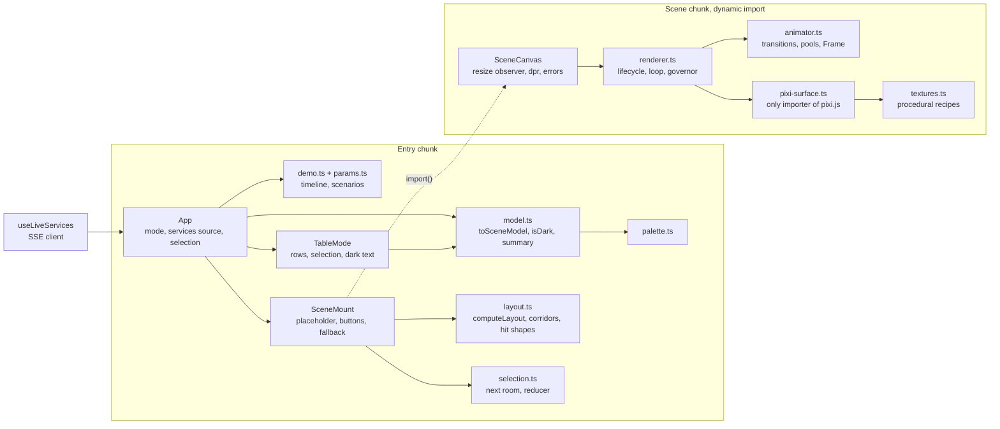
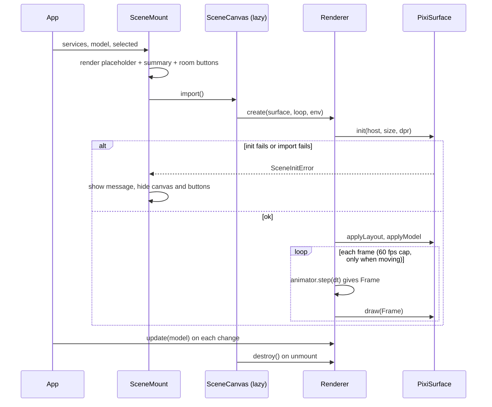

# Design Document

## Overview

`scene-engine` turns the live state of the four services into a house you can read in one second. The work is split so that almost everything can be tested without a GPU:

```
ServiceState[] --toSceneModel--> SceneModel --Animator--> Frame --Surface (PixiJS)--> canvas
                                      |                                   ^
                          computeLayout(viewport) --------------------------'
                                      |
                       summary text, room buttons, Table mode (same model helpers)
```

Key decisions:

- **Pure core.** `toSceneModel`, `computeLayout`, the particle allocator, the keyboard navigation and the demo timeline are pure functions with no PixiJS and no DOM. They carry the correctness properties.
- **The renderer only draws data.** The `Animator` (pure) smooths values and moves pooled particles and returns a `Frame` of typed arrays. The `PixiSurface` copies a Frame into PixiJS objects. A fake `Surface` and a manual `FrameLoop` make the whole lifecycle testable in Vitest.
- **Own frame loop, render on demand.** PixiJS is started with `autoStart: false` and no shared ticker. A small `FrameLoop` (requestAnimationFrame, 60 fps cap, 100 ms step limit) calls `animator.step` and `surface.draw`. When nothing moves (reduced motion, no transition) the loop stops and nothing is redrawn.
- **Procedural art only.** Rooms are polygons and gradients; ghosts and fog are textures generated once at start (5 textures). No image, SVG, font or sound file. Text uses the page's system font stack.
- **Dark means dark.** A dark room keeps its counts in the model (so the model stays monotonic) but the renderer draws no ghosts, fog or motes in it.
- **The table and the scene cannot disagree.** Both call the same helpers (`isDark`, `formatReason`, `levelLabel`). A property test renders the table for random states and compares it with the model.
- **Lazy chunk.** Only `SceneCanvas` (renderer, Animator, PixiSurface, `pixi.js`) is loaded with `import()`. The model, layout, selection, demo and the room buttons stay in the entry chunk because the summary, the buttons and the table need them before PixiJS arrives.
- **Demo mode is the same path.** `?demo=1` feeds scripted `ServiceState[]` into the same model, so the video shows exactly what production shows.

### Pinned versions

Checked against the npm registry on 13 Nov 2026.

| Package | Version | Use |
| --- | --- | --- |
| `pixi.js` | 8.23.0 | runtime dependency of `apps/web`, imported only by `pixi-surface.ts` |
| `@playwright/test` | 1.65.0 | dev dependency of `apps/web`, smoke test only |

`fast-check` 4.10.2, `vitest` 5.1.0 and `@testing-library/react` 16.3.3 stay as they are. No other package is added.

### Bundle budget

The entry chunk of the Web was 73,258 bytes gzip (about 71.5 KiB) on 13 Nov 2026 before this spec (`apps/web/dist`, one JS file). After the build of task 8.3 it is 79.5 KiB (the model, layout, selection, demo, room buttons and the dynamic import), and the scene chunk (the renderer, the animator, the surface and the parts of PixiJS 8 they use, in 6 files) is 155.5 KiB gzip.

| Chunk | Budget in `scripts/check-scene-bundle.mjs` | Measured |
| --- | --- | --- |
| entry (React, app, model, layout, demo, buttons) | 92 KiB gzip, and no PixiJS code | 80.2 KiB after task 10 (79.5 KiB after task 8.3, 71.5 KiB before this spec) |
| scene file (the `SceneCanvas` chunk alone; the number Vite prints, 98 kB) | 119 KiB gzip (task 10: measured plus 25 percent) | 95.2 KiB |
| scene (the `SceneCanvas` chunk and every file it imports statically that the entry does not have) | 180 KiB gzip | 156.5 KiB (6 files) |
| loaded on demand by PixiJS (renderer selection, browser setup) | reported, not budgeted | 15.8 KiB (6 small files); 172.3 KiB for the whole scene |

Task 10 found that the "scene chunk" of the earlier notes and the "about 96 KB" that Vite prints were two different measures: Vite prints one file, the script sums the 6 files the scene needs. The script now reports and budgets both, and lists the parts PixiJS loads on demand.

Task 8.3 built the Web, wrote the measured values here, and set each budget to the measured value plus 15 percent. The script reads Vite's manifest to find the chunk behind the dynamic import and checks that the entry chunk has no `pixi` string.

## Architecture





## Components and Interfaces

### Palette (`scene/palette.ts`)

Named colours as numbers and strings, used by the Surface and checked against `styles.css` (table in Visual Language). Pairs that carry text or a UI shape are listed in `CONTRAST_PAIRS` for the contrast test.

### Seeds and maths (`scene/rng.ts`, `scene/math.ts`)

```ts
export function hashString(s: string): number;                    // FNV-1a, uint32
export function mulberry32(seed: number): () => number;           // seeded [0, 1)
export function unit(seed: number, index: number, salt: number): number;  // stateless, [0, 1)
export const clamp: (v: number, lo: number, hi: number) => number;
/** Exponential approach: never passes the target, equals the target when tauMs is 0. */
export function approach(current: number, target: number, dtMs: number, tauMs: number): number;
```

### Scene model (`scene/model.ts`)

```ts
export const GHOST_MAX = 12, FOG_MAX = 20, MOTE_MAX = 6, PULSE_MAX = 12, PARTICLE_CAP = 200;
// FOG_MAX = FOG_BANK_MAX (10, low bank on the floor) + FOG_WISP_MAX (10, drifting wisps); splitFog fills the bank first.
export const LIGHT_BY_LEVEL = [1, 0.85, 0.65, 0.5, 0] as const;

export interface HuntVisual { phase: string; label: string; progress: number }   // filled by exorcist-agent

export interface RoomVisual {
  name: ServiceName;
  grid: RoomPosition;
  level: HauntLevel;
  levelLabel: string;                 // calm, uneasy, haunted, possessed, dark
  dark: boolean;                      // isDark(service)
  light: number;                      // 0..1, 0 when dark
  coolness: number;                   // 0 warm lamp .. 1 cold light
  ghostCount: number;                 // 0..GHOST_MAX, before the total cap
  ghostOpacity: number;               // 0..1
  fogDensity: number;                 // 0..1
  fogCount: number;                   // 0..FOG_MAX
  moteCount: number;                  // 0..MOTE_MAX, calm rooms only
  motion: { drift: number; flicker: number; tremble: number };   // all 0 with reduced motion
  badge: string;                      // formatReason(reason, metrics), '' without a reason
  badgeShort: string;                 // 'ERR 22%', 'P95 2.2 s', 'DOWN'
  badgeKind: HauntReasonKind | null;
  incident: { open: boolean; peakLevel: HauntLevel | null };
  label: string;
  clock: { hour: number; minute: number };    // radians, from `now` (UTC)
  seed: number;
  hunt?: HuntVisual | null;           // absent in this spec
  summary: string;                    // 'payments: haunted, error rate 22%, incident open'
}

export interface SceneModel {
  rooms: RoomVisual[];                // input order
  particles: { wanted: number; total: number; cap: number; trimmed: boolean };
  reducedMotion: boolean;
  quality: 'full' | 'low';
  transitionMs: number;               // 1000, or 0 with reduced motion
  summary: string;                    // all room summaries joined, for the canvas label
}

export interface ModelOptions { reducedMotion: boolean; quality: 'full' | 'low' }

export function toSceneModel(services: readonly ServiceState[], now: number, options: ModelOptions): SceneModel;
export function isDark(service: Pick<ServiceState, 'hauntLevel' | 'metrics'>): boolean;   // level 4 or up < 0.5
export function levelLabel(level: HauntLevel): string;
```

Formulas (all clamped, `null` counts as 0):

| Field | Formula |
| --- | --- |
| error intensity `e` | `clamp(errorRate / 0.5, 0, 1)`; errorRate is `metrics.errorRate`, or the reason value when the reason is `error_rate` and the metric is `null` |
| latency intensity `f` | `clamp((p95Ms - 200) / 2800, 0, 1)`; same fallback for the `p95` reason |
| `ghostCount` | `min(GHOST_MAX, max(round(e * GHOST_MAX), reason is error_rate ? level : 0))`; rounding, not a ceiling, so the background error ratio of a calm service (about 0.3 percent) draws no ghost |
| `ghostOpacity` | `ghostCount > 0 ? 0.25 + 0.6 * e : 0` |
| `fogDensity` | `min(1, max(f, reason is p95 ? 0.3 * level : 0))` (task 10: 0.15 made level 2 fog nearly invisible); `fogCount = ceil(fogDensity * FOG_MAX)`, split into bank and wisps by `splitFog` |
| `light` | `dark ? 0 : LIGHT_BY_LEVEL[level] * (1 - 0.2 * e) * (1 - 0.3 * f)` |
| `coolness` | `dark ? 0 : min(1, 0.2 * level + 0.1 * max(e, f))` |
| `moteCount` | `dark ? 0 : level 0: 6, level 1: 3, otherwise 0` |
| `motion.drift` | `reduced ? 0 : 0.3 + 0.7 * max(e, f)` |
| `motion.flicker` | `reduced ? 0 : level 3: 0.3, level 2: 0.05, otherwise 0` |
| `motion.tremble` | `reduced ? 0 : level 3: 0.012 (iso units), otherwise 0` |
| `transitionMs` | `reduced ? 0 : 1000` |
| `quality: 'low'` | wanted counts are halved (rounded up) before the total cap |

The allocator `allocateParticles(wanted, cap)` in `scene/particles.ts` is pure: it keeps `PULSE_MAX` for the corridors, so rooms share 188; when the wanted total is larger it removes ambient motes first, then fog puffs, then ghosts, one at a time, taking from the Room with the lowest level first (ties by room order). With the 2 by 2 house the wanted maximum is 4 * 35 = 140 (12 ghosts, 20 fog puffs and at most 3 motes per room since task 10) and nothing is trimmed; trimming only happens above 5 rooms.

`ghostSpec(seed, i)`, `fogSpec(seed, i)` and `fogBankSpec(seed, i)` are pure and return the normalised parameters of one wisp (position in the floor diamond, size, phase, speed, path), derived from `unit(seed, i, salt)`. They are used by the Animator and by tests; the model itself holds only counts and the seed. The Animator computes them once per Room seed (not per frame).

Ghosts haunt the back of the room, away from the nameplate: with `s = u + v`, a ghost centre has `s` in `[0.35, 0.6]` and the drift adds at most 0.16, so `s` stays under `GHOST_BACK_LIMIT = 0.8`; the Animator also clamps the ghost feet to `room.textTop - 0.04 * scale`, so no ghost covers a text pill at any size. Fog is two layers: the bank (wide flat `fogBank` texture, alpha `0.3 + 0.4 * density`, no lift, slow) hugs the floor, the wisps (round `fog` texture, alpha `0.25 + 0.35 * density`, lifted by 0.35 of their size) drift above it. With reduced motion both stay at their seed positions and keep their alpha.

### Layout (`scene/layout.ts`)

Isometric 2:1 projection of an iso unit grid: `P(u, v) = ((u - v) * 1, (u + v) * 0.5)`.

```ts
export const ROOM_SIZE = 2.0, ROOM_STRIDE = 3.2, WALL_HEIGHT = 1.0, MAX_SCALE = 160;
export interface Pt { x: number; y: number }
export interface Rect { x: number; y: number; w: number; h: number }

export interface RoomLayout {
  name: ServiceName;
  grid: RoomPosition;
  floor: [Pt, Pt, Pt, Pt];            // top, right, bottom, left
  silhouette: Pt[];                   // hexagon: floor plus the two back walls
  center: Pt;
  labelAt: Pt; badgeAt: Pt; incidentAt: Pt;
  labelBox: Rect;                     // the name on the nameplate, just inside the front corner of the floor
  incidentBox: Rect;                  // the incident row on the nameplate above the name (compact: a square left of it)
  badgeBox: Rect;                     // the reason badge, the row behind the nameplate
  textTop: number;                    // top of the highest text pill: ghost feet stay above it
  hit: Rect;                          // bounding box of the silhouette, for the button
  hitPolygon: Pt[];                   // silhouette relative to `hit`, for CSS clip-path
  huntRect: Rect;                     // reserved, on the left back wall, clear of every text box
  doors: { px: Pt; mx: Pt; py: Pt; my: Pt };   // midpoints of the floor edges facing +x, -x, +y, -y
}
export interface CorridorLayout { from: ServiceName; to: ServiceName; points: Pt[]; width: number }

export interface SceneLayout {
  width: number; height: number;      // CSS pixels
  dpr: number;                        // min(devicePixelRatio, 2)
  scale: number;                      // pixels per iso unit
  offset: Pt;
  compact: boolean;                   // scale < 26: use badgeShort
  labelPx: number; badgePx: number;   // max(11, 0.34 * scale) and max(11, 0.28 * scale)
  rooms: RoomLayout[];                // reading order: y, then x
  corridors: CorridorLayout[];        // SERVICE_NAMES order, only between Rooms that exist
  aspect: number;                     // width / height of the house at scale 1
}

export function computeLayout(rooms: readonly { name: ServiceName; grid: RoomPosition }[],
                              viewport: { width: number; height: number; dpr: number }): SceneLayout;
```

The constants come from a numeric check: with a room edge of 2.0, a stride of 3.2 and a wall height of 1.0 iso units, the silhouettes of all pairs in a 3 by 3 grid keep a separation of at least 0.179 iso units (separating axis test), so they never overlap; a stride of 3.0 with a wall height of 1.0 touches, and 2.6 with 0.9 overlaps. The house bounding box (silhouettes and corridors) is fitted into the viewport with a margin of `max(8 px, 4 percent)`, centred, with scale at most `MAX_SCALE`.

Corridors run along the "streets", the bands of width 1.2 iso units between cells. Two rooms in the same row or column connect straight through the facing doors; two rooms on a diagonal connect through the street junction between them (so gate to orders is one segment, orders to payments goes through the central junction). The path is at floor level, so a Room's back walls may hide a part of it, which is the normal painter's order; the path never enters a floor diamond.

The mount height is `clamp(width / aspect, 220, 0.7 * window.innerHeight)`.

**Text rows (task 10).** In iso units from the floor centre (the front corner is at +1), with `hL`, `hB` the label and badge heights and pill padding `0.2 * h`: the nameplate pill ends at `PLAQUE_FRONT = 0.97`; above it, after a gap of `ROW_GAP = 0.06`, the incident row (`INCIDENT_ROW_W = 2.2` wide; in compact mode the mark is a square left of the name instead); behind that the reason badge. The hunt slot moved to the left back wall (`x - 1.5 .. x - 0.5`, `y - 1.15 .. y - 0.85`), inside the silhouette. For the four-room house from 360 to 3840 px wide every text box stays inside the screen bounds of its floor and clear of the other rooms (Property 15).

**House (task 10).** `layout.house` is drawn behind the rooms with no text: the floor slab around all cells with a margin of `HOUSE_MARGIN = 0.3`, two back walls of `HOUSE_WALL = 1.2`, a pitched roof from the two eaves to a peak `ROOF_RISE = 0.9` above the back corner, a chimney on the right slope, a lit attic window in the gable, and a plinth (`PLINTH = 0.15`) with the ground line under the front edges. All its points are part of the fit, so it stays inside the canvas; the rooms are about 10 to 25 percent smaller than before at the same viewport.

### Selection and keyboard (`scene/selection.ts`)

```ts
export type NavKey = 'ArrowLeft' | 'ArrowRight' | 'ArrowUp' | 'ArrowDown' | 'Home' | 'End';
export function nextRoom(rooms: readonly RoomLayout[], current: ServiceName, key: NavKey): ServiceName;
export function tabOrder(rooms: readonly RoomLayout[]): ServiceName[];       // reading order
export function selectionReducer(state: ServiceName | null, action:
  { type: 'select'; name: ServiceName } | { type: 'toggle'; name: ServiceName } | { type: 'clear' }): ServiceName | null;
```

An arrow key looks at the Rooms whose centre lies in the half plane of that screen direction and picks the one with the smallest `along + 3 * across` distance; with none it returns the current Room. Home and End return the first and last Room of the reading order.

### Animator (`scene/animator.ts`, lazy chunk, no PixiJS)

```ts
export interface ParticleBuffer {
  readonly capacity: number;
  count: number;
  readonly x: Float32Array; readonly y: Float32Array;
  readonly scale: Float32Array; readonly alpha: Float32Array; readonly rotation: Float32Array;
}
export interface RoomFrame {
  name: ServiceName;
  light: number; coolness: number;
  dim: number;                        // alpha of the dark overlay, 0 lit .. 0.92 dark
  flicker: number;                    // multiplier around 1
  shake: Pt;                          // tremble offset in pixels
  lampBreath: number;                 // 0..1
  outlineAlpha: number; badgeAlpha: number;
  clock: { hour: number; minute: number };
  incident: boolean;
}
export interface Frame {
  time: number;
  rooms: RoomFrame[];
  corridors: { lit: number; pulses: number }[];
  ghosts: ParticleBuffer; fog: ParticleBuffer; motes: ParticleBuffer; pulses: ParticleBuffer;
  selected: ServiceName | null;
  moving: boolean;                    // false when nothing changes any more
}
export interface Animator {
  setLayout(layout: SceneLayout): void;
  setModel(model: SceneModel): void;
  select(name: ServiceName | null): void;
  step(dtMs: number, timeMs: number): Frame;   // returns the same Frame object each time
}
export function createAnimator(): Animator;
```

`step` limits `dtMs` to 100, moves each displayed value with `approach(current, target, dt, transitionMs / 3)` (about 95 percent after one second), fades ghost `i` toward `i < ghostCount ? ghostOpacity : 0` with a stagger of 80 ms per index, and writes particle positions from `ghostSpec`/`fogSpec` and `time` (Lissajous paths inside the floor diamond scaled by `motion.drift`; with drift 0 the time term is 0). Flicker is a seeded value noise with at most 2 Hz of bandwidth, which keeps brightness changes under 3 per second. All buffers are allocated in `createAnimator` for the caps; `step` allocates nothing. `moving` is true while a transition is unfinished or any motion amplitude is above 0.

### Surface (`scene/surface.ts`, `scene/pixi-surface.ts`)

```ts
export class SceneInitError extends Error { constructor(readonly reason: 'webgl' | 'import' | 'other') }

export interface SurfaceInit { host: HTMLElement; width: number; height: number; dpr: number; quality: 'full' | 'low' }
export interface Surface {
  init(opts: SurfaceInit): Promise<void>;         // rejects with SceneInitError
  applyLayout(layout: SceneLayout): void;         // redraws static art: walls, floors, corridors, labels, huntRect kept empty
  applyModel(model: SceneModel): void;            // badge and label texts, incident marks
  draw(frame: Frame): void;
  resize(width: number, height: number, dpr: number): void;
  setQuality(q: 'full' | 'low'): void;            // resolution 1 and no filters in low
  onContext(cb: (event: 'lost' | 'restored') => void): void;
  destroy(): void;                                // idempotent
}
```

`PixiSurface` creates the `Application` with `autoStart: false`, `sharedTicker: false`, `preference: ['webgl', 'webgpu']` (no 2D canvas renderer, so a missing GPU context shows the fallback), `antialias: true`, `autoDensity: true`, `resolution = min(dpr, 2)`. Scene graph, back to front:

```
stage
  background        night sky, a few fixed stars (Graphics)
  house             roof, chimney, attic window, outer back walls, floor slab, plinth, ground line (Graphics, no text)
  corridors         one Graphics per corridor: idle trim line (alpha 0.6) and the warm lit line (alpha 0.9 * lit)
  rooms             sorted by (x + y): floor + walls + furniture, glow sprite (additive), dim overlay, outline
  fogBankLayer      ParticleContainer (fogBank texture): the low bank on the floor
  fogLayer          ParticleContainer (fog texture): the drifting wisps
  moteLayer         ParticleContainer (mote texture)
  pulseLayer        ParticleContainer (mote texture, warm, alpha 1 * lit)
  ui                selection ring (below the texts: it runs through the front corner where the nameplate is)
  texts             per room: reason badge pill, the lit nameplate (pill with a warm rim) with the name and the
                    incident mark (Graphics triangle, "!" and "incident" Texts made once and reused), hunt slot;
                    above the fog so it never washes out the text
  ghostLayer        ParticleContainer (ghost texture): ghosts float in front of the text, but their feet stay above it
```

Textures (5, drawn once as canvas-2D recipes and turned into textures with `Texture.from(canvas)`): `ghost` (rounded wisp with a wavy hem and two dark eye cuts), `fog` (radial gradient puff), `fogBank` (a wide, flat elliptical puff), `mote` (small soft dot) and `glow` (large warm radial gradient). The ring is a `Graphics` stroke, not a texture. The pools are sized from the constants (`MAX_ROOMS * GHOST_MAX` and so on). `Particle` objects are created once per pool slot; the Surface copies `x, y, scale, alpha, rotation` for `count` slots and hides the rest.

### Frame loop, governor and renderer (`scene/frame-loop.ts`, `governor.ts`, `renderer.ts`)

```ts
export interface FrameLoop { start(cb: (dtMs: number, nowMs: number) => void): void; stop(): void; readonly running: boolean }
export interface Env { isHidden(): boolean; onVisibility(cb: () => void): () => void }

export class PerfGovernor {
  constructor(opts?: { highMs?: number; lowMs?: number; highForMs?: number; lowForMs?: number });
  push(frameMs: number): 'full' | 'low';        // low after >20 ms average for 2 s; full after <14 ms for 10 s
}

export interface RendererStats { frameMs: number; particles: number; quality: 'full' | 'low'; frames: number }
export interface SceneRenderer {
  start(initial: { model: SceneModel; layout: SceneLayout }): Promise<void>;
  update(model: SceneModel): void;
  resize(layout: SceneLayout): void;
  select(name: ServiceName | null): void;
  destroy(): void;
  readonly stats: RendererStats;
}
export function createSceneRenderer(deps: {
  surface: Surface; loop: FrameLoop; env: Env; animator?: Animator; now?: () => number;
  onQuality?: (q: 'full' | 'low') => void; onContext?: (event: 'lost' | 'restored') => void;
}): SceneRenderer;
```

Behaviour: `start` initialises the Surface, pushes the layout and model, draws one Frame, and starts the loop only if `frame.moving`. `update` and `resize` restart the loop when they create motion. The loop cap is 60 fps (frames closer than 15 ms apart are skipped). On `visibilitychange` to hidden the loop stops; on visible it restarts with the clock reset, so the first step is not a jump. The governor receives each frame time; a change of quality calls `surface.setQuality` and `onQuality`, and the App recomputes the model with `quality`. `destroy` is idempotent: it stops the loop, runs every unsubscribe function, calls `surface.destroy`, and ignores a `start` that finishes afterwards (it destroys the surface it just made).

### React integration

- `SceneMount({ services, model, layoutInput, selected, onSelect, mode })` renders: the section `#scene-mount` (`aria-label="House scene"`), a placeholder with the summary, the lazy `SceneCanvas`, and `RoomButtons`. It is the only place that knows about the fallback.
- `SceneCanvas` (default export of `scene/SceneCanvas.tsx`, loaded with `React.lazy`) owns a `ResizeObserver` on the mount, computes `computeLayout`, creates the renderer with the Pixi surface and an rAF loop, calls `update` on each model, and destroys on unmount. The canvas has `role="img"` and `aria-label` set to `model.summary`.
- `RoomButtons` is a `div role="group" aria-label="Rooms"` with one `<button>` per Room in reading order, positioned with `hit` and clipped with `clip-path: polygon(...)` from `hitPolygon`, so the pointer target is the silhouette. Each button has `aria-pressed` for the selection and the label from the Room visual. Arrow keys call `nextRoom`; Escape clears.
- `SceneFallback` shows "The house view is not available on this device. The table shows the same information." in a `role="status"` paragraph.
- `useServicesSource(mode, client)` returns `{ services, status, ingest }` from the SSE client (live) or from the demo timeline (demo). `usePrefersReducedMotion()` follows `matchMedia`. `useNow(60_000)` gives the clock time.
- `App` holds `selected` with `selectionReducer`, computes `toSceneModel(services, now, { reducedMotion, quality })` with `useMemo`, and passes the model to `SceneMount` and to `TableMode`.

### Table mode changes

`TableMode` gets `selected` and `onSelect`. Each service name cell becomes a `<button>` (keyboard reachable, visible focus) that selects. The selected row has `aria-current="true"`, a heavier left border and a leading "▶" marker (shape, not colour only), and is scrolled into view when the selection comes from the Scene. The Haunt level cell uses `levelCellText(service)`: `4 (dark)`, or `2 (haunted), room dark` when only `isDark` is true. The reason cell already uses `formatReason`, the same function that makes the Badge.

### Demo mode (`scene/demo.ts`, `scene/params.ts`)

```ts
export type DemoMode = { kind: 'timeline'; loop: boolean } | { kind: 'scenario'; name: DemoScenarioName } | null;
export const DEMO_SCENARIOS = ['calm', 'payments-haunted', 'payments-possessed', 'orders-fog', 'ledger-dark', 'all-haunted'] as const;
export function parseDemoParam(search: string, env: { PROD: boolean; VITE_DEMO_MODE?: string }): DemoMode;
export function demoServices(tMs: number): ServiceState[];                 // timeline, pure
export function scenarioServices(name: DemoScenarioName): ServiceState[];  // frozen state
export const DEMO_DURATION_MS = 48_000;
```

`demoServices` replays the script in 1 s steps with `scoreSample` and `stepHaunt`, so levels rise after 2 polls and fall after 3 like the real pipeline, and builds `ServiceState` with metrics, reason, `updatedAt` from a fixed epoch and an incident when the level reaches 2. Timeline:

| Time (s) | Event |
| --- | --- |
| 0 to 5 | all calm |
| 5 to 11 | payments error ratio rises from 0 to 0.35 (level 2 at about 8 s, incident opens) |
| 16 to 20 | payments error ratio rises to 0.6 (level 3: flicker and tremble) |
| 20 to 26 | orders p95 rises from 100 ms to 2400 ms (fog, level 2) |
| 30 | ledger `up` drops to 0 (level 4, dark room) |
| 36 to 40 | everything returns to normal (ledger back up 36 to 38; levels fall after 3 polls; in the demo an incident closes after 2 s of calm, `DEMO_INCIDENT_CLOSE_S`, instead of the real 30 s, so the 48 s loop ends calm) |
| 44 to 48 | calm hold; with `loop=1` the timeline restarts at 48 s |

`parseDemoParam` returns `null` when `PROD` is true and `VITE_DEMO_MODE` is not `"true"`, and for any value other than `1` or a known scenario name. In Demo mode the App makes no request to the API, shows `Demo data, not live` in the header, and publishes `window.__hauntedScene = renderer.stats` for measurement.

### Playwright smoke (`apps/web/e2e/scene.spec.ts`, `apps/web/playwright.config.ts`)

The config starts `vite` on port 4173 (`webServer`), uses Chromium with `--use-angle=swiftshader` and `--enable-unsafe-swiftshader` so that WebGL works without a GPU, and writes to `apps/web/test-results/`. Each test opens `/?demo=payments-haunted` or `/?demo=ledger-dark`, waits for the canvas, saves a screenshot, and asserts that (1) the canvas is not blank (the screenshot is drawn in the page and counted for distinct colours: at least 16, and at least 5 percent of pixels differ from the background colour), and (2) the payments row says `2 (haunted)` and `error rate` (or the ledger row says `4 (dark)` and `service down`). The suite is skipped with a visible message when the Chromium browser is not installed.

## Data Models

There is no database change and no API change. The new data are in memory:

| Name | Where | Notes |
| --- | --- | --- |
| `SceneModel` / `RoomVisual` | `scene/model.ts` | derived from `ServiceState[]`, never stored |
| `SceneLayout` | `scene/layout.ts` | derived from rooms and the viewport |
| `Frame` | `scene/animator.ts` | one object reused every tick, typed arrays sized by the caps |
| `selected` | `App` state | `ServiceName | null`, shared by the Scene and the table |
| `quality` | `App` state | set by the renderer governor, read by `toSceneModel` |

Query parameters: `demo` (`1` or a scenario name) and `loop` (`1`). Environment: `VITE_DEMO_MODE` (`true` enables Demo mode in a production build), added to `vite-env.d.ts` and to the web block of `.env.example`.

## Visual Language

An original look: a small dark house seen from above at night, cut open so you can see into the rooms, drawn only with polygons, gradients and a few generated sprites. No outline of any existing character, building or interface is used.

### Palette tokens

| Token | Value | Use |
| --- | --- | --- |
| `night` | `#14121c` | page and sky (equal to `--bg`) |
| `nightDeep` | `#0b0a10` | dark room fill, vignette |
| `wallLeft` | `#3b3354` | left back wall |
| `wallRight` | `#2f2945` | right back wall |
| `floor` | `#4a3f66` | floor |
| `trim` | `#8d82bb` | outline, corridor, selection base |
| `lampWarm` | `#ffd08a` | lamp and warm light |
| `glowWarm` | `#ffb45e` | additive glow |
| `lightCold` | `#9cc7e6` | cold light at high levels |
| `ghost` | `#e9f3ff` | wisps |
| `fog` | `#8fb3c9` | fog puffs |
| `alarm` | `#ff7a66` | incident mark, level 3 rim |
| `pill` | `#1a1626` | label and badge background (85 percent opaque) |
| `text` | `#f4efe6` | label and badge text |
| `ring` | `#ffd866` | selection ring (equal to `--focus`) |

Contrast checked on 13 Nov 2026: text on pill 15.5 to 1; badge colours on pill 10.3 to 1 (alarm) and 11.2 to 1 (fog); trim on night 5.3 to 1 and on dark room 5.7 to 1; ring on night 13.5 to 1; text on dark room 17.2 to 1. All pairs pass 4.5 to 1 for text and 3 to 1 for shapes; `CONTRAST_PAIRS` in `palette.ts` repeats them for the test.

### Level by level

| Level | Light | Look | Motion |
| --- | --- | --- | --- |
| 0 calm | 1.0, warm lamp glow | lamp, clock, up to 6 dust motes, corridor lit | lamp glow breathes 3 percent at 0.2 Hz, motes drift, corridor pulses slowly |
| 1 uneasy | 0.85, a little cooler | 3 motes, the badge appears | motes drift faster |
| 2 haunted | 0.65, cool tint | ghosts and fog by metrics, badge, incident mark | light drifts by 5 percent, wisps and fog drift |
| 3 possessed | 0.5, cold rim in `alarm` | strong ghosts or fog | flicker (amplitude 0.3, under 2 Hz), objects tremble 0.012 iso units |
| 4 dark | 0 | fill `nightDeep`, outline in `trim`, label and badge on pills | none |

Ghosts are rounded wisps with a wavy hem and two dark eye cuts, drawn semi-transparent; fog is soft grey-blue puffs in slow layers. Both keep inside the floor diamond of their Room. The level 3 rim and the incident mark use a shape (a small triangle with "!" and the text "incident") as well as `alarm`.

### Motion rules

- Transitions take about 1 s (exponential approach, no overshoot); particles fade in and out one by one, 80 ms apart.
- Drift speeds are 0.05 to 0.15 iso units per second; fog layers move at 0.02 to 0.05.
- No brightness change faster than 3 per second; flicker is smooth noise, never a strobe.
- Reduced motion: no drift, no flicker, no tremble, no breathing, no transitions; ghosts and fog sit at their seed positions with the same counts and densities, and no frame loop runs while nothing changes.
- Low power: half the particles, no filters, resolution 1.

## Correctness Properties

*A property is a statement that must hold for all valid inputs. Each one below is checked by a property-based test with fast-check, at least 100 runs, with the comment `// Feature: scene-engine, Property N`. Properties 1 to 10, 12, 13 and 14 need no WebGL and no DOM.*

### Property 1: The model is monotonic

For any Room and any inputs, with the other inputs unchanged, a higher Haunt level, a higher error ratio or a higher p95 never gives a smaller `ghostCount`, a lower `ghostOpacity`, a smaller `fogDensity` or `fogCount`, or a larger `light`. The property is checked on houses of up to 5 Rooms (at most 32 particles each), where the cap for rooms is never reached.

**Validates: Requirements 3.4, 3.5, 4.2, 4.3**

### Property 2: Caps hold for any input

For any array of up to 9 valid `ServiceState`, any quality and any reduced-motion flag, each Room has at most 12 ghosts, 20 fog puffs (10 bank, 10 wisps) and 6 motes, the total of all particle classes plus the corridor pulses is at most 200, no count is negative or larger than the wanted count, and when the wanted total is within the cap nothing is trimmed. When trimming happens, motes go before fog and fog before ghosts, from the lowest level up.

**Validates: Requirements 3.6, 6.1**

### Property 3: The model is deterministic

For any `services`, `now` and `options`, two calls give deeply equal results, and the result does not depend on the order of calls or on the clock. For any seed and index, `ghostSpec` and `fogSpec` give the same values every time and keep the position inside the floor diamond.

**Validates: Requirements 3.1, 3.3, 4.7**

### Property 4: A dark room is dark

For any Service with Haunt level 4 or `up` below 0.5 (including `up` equal to 0), the Room visual has `dark` true, `light` 0 and `moteCount` 0; for any Service with level below 4 and `up` of 0.5 or more or `null`, `dark` is false and `light` is above 0.

**Validates: Requirements 3.7, 4.5**

### Property 5: Reduced motion removes motion and keeps the information

For any input, with reduced motion on every motion amplitude is 0 and `transitionMs` is 0, and the ghost counts, ghost opacities, fog densities, light, badge and dark state equal those of the same input with reduced motion off.

**Validates: Requirements 7.2, 7.3**

### Property 6: The model and the table agree

For any array of valid `ServiceState`, for every Service, the table row and the Room visual show the same Haunt level number and label, the same reason text (the Badge text, with "none" in the table exactly when the Badge is empty), the same dark or lit state (the level cell says "dark" exactly when the Room is dark), and an open Incident in the table exactly when the Room visual has one.

**Validates: Requirements 9.1, 9.2, 9.3**

### Property 7: The layout fits and never overlaps

For any set of distinct room positions in a grid up to 3 by 3 and any viewport from 360 by 360 to 3840 by 2160 with any device pixel ratio, every Room silhouette lies inside the viewport, no two silhouettes overlap, `dpr` is at most 2, label and badge sizes are at least 11 px, `compact` is true exactly when the scale is below 26, each `huntRect` lies inside its floor and does not meet the label or the badge anchors, and the result is the same for the same input.

**Validates: Requirements 2.1, 2.2, 2.5, 2.6, 2.7, 11.2**

### Property 8: Corridors follow the call chain through the gaps

For any set of rooms, the corridors connect consecutive existing Services of `SERVICE_NAMES` in order, start and end at doors of the two Rooms, never enter the floor of any Room, and are as lit as the dimmer of their two Rooms (0 when either is dark).

**Validates: Requirements 2.3, 2.4**

### Property 9: Transitions never overshoot

For any current value, target, time step and time constant, `approach` returns a value between the current value and the target (inclusive), moves monotonically toward the target as the step grows, returns the target when the time constant is 0 or the step is 0 from the target, and after five time constants is within 1 percent of the distance.

**Validates: Requirements 5.2**

### Property 10: The animator keeps its pools, stays within caps and rests when still

For any sequence of models, layouts, selections and time steps, the Animator returns the same Frame object and the same typed arrays every time, particle counts never exceed their capacities and the sum never exceeds 200, no frame step used is larger than 100 ms, with reduced motion the particle positions at two different times are equal, and once all transitions are finished and all motion amplitudes are 0 the Frame reports `moving` false.

**Validates: Requirements 5.2, 5.3, 5.6, 6.1, 6.2, 7.3, 7.4**

### Property 11: The renderer cleans up after itself

For any sequence of `start`, `update`, `resize`, `select`, visibility changes, context events and `destroy` (with `destroy` possibly before `start` finishes, and possibly repeated), run with a fake Surface, a manual loop and a fake Env: after `destroy` the loop is not running, no Env subscription remains, the Surface was destroyed exactly once, no `draw` happens after `destroy`, no frame loop runs while hidden, a hidden then visible tab gives a first step of at most 100 ms, and `update` after `start` never creates a second Surface.

**Validates: Requirements 5.1, 5.4, 5.5, 6.2, 10.3**

### Property 12: The demo timeline is valid and deterministic

For any time t from 0 to twice the duration, `demoServices(t)` is a valid array of four `ServiceState` in room order (it passes `validateServiceStates`), is equal for equal t, has levels that follow `stepHaunt` (a level only changes after 2 steps of 1 s above it, or 3 below it), and with `loop` it equals the state at t modulo the duration. Every scenario name gives a valid, fixed array.

**Validates: Requirements 12.1, 12.2, 12.6**

### Property 13: Keyboard navigation stays inside the house

For every subset of the 3 by 3 grid with at least one Room, `tabOrder` contains every Room exactly once in reading order, and for any Room and any key `nextRoom` returns a Room of the set; an arrow key never returns the same Room when another Room lies in that half plane; Home and End return the first and last Room.

**Validates: Requirements 8.2**

### Property 14: The model is total

For any array of valid `ServiceState` (including none, `null` metrics, any level and any reason), `toSceneModel` does not throw, returns exactly one Room visual per Service in input order, and every number in it is finite.

**Validates: Requirements 3.2, 3.8**

### Property 15: The nameplate and the badges stay inside their room

For the four-room house and any viewport of the gallery range (360 to 3840 px wide, at the mount height or any height from 360 to 2160, dpr 1 or 2), the label, incident and badge boxes of every Room lie inside the screen bounds of its floor diamond and are clear of every other Room silhouette, and the incident row is never wider than the floor. Property 7 also checks, for every grid up to 3 by 3, that the hunt slot is inside the silhouette and clear of all three text boxes, and that the house stays inside the canvas.

**Validates: Requirements 15.1, 15.3, 11.2**

## Error Handling

- **PixiJS fails to start** (no WebGL, blocked, out of memory): `PixiSurface.init` rejects with `SceneInitError`; `SceneCanvas` reports it unless it was unmounted first (a `disposed` flag set in the effect cleanup, and the renderer resolves quietly when it was destroyed during the setup, so a StrictMode double mount never reports); `SceneMount` shows `SceneFallback`, removes the canvas and the room buttons, and the table stays the full view. The error text is not shown to the user, only the fixed message.
- **The chunk does not load** (offline, deploy in between): the `import()` promise rejects; an error boundary around the lazy component shows the same fallback. A reload retries.
- **Context lost**: the Surface reports `lost`; the message appears at once; on `restored` the renderer is set up again once; a second loss keeps the message.
- **Invalid or empty data**: the model is total. An empty `services` array gives an empty house and the placeholder text "No data yet". A Service with `null` metrics draws as calm or from its reason value.
- **Resize storm**: size changes are coalesced into one layout per animation frame; a size of 0 is ignored until the mount has a size.
- **Hidden tab**: the loop stops; on return the first step is limited to 100 ms.
- **Demo parameter**: an unknown value is ignored, with a short note in the console and no change in behaviour; in a production build without `VITE_DEMO_MODE` the parameter is ignored.
- **Reduced motion changes at runtime**: the hook updates the option, the model is recomputed with zero amplitudes and `transitionMs` 0, and the loop stops when nothing moves.
- **Bundle regressions**: `scripts/check-scene-bundle.mjs` fails the build check when PixiJS code reaches the entry chunk or a budget is exceeded.

## Testing Strategy

- **Unit tests** (Vitest, jsdom, no WebGL): model formulas and edge values (levels 0 to 4, `up` at 0.5, caps), allocator order, `approach`, seeds, layout numbers for the 2 by 2 house at 360, 1280 and 3840 px, corridor routes, `nextRoom` on the 2 by 2 and 3 by 3 grids, `parseDemoParam` for every case (including `PROD`), demo script milestones (dark at 31 s, calm at 46 s), palette contrast pairs and the match between `palette.ts` and `styles.css`, the asset audit (no image, SVG, font or sound import or `new Image` in `apps/web/src/scene`), `PerfGovernor` switching and recovery times, `SceneMount` states with Testing Library (placeholder, buttons in reading order with labels, fallback after a rejected import or a `SceneInitError`, selection sync with the table, Escape), table changes (dark text, selected row), and the Header demo text.
- **Property tests** (fast-check 4.10.2): one test per property above, at least 100 runs, comment `// Feature: scene-engine, Property N`.
- **Renderer lifecycle tests**: `createSceneRenderer` with a fake Surface (records calls), a manual `FrameLoop` and a fake `Env`; they cover start, update, quality change, hidden and visible, context lost and restored, destroy before and after start, and repeated destroy.
- **Playwright smoke** (`pnpm --filter @haunted-ops/web test:e2e`, not part of `pnpm test`): the two demo URLs, screenshots in `apps/web/test-results/`, canvas not blank, table text matches. It records average frame time and particle count from `window.__hauntedScene` in the report; frame time is informational because headless software rendering is slow.
- **Bundle check** (`scripts/check-scene-bundle.mjs` after `pnpm build`): scene chunk and entry chunk sizes, no PixiJS in the entry chunk.
- **Manual visual review**: a short checklist in `docs/DEV.md` (all six demo scenarios at 360, 1280 and 3840 px, reduced motion on, keyboard only) run in task 9.
- **PixiJS Surface unit test** (task 10, `scene/pixi-surface.test.ts`): the real `PixiSurface` against a small stand-in for `pixi.js` (and a sized stand-in for the 2D canvas textures): init adds the canvas, draw renders, destroy releases the application with its children and textures exactly once and removes the context listeners, destroy during init releases the application and never adds the canvas, a failed init rejects with `SceneInitError`, and the incident texts are reused across model changes. The real WebGL drawing is covered only by the Playwright smoke and gallery tests.
- **Not covered here**: real GPU frame times on a 2020 laptop (recorded by hand in the Notes of `tasks.md`), sound, and hunt drawing.
