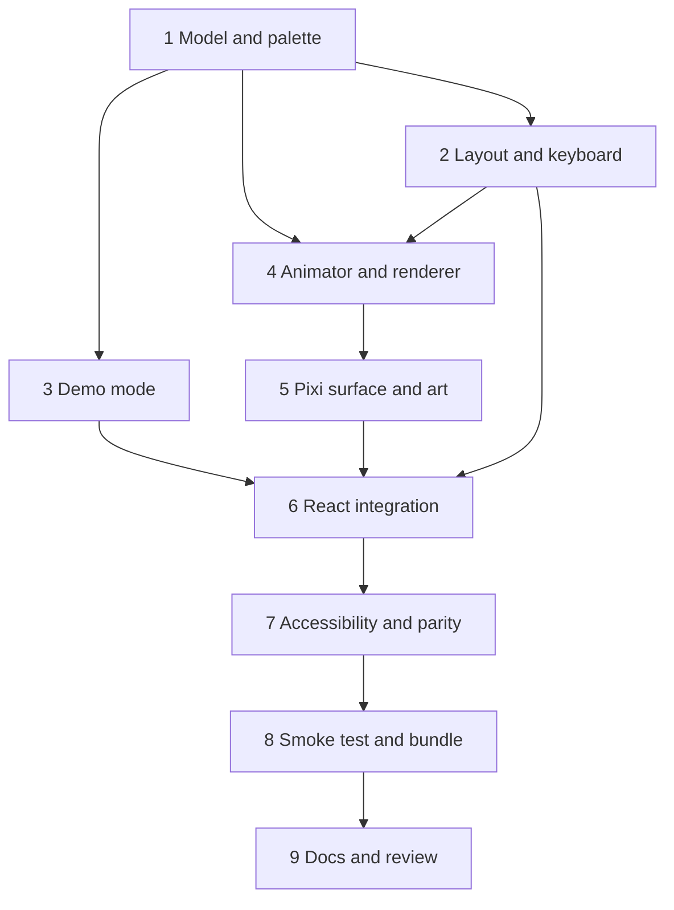

# Implementation Plan: scene-engine

## Overview

Draw the house: a pure scene model and layout, a pure animator, a thin PixiJS surface in a lazy chunk, keyboard and screen reader access, parity with the table, a fallback, a demo mode for the video, and one visual smoke test. It is 9 top-level tasks, sized for two days. Each task ships with its tests. Property tests are their own sub-tasks, marked `*`, and carry the comment `// Feature: scene-engine, Property N`. Unit and property tests run in Vitest without WebGL; only the Playwright smoke test (task 8) needs a browser.

## Tasks

- [ ] 1. Palette, maths and the scene model
  - [ ] 1.1 Add `scene/palette.ts` with the palette tokens, the system `FONT_STACK` and `CONTRAST_PAIRS`; add a test that the tokens that repeat CSS custom properties (`night`, `ring`) match `styles.css`, and that every pair in `CONTRAST_PAIRS` passes 4.5 to 1 for text and 3 to 1 for shapes
    - _Requirements: 8.5, 13.1, 13.4_
  - [ ] 1.2 Add `scene/rng.ts` (`hashString`, `mulberry32`, `unit`) and `scene/math.ts` (`clamp`, `approach`)
    - _Requirements: 3.1, 5.2_
  - [ ] 1.3 Add `scene/particles.ts`: `allocateParticles` (motes, then fog, then ghosts, lowest level first, 188 for rooms plus 12 corridor pulses) and the pure `ghostSpec` and `fogSpec`
    - _Requirements: 3.6, 4.7_
  - [ ] 1.4 Add `scene/model.ts`: `toSceneModel`, `isDark`, `levelLabel`, `HuntVisual`, the formulas of the design, the badge and short badge from `formatReason`, the clock from `now`, the summary text; no PixiJS or DOM import, no `Math.random`, no `Date.now`
    - _Requirements: 3.1, 3.2, 3.3, 3.4, 3.7, 3.8, 3.9, 4.1, 4.2, 4.3, 4.4, 4.5, 4.6, 7.2, 11.1_
  - [ ] 1.5 Unit tests: each formula at its edges (levels 0 to 4, error ratio 0, 0.25, 0.5, 1; p95 200, 1600, 3000; `up` 0, 0.49, 0.5, `null`), the reason fallback when metrics are `null`, motion amplitudes by level, `transitionMs`, `quality: 'low'` halving, allocator order and the 2 by 2 and 9 room cases, `ghostSpec` inside the floor, the summary text, an empty array
    - _Requirements: 3.2, 3.4, 3.6, 3.7, 3.8, 4.4, 4.6, 7.2_
  - [ ]* 1.6 Property test: the model is monotonic (Property 1)
    - _Requirements: 3.4, 3.5, 4.2, 4.3_
  - [ ]* 1.7 Property test: caps hold for any input (Property 2)
    - _Requirements: 3.6, 6.1_
  - [ ]* 1.8 Property test: the model is deterministic (Property 3)
    - _Requirements: 3.1, 3.3, 4.7_
  - [ ]* 1.9 Property test: a dark room is dark (Property 4)
    - _Requirements: 3.7, 4.5_
  - [ ]* 1.10 Property test: reduced motion removes motion and keeps the information (Property 5)
    - _Requirements: 7.2, 7.3_
  - [ ]* 1.11 Property test: transitions never overshoot (Property 9)
    - _Requirements: 5.2_
  - [ ]* 1.12 Property test: the model is total (Property 14)
    - _Requirements: 3.2, 3.8_

- [ ] 2. Layout, corridors and keyboard navigation
  - [ ] 2.1 Add `scene/layout.ts`: the isometric projection, the constants (room 2.0, stride 3.2, wall 1.0, scale at most 160), silhouettes, fit and centre in any viewport from 360 by 360 to 3840 by 2160, `dpr` capped at 2, label and badge sizes of at least 11 px, `compact` below a scale of 26, the aspect for the mount height; no PixiJS or DOM import
    - _Requirements: 2.1, 2.2, 2.5, 2.6, 2.7_
  - [ ] 2.2 Route the corridors along the streets in `SERVICE_NAMES` order (straight for neighbours, through the junction for diagonals), never over a floor, with `lit` from the dimmer Room
    - _Requirements: 2.3, 2.4_
  - [ ] 2.3 Add doors, `hit`, `hitPolygon` and the reserved `huntRect` (inside the floor, clear of the label and badge anchors)
    - _Requirements: 2.2, 11.2_
  - [ ] 2.4 Add `scene/selection.ts`: `nextRoom`, `tabOrder`, `selectionReducer`
    - _Requirements: 8.2, 8.3, 8.4_
  - [ ] 2.5 Unit tests: the numeric clearance of the silhouettes in a 3 by 3 grid (at least 0.179 iso units), the 2 by 2 layout at 360, 1280 and 3840 px, a grid with gaps, a single Room, a diagonal corridor through the junction, compact mode at 360 px with 3 by 3, `nextRoom` on the 2 by 2 grid, the selection reducer
    - _Requirements: 2.1, 2.2, 2.3, 2.6, 8.2, 8.4_
  - [ ]* 2.6 Property test: the layout fits and never overlaps (Property 7)
    - _Requirements: 2.1, 2.2, 2.5, 2.6, 2.7, 11.2_
  - [ ]* 2.7 Property test: corridors follow the call chain through the gaps (Property 8)
    - _Requirements: 2.3, 2.4_
  - [ ]* 2.8 Property test: keyboard navigation stays inside the house (Property 13)
    - _Requirements: 8.2_

- [ ] 3. Demo mode and URL parameters
  - [ ] 3.1 Add `scene/params.ts` with `parseDemoParam` (`1`, the six scenario names, `loop=1`, unknown values ignored, production builds ignore the parameter unless `VITE_DEMO_MODE` is `true`); add `VITE_DEMO_MODE` to `vite-env.d.ts` and the web block of `.env.example`
    - _Requirements: 12.2, 12.3, 12.4, 14.3_
  - [ ] 3.2 Add `scene/demo.ts`: the pure timeline `demoServices(t)` built with `scoreSample` and `stepHaunt` in steps of 1 s, `scenarioServices(name)`, `DEMO_DURATION_MS`, valid `ServiceState` with metrics, reason, incident and fixed `updatedAt`
    - _Requirements: 12.1, 12.2, 12.6_
  - [ ] 3.3 Add `useServicesSource(mode, client)`: live (SSE client) or demo (timeline from a clock, or the frozen scenario); in Demo mode no request goes to the API or the stream; show "Demo data, not live" in the header
    - _Requirements: 12.1, 12.5_
  - [ ] 3.4 Unit tests: every `parseDemoParam` case, timeline milestones (calm at 3 s, payments level 2 after 8 s, level 3 at about 18 s, orders fog, ledger dark at 31 s, calm at 46 s), loop, each scenario validates, no fetch or EventSource in Demo mode, the header text
    - _Requirements: 12.1, 12.2, 12.3, 12.4, 12.5, 12.6_
  - [ ]* 3.5 Property test: the demo timeline is valid and deterministic (Property 12)
    - _Requirements: 12.1, 12.2, 12.6_

- [ ] 4. Animator, governor and renderer lifecycle
  - [ ] 4.1 Add `scene/surface.ts` (the `Surface` interface, `SceneInitError`, the `Frame`, `RoomFrame` and `ParticleBuffer` types)
    - _Requirements: 5.5, 10.1_
  - [ ] 4.2 Add `scene/animator.ts`: exponential transitions of light, fog and ghost opacity, ghosts fading one by one, pooled typed-array particles from `ghostSpec` and `fogSpec`, tremble, seeded flicker with at most 2 Hz of bandwidth, lamp breathing, corridor pulses, dark rooms hiding their particles, reduced motion giving still wisps and fog, the `moving` flag, a step limit of 100 ms, the same Frame object every time
    - _Requirements: 4.1, 4.2, 4.3, 4.4, 4.5, 5.2, 5.3, 5.6, 6.1, 7.3, 7.4, 8.6_
  - [ ] 4.3 Add `scene/governor.ts` (`PerfGovernor`: low after an average above 20 ms for 2 s, full again after an average under 14 ms for 10 s)
    - _Requirements: 6.3_
  - [ ] 4.4 Add `scene/frame-loop.ts` (requestAnimationFrame loop with a 60 fps cap and an injectable clock), `Env` (visibility) and `scene/renderer.ts`: `createSceneRenderer` with start, update, resize, select and an idempotent destroy that stops the loop, runs every unsubscribe, destroys the Surface once and discards a setup that finishes late; pause when hidden and resume without a time jump; render only while moving; stats
    - _Requirements: 5.1, 5.4, 5.5, 5.6, 6.1, 6.2, 6.5, 10.3_
  - [ ] 4.5 Add the test support (`FakeSurface`, `ManualLoop`, `FakeEnv`) and unit tests: transitions reach 95 percent in 1 s, ghosts fade one by one, a dark room draws no particles, level 3 flickers and trembles, reduced motion stills everything, no allocation (same arrays), the governor timings, start, update and destroy order, hidden and visible, context lost and restored, destroy before start finishes, repeated destroy
    - _Requirements: 4.2, 4.3, 4.4, 4.5, 5.2, 5.3, 5.4, 6.2, 6.3, 7.3, 10.3_
  - [ ]* 4.6 Property test: the animator keeps its pools, stays within caps and rests when still (Property 10)
    - _Requirements: 5.2, 5.3, 5.6, 6.1, 6.2, 7.3, 7.4_
  - [ ]* 4.7 Property test: the renderer cleans up after itself (Property 11)
    - _Requirements: 5.1, 5.4, 5.5, 6.2, 10.3_

- [ ] 5. PixiJS surface and the art
  - [ ] 5.1 Add `pixi.js` 8.23.0 (exact) to `apps/web`; add `scene/pixi-surface.ts`, the only importer of `pixi.js`: `Application` with `autoStart: false`, no shared ticker, `preference: 'webgl'`, resolution capped at 2, resize, context lost and restored events, idempotent destroy that releases textures and the application; a failed init rejects with `SceneInitError`
    - _Requirements: 1.1, 1.4, 5.4, 10.1, 10.3_
  - [ ] 5.2 Add `scene/textures.ts`: the procedural recipes and the one-time generation of 5 textures (ghost wisp, fog puff, mote, warm glow, ring), none from files
    - _Requirements: 6.4, 13.2_
  - [ ] 5.3 Draw the static art with `scene/shapes.ts` (pure polygon and path builders, unit tested) and the Surface: night background and stars, rooms (floor, back walls, lamp, clock, furniture), corridors, outlines, label and badge pills with text, incident mark (triangle and "incident"), the empty hunt container given its rectangle and `hunt`, redrawn only when the layout or the model texts change
    - _Requirements: 2.1, 4.1, 4.6, 11.3, 13.2, 13.3, 13.4_
  - [ ] 5.4 Draw each Frame: glow and dim per room, flicker and shake, selection ring, four particle containers filled from the buffers, nothing drawn in dark rooms except outline, label and badge; low quality sets resolution 1 and drops filters
    - _Requirements: 4.1, 4.2, 4.3, 4.4, 4.5, 6.1, 6.3, 6.4, 8.6_
  - [ ] 5.5 Unit tests for `shapes.ts` (polygons inside the silhouette, huntRect clear of the label), the asset audit (no image, SVG, font or sound import, no `new Image`, only `pixi-surface.ts` imports `pixi.js`), and `pnpm typecheck` and `pnpm lint` on the surface; the drawing itself is covered by the smoke test of task 8
    - _Requirements: 1.1, 6.4, 11.2, 13.2_

- [ ] 6. React integration, lazy loading and fallback
  - [ ] 6.1 Rewrite `SceneMount`: the section `#scene-mount`, a static placeholder with the summary while the chunk loads and a fixed height from the layout aspect, `React.lazy` for `SceneCanvas`, an error boundary, and `SceneFallback` (a `role="status"` message); the mount is never empty
    - _Requirements: 1.2, 1.3, 10.1, 10.2, 10.4_
  - [ ] 6.2 Add `scene/SceneCanvas.tsx` (default export of the lazy chunk): a `ResizeObserver` coalesced per animation frame, `computeLayout`, the renderer with the Pixi surface and the rAF loop, `update` on every model, `role="img"` and an `aria-label` equal to the summary, destroy on unmount
    - _Requirements: 1.2, 2.5, 5.1, 8.1_
  - [ ] 6.3 Add `usePrefersReducedMotion` (matchMedia, reacts to changes), `useNow(60_000)` and the `quality` state fed by the renderer; wire `App`: the model from `toSceneModel(services, now, { reducedMotion, quality })`, the selection with `selectionReducer`, the props of `SceneMount` and `TableMode`
    - _Requirements: 6.3, 7.1, 7.2_
  - [ ] 6.4 Handle context lost and restored in `SceneMount` (message at once, one setup again on restore, the message removed), and a failed `import()` or `SceneInitError` (message, canvas and buttons removed, table untouched)
    - _Requirements: 10.1, 10.2, 10.3, 10.4_
  - [ ] 6.5 Component tests with Testing Library and an injected fake renderer: placeholder text before the chunk, canvas label equals the summary, fallback after a rejected import and after a `SceneInitError`, the mount is never empty, context lost then restored, reduced motion change, unmount destroys once
    - _Requirements: 1.3, 7.1, 8.1, 10.1, 10.2, 10.3, 10.4_

- [ ] 7. Accessibility, selection sync and parity
  - [ ] 7.1 Add `RoomButtons`: one button per Room in reading order with the label of the Room visual, shaped by `hitPolygon` with `clip-path`, Tab in room order, arrow keys with `nextRoom`, Home and End, Enter or Space to select, Escape to clear, visible focus
    - _Requirements: 8.2, 8.3, 8.4_
  - [ ] 7.2 Update `TableMode`: the service name as a button that selects, the selected row with `aria-current`, a leading "▶" marker and a heavier border, scrolled into view when the Scene selects, the Haunt level cell from `levelCellText` ("4 (dark)", or "2 (haunted), room dark" when only `isDark` is true); the reason cell keeps `formatReason`
    - _Requirements: 8.3, 9.1, 9.3_
  - [ ] 7.3 Make the Scene and the table share `isDark`, `levelLabel` and `formatReason`, and keep every scene file under `apps/web/src/scene/` so that the `scene-table-parity` hook keeps matching
    - _Requirements: 9.1, 9.4_
  - [ ] 7.4 Unit and component tests: focus order and labels, arrow keys, Home and End, Enter and Space, Escape clears both views, clicking a Room selects the row and clicking a row selects the Room (ring in the Frame), the selected row cues, "dark" text for `up` equal to 0 at level 2, no second live region, flicker rate of the animator under 3 brightness changes per second over 10 s of simulated time, every Palette pair used for text above 4.5 to 1
    - _Requirements: 8.1, 8.2, 8.3, 8.4, 8.5, 8.6, 9.3_
  - [ ]* 7.5 Property test: the model and the table agree (Property 6)
    - _Requirements: 9.1, 9.2, 9.3_

- [ ] 8. Smoke test, bundle check and measurements
  - [ ] 8.1 Add `@playwright/test` 1.65.0 (exact) to `apps/web`, `playwright.config.ts` (Vite web server on port 4173, Chromium with software WebGL flags, output in `apps/web/test-results/`), the script `test:e2e`, and the git-ignore entries `apps/web/test-results/` and `apps/web/playwright-report/`
    - _Requirements: 1.4, 14.2_
  - [ ] 8.2 Write `e2e/scene.spec.ts`: open `?demo=payments-haunted` and `?demo=ledger-dark`, save screenshots, assert the canvas is not blank (distinct colours and share of pixels that differ from the background) and the table shows `2 (haunted)` with `error rate` and `4 (dark)` with `service down`; skip with a visible message when Chromium is not installed
    - _Requirements: 14.2_
  - [ ] 8.3 Write `scripts/check-scene-bundle.mjs` (reads the Vite manifest, gzips the entry and scene chunks, fails when PixiJS code is in the entry chunk or a budget is exceeded), enable the manifest in the Vite build, build, and record the measured gzip sizes in the Bundle budget table of `design.md` and in the Notes; set each budget to the measured value plus 15 percent
    - _Requirements: 1.2, 1.5_
  - [ ] 8.4 Publish the renderer stats on `window.__hauntedScene` in Demo mode only and have the smoke test record the average frame time and the particle count in the report
    - _Requirements: 6.5, 6.1_
  - [ ] 8.5 Unit tests for the helpers of the bundle script (manifest reading, gzip size, the PixiJS marker check) with fixtures
    - _Requirements: 1.5_

- [ ] 9. Documents, visual review and verification
  - [ ] 9.1 Update `docs/DEV.md`: the demo URLs and scenarios, `VITE_DEMO_MODE`, installing Chromium for Playwright, running the smoke test and the bundle check, the manual visual checklist; confirm `.env.example` lists `VITE_DEMO_MODE` with no real value
    - _Requirements: 14.3_
  - [ ] 9.2 Run the visual review: the six scenarios at 360, 1280 and 3840 px wide, reduced motion on and off, keyboard only, the fallback (WebGL disabled); fix what reads badly; record any GPU frame time seen on a real laptop in the Notes
    - _Requirements: 4.1, 4.2, 4.3, 4.4, 4.5, 7.3, 10.1, 13.3_
  - [ ] 9.3 Verification: `pnpm typecheck`, `pnpm lint`, `pnpm test`, `pnpm build`, `pnpm check:build`, the bundle check, and the smoke test; scan the diff for secrets, home paths, image or font files, and the names of existing works; record the counts in the Notes
    - _Requirements: 13.2, 13.3, 14.1, 14.4_

## Task Dependency Graph



```json
{
  "waves": [
    { "id": 0, "tasks": ["1"] },
    { "id": 1, "tasks": ["2", "3"] },
    { "id": 2, "tasks": ["4"] },
    { "id": 3, "tasks": ["5"] },
    { "id": 4, "tasks": ["6"] },
    { "id": 5, "tasks": ["7"] },
    { "id": 6, "tasks": ["8"] },
    { "id": 7, "tasks": ["9"] }
  ]
}
```

## Notes

- Sub-tasks marked `*` are property-based tests. They are required for this spec: every correctness property has one.
- Properties 1 to 14 need no WebGL and no database. The Playwright smoke test and the bundle check are not part of `pnpm test`; they run with `pnpm --filter @haunted-ops/web test:e2e` and `node scripts/check-scene-bundle.mjs` after a build.
- New packages: `pixi.js` 8.23.0 and `@playwright/test` 1.65.0, both exact, checked against the registry on 13 Nov 2026. Playwright downloads Chromium with `pnpm exec playwright install chromium`; that download is not part of `pnpm install`.
- Only `scene/pixi-surface.ts` imports `pixi.js`. Everything else, including the renderer logic, runs against the `Surface` interface, so a PixiJS API detail never blocks a test.
- The layout constants (room 2.0, stride 3.2, wall 1.0) come from a separating-axis check on a 3 by 3 grid with a clearance of 0.179 iso units. If the art changes the wall height or the room size, redo the check; Property 7 will fail if the clearance is lost.
- The entry chunk was 73,258 bytes gzip before this spec. The scene chunk size is an estimate until task 8.3 records the measurement.
- The existing hook `.kiro/hooks/scene-table-parity.json` matches `apps/web/src/scene/.*`; keep all scene sources there.
- The monotonic Property 1 is checked up to 6 rooms because the total cap can trim a room when another room gets worse in a house of more than 5 rooms.
- Out of scope: hunts and the evidence UI (`exorcist-agent`), fix pull requests (`fix-proposal-flow`), sound (`spatial-audio`), the deploy.
