# Implementation Plan: visual-refresh
## Overview
Make the page around the Scene modern and easy to read, in the look "a lantern in a dark house": design tokens, a two-column layout with a side Panel, a header with a short explanation, a Summary bar, the Hunt as a Timeline, a Legend, a table that becomes cards on a phone, restyled replay pages, and the document head. It is 11 top-level tasks in part 1 and tasks 12 to 17 in part 2 (the Scene and four fixes of the page), tasks 18 to 24 in part 3 and tasks 25 to 33 in part 4 (the illustrated sprites) and tasks 34 to 41 in part 5 (the polish of the sprite scene) and tasks 42 to 48 in part 6 (three polish fixes: tint, mint glow, Hunt marks on a phone) and tasks 49 to 61 in part 7 (calmer chips, a mint hunt badge, a real moon, floor marks that mean something, and sound cues with a mute button). Property tests are their own sub-tasks, marked `*`, and carry the comment `// Feature: visual-refresh, Property N`. Tasks 1 to 11 touch `apps/web/src/scene/` only in the `bg` and `focus` values of `palette.ts`; tasks 12 to 17 are the PixiJS scene. Nothing here touches the API, a server, GitHub or the real `kiro-cli`, and no test makes a network call.
## Tasks
- [x] 1. Design tokens and contrast
  - [x] 1.1 Replace the colours of `:root` in `apps/web/src/styles.css` with the new tokens and add the type, scale, spacing, radius and shadow tokens; every colour outside `:root` stays a custom property
    - _Requirements: 1.1, 1.2, 1.3_
  - [x] 1.2 Change only `bg` (and `focus` if it changed) in `apps/web/src/scene/palette.ts` so `model.test.ts` still holds
    - _Requirements: 1.4_
  - [x] 1.3 Update `CONTRAST_PAIRS` and the CSS pairs in `a11y/contrast.test.ts` for every new text and background pair and the focus ring; adjust the lightness of any failing token and record the ratios under "Contrast results" in the design
    - _Requirements: 1.5, 1.6, 10.4_
  - [x]* 1.4 Property test: every contrast pair passes its threshold (Property 1)
    - _Requirements: 1.1, 1.4, 1.5, 1.6_
- [x] 2. Layout and header
  - [x] 2.1 Add the Icon module `apps/web/src/components/icons.tsx` (inline SVG paths, `aria-hidden`, a neutral fallback)
    - _Requirements: 4.2, 4.7, 9.2_
  - [x] 2.2 Restyle `Header.tsx` (name in `--font-display`, the explanation line, the connection pill, the quiet mode switch); the Skip link and the switch keep their order
    - _Requirements: 2.5, 2.6_
  - [x] 2.3 Add the two-column grid in `App.tsx` and `styles.css` (Scene or table on the left, `<aside aria-label="Incident">` 360 px on the right at 64rem, one column below), with no horizontal overflow
    - _Requirements: 2.1, 2.2, 2.3, 2.4_
- [x] 3. Summary bar
  - [x] 3.1 Add the pure `summarize` (`summary.ts`) and `SummaryBar.tsx`: counts worst first with level marks, the Hunt state from `HuntSummary`, no live region; first block of the Panel and before the table in Accessible mode
    - _Requirements: 3.1, 3.3, 3.4, 3.5_
  - [x] 3.2 Unit and component tests: the count text, levels with no service omitted, each Hunt state, no hunt, no "of", not a live region
    - _Requirements: 3.1, 3.3, 3.4_
  - [x]* 3.3 Property test: the summary counts add up and match the levels (Property 2)
    - _Requirements: 3.1, 3.2_
- [x] 4. Panel and hunt
  - [x] 4.1 Restyle `HuntSection.tsx`: the Timeline with a tool icon, time and summary for each step, the diagnosis card (culprit, summary, "AI generated"), the compact evidence list, the Proposal card with a status pill and the button-styled pull request link
    - _Requirements: 4.1, 4.2, 4.3, 4.4, 4.5, 4.7_
  - [x] 4.2 Add the empty state of one sentence when there is no Hunt
    - _Requirements: 4.6_
  - [x] 4.3 Component tests: one Timeline item per step, icons `aria-hidden`, the diagnosis card, the Proposal pill and link, the empty state
    - _Requirements: 4.2, 4.3, 4.5, 4.6, 4.7, 10.2_
- [x] 5. Table and cards
  - [x] 5.1 Restyle `TableMode.tsx` (sticky header, row hover and focus, right-aligned `--font-num` numbers, the level as a pill with mark and word) and add `data-label` and explicit roles to the cells; DOM, columns and focus order unchanged
    - _Requirements: 5.1, 5.2, 5.3, 5.5_
  - [x] 5.2 Add the card mode below 40rem in CSS only, with no sideways scroll
    - _Requirements: 5.4_
  - [x] 5.3 Component test: `data-label` equals each column header and the table roles stay present in card mode
    - _Requirements: 5.3, 5.5, 10.2_
  - [x]* 5.4 Property test: every cell is labelled by its column and keeps its role (Property 4)
    - _Requirements: 5.1, 5.3, 5.5_
- [x] 6. Legend
  - [x] 6.1 Add `legend-state.ts` (`readLegendOpen`, `writeLegendOpen`, a throwing storage ignored) and `Legend.tsx` (`<details>` "What am I looking at?", the rows, original inline SVG glyphs, the five levels with their marks); place it in the Panel
    - _Requirements: 6.1, 6.2, 6.3, 6.4_
  - [x] 6.2 Component tests: open on a first visit, the stored choice is kept, a throwing storage, every row and level present
    - _Requirements: 6.2, 6.3, 10.2_
  - [x]* 6.3 Property test: the Legend remembers its state (Property 3)
    - _Requirements: 6.2_
- [x] 7. Motion
  - [x] 7.1 Add the hover, focus and open transitions (under 200 ms) and the one soft pulse on the "Hunt running" pill; turn all off under `prefers-reduced-motion` and in Accessible mode (extend `styles.css:187-198`); add a style test for both rules
    - _Requirements: 7.1, 7.2_
- [x] 8. Replay pages and document
  - [x] 8.1 Restyle `ReplayApp.tsx`: the list as cards (title, scenario pill, date, duration) and the empty state with a link back to live; keep the banner
    - _Requirements: 8.1, 8.2, 8.4_
  - [x] 8.2 Restyle `ReplayControls.tsx` as one toolbar with icon and text buttons and a styled range input; the button names do not change
    - _Requirements: 8.3, 8.5_
  - [x] 8.3 Add the description, `theme-color` `#0B0A12` and the inline SVG favicon to `apps/web/index.html`
    - _Requirements: 8.6_
- [x] 9. Budget
  - [x] 9.1 Build the web app, run `node scripts/check-scene-bundle.mjs` once, and raise `BUDGETS.entry` to 94 KiB at most only if the measured entry needs it; write the measured entry and replay numbers and the reason in the script comment and under "Budget record" in the design
    - _Requirements: 9.1, 9.2, 8.5_
- [x] 10. Update and add tests
  - [x] 10.1 Update the unit and component tests that the layout breaks, by changing selectors only: `App.test.tsx`, `table.test.tsx`, `focus.test.tsx`, `hunt.test.tsx`, `accessible-mode.test.tsx`, `replay.test.tsx`, `a11y.test.tsx`; keep the Accessible mode rules (one live region, focus order, Escape, parity, `?mode=accessible`, no Scene)
    - _Requirements: 9.3, 10.1_
  - [x] 10.2 Update the end-to-end tests `accessible.spec.ts`, `replay.spec.ts`, `no-webgl.spec.ts` and `scene.spec.ts` by changing selectors only
    - _Requirements: 9.3, 10.1_
  - [x] 10.3 Add `apps/web/e2e/layout.spec.ts`: `scrollWidth <= 390` at 390×844 on `/?demo=1`, `/?mode=accessible&demo=1` and `/replays`; the Panel beside the Scene at 1440×900
    - _Requirements: 2.1, 2.4, 10.3_
  - [x] 10.4 Extend `e2e/gallery.spec.ts` with screenshots only if it is cheap
    - _Requirements: 10.5_
  - [x] 10.5 Run `pnpm typecheck`, `pnpm lint` and only the test files created or changed (the full suite is the orchestrator's)
    - _Requirements: 10.6_
- [x] 11. Steering and records
  - [x] 11.1 Add the tokens and the contrast rule to `.kiro/steering/a11y-perf.md`; in `.kiro/steering/structure.md` insert `10. visual-refresh` and renumber `spatial-audio` to 11 and `submission-kit` to 12; add one README sentence on the Legend if useful
    - _Requirements: 11.1, 11.2_
  - [x] 11.2 Add one `2026-11-16 | visual-refresh/N | …` line per finished task to `docs/KIRO_USAGE.md` (the file ends with a newline); delete helper files; run the spec validator
    - _Requirements: 11.3, 11.4, 11.5_
- [x] 12. Level to look
  - [x] 12.1 Add the table `LEVEL_LOOK`, `lookOf` and `ghostFloor` to `apps/web/src/scene/model.ts`; `RoomVisual` gets `look` and `mist`; `light` is the glow of the look; no ghost when calm, a floor of ghosts for possessed; no dust in Low quality; add the scene colours to `palette.ts` (`danger`, `ecto`, `fog` cyan, `moon`, `floorFar`, `wallInner`) and their contrast pairs
    - _Requirements: 12.1, 12.2, 12.3, 12.5, 12.6_
  - [x] 12.2 Update `model.test.ts` and `model.property.test.ts` to the new rule and add unit tests of the table, the mist and the dust
    - _Requirements: 12.1, 12.2, 12.5, 17.2_
  - [x]* 12.3 Property test: the light follows the trouble (Property 5)
    - _Requirements: 12.1, 12.2, 12.6_
  - [x] 12.4 Add to the Animator and the Frame the tint, the cold edge, the danger outline, the mist, the glow pulse (`glowPulse`, one cycle of 2 s, one start per second at most) and the new surface drawing of the levels in `pixi-surface.ts`
    - _Requirements: 12.1, 12.4, 12.5_
  - [x] 12.5 Unit tests of the pulse (one cycle, at most one change of direction per second, none at first sight, for a fall, a dark room, Low quality or Reduced motion) and of the frame of each level
    - _Requirements: 12.4, 17.2_
- [x] 13. Drawing upgrades
  - [x] 13.1 Draw the ghost silhouette and three noise textures once in `textures.ts`
    - _Requirements: 13.1, 13.3, 13.6_
  - [x] 13.2 Ghost motion: golden-ratio spread in `particles.ts`, sine sway and eased fade in the Animator
    - _Requirements: 13.1, 13.2_
  - [x] 13.3 Fog layers: three drifting noise sprites per room, at different speeds, inside the floor
    - _Requirements: 13.3, 12.3_
  - [x] 13.4 Sky: horizon bands, far stars, near stars and the moon, with the parallax of the focused room; the roof on its own layer that fades while a room is focused
    - _Requirements: 13.4, 14.1_
  - [x] 13.5 Rooms: floor gradient, inner wall panels and one icon per service on the back wall (`shapes.ts`, `pixi-surface.ts`)
    - _Requirements: 14.1, 14.2_
  - [x] 13.6 Labels: the room name at 14 px or more under 640 px, the row boxes keep the 11 px rule (`layout.ts`)
    - _Requirements: 14.3_
  - [x] 13.7 Low quality and Reduced motion: parallax, fog layers beyond the first, dust and pulse off; static ghosts, fog and mist; every level look stays
    - _Requirements: 15.1, 15.2_
  - [x]* 13.8 Property test: reduced motion freezes every animated offset (Property 6)
    - _Requirements: 15.2, 15.3_
  - [x] 13.9 Update `layout.test.ts`, `animator.test.ts`, `pixi-surface.test.ts` and `art.test.ts` to the new rules and add the art tests (floor detail, icons, roof split, star layers)
    - _Requirements: 13.1, 14.1, 14.2, 14.3, 17.2_
- [x] 14. Four fixes of the page
  - [x] 14.1 Panel: `huntSectionService` also picks the service of the most recently finished Hunt (`latestFinishedService`), the Summary bar uses the same one; say "Diagnosed. The steps and evidence are shown in live mode." for a diagnosed Hunt with no steps and no API; tests of both
    - _Requirements: 16.1_
  - [x] 14.2 Level pill tokens `--level-calm` to `--level-dark` in `styles.css`; the calm pill does not use `--lantern`; contrast pairs and a style test in `contrast.test.ts`
    - _Requirements: 16.2_
  - [x] 14.3 Desktop table: `table-layout: fixed` with explicit column widths and tabular numbers; `layout.spec.ts` asserts equal header widths at t=0 and t=20 s at 1440 and 1024 px
    - _Requirements: 16.3_
  - [x] 14.4 Mobile order under 64rem by CSS `order`; `layout.spec.ts` asserts the visual order at 390×844
    - _Requirements: 16.4_
- [x] 15. Budget
  - [x] 15.1 Build the web app, run `node scripts/check-scene-bundle.mjs` once and write the measured numbers under "Budget record, part 2" in the design; add no import to `apps/web/src/scene/hooks.ts`
    - _Requirements: 17.1_
- [x] 16. Checks of part 2
  - [x] 16.1 Run `pnpm typecheck`, `pnpm lint` and only the test files created or changed (the full suite and the end-to-end run are the orchestrator's)
    - _Requirements: 17.3_
- [x] 17. Steering and records of part 2
  - [x] 17.1 Update `.kiro/steering/scene-rendering.md` with the level to look table and the new layers; add one `2026-11-17 | visual-refresh/N | …` line per finished task to `docs/KIRO_USAGE.md` (the file ends with a newline); run the spec validator
    - _Requirements: 17.4, 17.5_
- [x] 18. One chip per room
  - [x] 18.1 Layout: replace the label, badge and incident boxes with `chipAt`, `chipBox`, `chipBand` and `chipReserve` (one chip under the room, top in the bottom 20 %, the rest below the front corner, the fit keeps the overhang inside the canvas); the Exorcist figure stands above the chip
    - _Requirements: 18.3, 18.4, 18.6_
  - [x] 18.2 Drawing: `chipLayout` in `shapes.ts` in place of `plaqueLayout`; `pixi-surface.ts` draws one pill with the level mark and name and a `!` in `--danger` while an incident is open, and no badge or incident word; `levelMark` in the model and the contrast pair of the `!`
    - _Requirements: 18.1, 18.2_
  - [x]* 18.3 Property test: one chip per room, in the band under it, no two overlap, for any room set and width from 320 to 1920 (Property 7)
    - _Requirements: 18.1, 18.3, 18.4, 18.5_
  - [x] 18.4 Update `layout.test.ts`, `layout.property.test.ts` (rectGap and Property 15), `art.test.ts`, `hunt-scene.test.ts` and `animator.test.ts` to the single chip
    - _Requirements: 18.5, 18.6, 22.2_
- [x] 19. Ghosts as separate silhouettes
  - [x] 19.1 `particles.ts`: ghost sites on a hex lattice inside the band 0.25 to 0.8, seeded order, size 0.5 to 0.8, small drift, `ghostMinDistance` and `ghostDistance`; remove `GHOST_BACK_LIMIT`
    - _Requirements: 19.1, 19.3_
  - [x] 19.2 Ghost alpha at most 0.7 in the model, and a ghost texture with a cold body, a dark outline and deeper eye holes
    - _Requirements: 19.3, 19.4, 19.5_
  - [x]* 19.3 Property test: ghosts keep their distance and stay in the room for any seed and level (Property 8)
    - _Requirements: 19.1, 19.2, 19.3_
  - [x] 19.4 Update `model.test.ts`, `model.property.test.ts` and `animator.test.ts` to the new opacity and band
    - _Requirements: 22.2_
- [x] 20. The hunt mist can be seen
  - [x] 20.1 Write the failing test first in `pixi-surface.test.ts` (mist visible, ecto tint, alpha 0.6 or more, above the floor and the glow, at least 60 % of the room width) and run it: it fails on alpha 0.5
    - _Requirements: 20.1, 20.2_
  - [x] 20.2 Fix the cause: a dense `fog` puff for the first mist sprite, alphas 0.92 and 0.78, a slow breath of 4 s (`mistBreath`) with a swing of 0.12, Low quality with one layer; write the cause in the design
    - _Requirements: 20.2, 20.3, 20.4, 20.5_
  - [x] 20.3 Tests of the breath (cycle, swing, floor of 0.6), Reduced motion (still and visible), Low quality (one layer) and `mistBreath` zero in Property 6
    - _Requirements: 20.3, 20.4, 22.2_
- [x] 21. The Incident column of the table
  - [x] 21.1 `styles.css`: widths 6.5, 9.5, 7, 5.5, 4.5, 3.5, 10, 9.5, 6 rem, `min-width: 62rem` with the total in a comment, `overflow-wrap: break-word`
    - _Requirements: 21.1, 21.2, 21.4_
  - [x] 21.2 `layout.spec.ts`: at 1440×900 and demo second 20, every Incident cell is at most two lines high; the stable-width and no-clip tests keep passing at 1440 and 1024
    - _Requirements: 21.3_
- [x] 22. Budget
  - [x] 22.1 Build the web app, run `node scripts/check-scene-bundle.mjs` once and write the measured numbers under "Budget record, part 3" in the design; add no import to `apps/web/src/scene/hooks.ts`
    - _Requirements: 22.1_
- [x] 23. Checks of part 3
  - [x] 23.1 Run `pnpm typecheck`, `pnpm lint`, only the test files created or changed, `e2e/layout.spec.ts` once and the spec validator (the full suite and the whole end-to-end run are the orchestrator's)
    - _Requirements: 22.3_
- [x] 24. Steering and records of part 3
  - [x] 24.1 Update `.kiro/steering/scene-rendering.md` with the chip rule and the ghost spacing rule (two lines); add one `2026-11-17 | visual-refresh/N | …` line per finished task to `docs/KIRO_USAGE.md` (the file ends with a newline)
    - _Requirements: 22.4, 22.5_
- [x] 25. Load the sprites, with the procedural art as the fallback
  - [x] 25.1 `apps/web/src/scene/sprites.ts`: the manifest of the ten `/scene/` paths, the room fit constants, the service to room map, `roomSpriteFit`, `spriteSilhouette`, `spriteBrightness`, `loadSprites` (parallel `Assets.load`, 8 s timeout, `null` on any error, timeout or non-image) and `unloadSprites`
    - _Requirements: 23.1, 23.2, 23.3, 24.1_
  - [x] 25.2 `PixiSurface.init`: start `loadSprites` with the renderer only when WebGL is there, await it before the textures, skip the procedural ghost texture with sprites, `null` keeps today's art; `destroy` unloads the files
    - _Requirements: 23.4, 23.5_
- [x] 26. The rooms are illustrated
  - [x] 26.1 `buildRoom`: one `Sprite` at the fitted place with no procedural body, rug, icon or clock; no roof over sprite rooms; outlines follow the picture's hexagon; the danger tint covers the floor only; a room without a sprite keeps the procedural room
    - _Requirements: 23.4, 24.1, 24.2, 24.3, 24.4_
- [x] 27. The level look on the pictures
  - [x] 27.1 `drawRoom`: tint the sprite with the grey of `spriteBrightness(light, dim)`, no filters, a lower lamp glow over a picture, mist, fog and outlines unchanged
    - _Requirements: 25.1, 25.2, 25.3, 27.1, 27.2_
  - [x]* 27.2 Property test: the brightness is non-decreasing from calm to possessed and the dark room is the darkest (Property 9)
    - _Requirements: 25.2, 25.4_
- [x] 28. Ghosts, fog and the Exorcist as sprites
  - [x] 28.1 `ghostKind` and `GHOST_KIND_MAX` in `particles.ts`, a `kind` array in the buffers, the animator writes it, one pool per ghost sprite with the existing caps
    - _Requirements: 26.1, 26.5_
  - [x]* 28.2 Property test: the ghost pools never pass the per-room, per-pool and total caps (Property 10)
    - _Requirements: 26.1, 26.2_
  - [x] 28.3 Fog wisps from `fog-wisp.webp` tinted `#7FD4E6`; the Exorcist `Sprite` (walk, scan, mirrored, lantern glow over the picture's lantern)
    - _Requirements: 26.3, 26.4, 26.5_
- [x] 29. Asset budget and release
  - [x] 29.1 `scripts/check-scene-bundle.mjs`: each `dist/scene/*.webp` at most 80 KiB, all at most 400 KiB, the total printed, a missing manifest file fails; a script test; record the finding on `deploy/build-release.sh` (it ships `dist/scene/` whole; no change needed) and on `check:build`
    - _Requirements: 28.1, 28.2_
- [x] 30. Update and add tests
  - [x] 30.1 `art.test.ts`: `Assets.load` and `/scene/` paths only in `sprites.ts`, every path in the manifest and under `/scene/`, the other bans for every file; `pixi.js` imported by `pixi-surface.ts` and `sprites.ts` only
    - _Requirements: 29.1_
  - [x] 30.2 `pixi-surface.test.ts` (the `Assets` mock, texture counts for both paths, no procedural body or roof with sprites, ghost pools within the caps, the figure picture) and the new `sprites.test.ts`
    - _Requirements: 29.2, 29.3_
  - [x] 30.3 `scene.spec.ts` (ten files, 200 and `image/webp`, no console error, the fallback case), `no-webgl.spec.ts` and `accessible.spec.ts` (no `/scene/*.webp` request)
    - _Requirements: 29.4_
- [x] 31. Budget
  - [x] 31.1 Build the web app, run `node scripts/check-scene-bundle.mjs` once and write the measured numbers in the design ("Measured (build of part 4)"); add no import to `apps/web/src/scene/hooks.ts`
    - _Requirements: 28.1_
- [x] 32. Checks of part 4
  - [x] 32.1 Run `pnpm typecheck`, `pnpm lint`, only the test files created or changed, `e2e/scene.spec.ts` once, the build with the bundle check once and the spec validator (the full suite and the whole end-to-end run are the orchestrator's)
    - _Requirements: 29.3, 30.4_
- [x] 33. Steering, README and records of part 4
  - [x] 33.1 Replace the procedural-only rule in `.kiro/steering/scene-rendering.md`, `tech.md` and `security.md`, add the "Art" section to the README, and add one `2026-11-17 | visual-refresh/N | …` line per finished task to `docs/KIRO_USAGE.md` (the file ends with a newline)
    - _Requirements: 30.1, 30.2, 30.3, 30.4_
- [x] 34. Room size
  - [x] 34.1 `ROOM_SPRITE_SCALE` in `sprites.ts` (largest value at most 0.9 that clears the front corner of the room behind; 0.82), applied in `roomSpriteFit` on the front corner; record the value in the design
    - _Requirements: 31.1, 31.2_
- [x] 35. Procedural leftovers
  - [x] 35.1 Hunt marks, rings and a dark pill only while the room has a hunt; the attic window, the back walls and their corner line only without sprites; list the checked decorations in the design
    - _Requirements: 32.1, 32.2, 32.3_
- [x] 36. Calm darker
  - [x] 36.1 New `spriteBrightness` (calm at most 0.40, haunted at least 0.80, possessed 1, dark under 0.05)
    - _Requirements: 33.1, 33.2_
  - [x]* 36.2 Property test: Property 9 with the new bounds
    - _Requirements: 33.1_
- [x] 37. The Exorcist can be seen
  - [x] 37.1 `FIGURE_H_SPRITE` 1.15 (28 px at least under 40rem), a `figures` layer above the ghost pools and below the chips, a static mint glow behind the figure
    - _Requirements: 34.1, 34.3_
  - [x]* 37.2 Property test: the figure is above every pool and below the chips (Property 11)
    - _Requirements: 34.2_
- [x] 38. Update and add tests
  - [x] 38.1 Update `sprites.test.ts`, `sprites.property.test.ts` and `pixi-surface.test.ts` to the new rules; add the demo-layout geometry, the marks and pill, and the figure height tests
    - _Requirements: 35.1_
- [x] 39. Budget
  - [x] 39.1 Build, run `node scripts/check-scene-bundle.mjs` once and write the numbers in the design ("Measured (build of part 5)"); the scene chunk stays at most 180 KiB
    - _Requirements: 35.2_
- [x] 40. Checks of part 5
  - [x] 40.1 Run `pnpm typecheck`, `pnpm lint`, the changed test files, `e2e/scene.spec.ts` and `e2e/layout.spec.ts` once, the build with the bundle check once and the spec validator
    - _Requirements: 35.1, 35.2, 35.3_
- [x] 41. Records of part 5
  - [x] 41.1 One `2026-11-17 | visual-refresh/N | …` line per finished task in `docs/KIRO_USAGE.md` (the file ends with a newline)
    - _Requirements: 35.3_
- [x] 42. The trouble tint on the sprite floor
  - [x] 42.1 Add the pure `spriteFloor(fit)` in `sprites.ts` (left, back, right, front) and its unit tests
    - _Requirements: 36.1_
  - [x] 42.2 Draw the tint of a sprite room on `spriteFloor(fit)` and scale its lamp glow by `ROOM_SPRITE_SCALE`; the fallback keeps its shape
    - _Requirements: 36.2, 36.3_
  - [x]* 42.3 Property test: every tint point lies inside the sprite silhouette (Property 12)
    - _Requirements: 36.1, 36.2_
- [x] 43. The Exorcist's mint glow
  - [x] 43.1 Add `HuntFrame.figureGlow`, `FIGURE_GLOW_REST` and `FIGURE_GLOW_MS`; the animator breathes it between 0.7 and 0.9 over 3 s and fixes it at 0.85 under Reduced motion and in Low quality
    - _Requirements: 37.2_
  - [x] 43.2 Draw the glow `h·1.6` by `h·1.8`, at least 40 px tall under 40rem, alpha from the frame; update the glow alpha test and add the size, 40 px and breathing tests
    - _Requirements: 37.1, 37.3, 39.1_
- [x] 44. The Hunt marks on a phone
  - [x] 44.1 Add the pure `huntMarkStyle` in `shapes.ts` (scene chunk only; dots of 4 px with a 2 px gap, else the "Hunt · n steps" pill at 14 px) and draw it in `pixi-surface.ts`, slot unchanged, desktop dots unchanged; record the choice in the design
    - _Requirements: 38.1, 38.2, 38.3_
  - [x] 44.2 Tests: the narrow dots or pill at 320, 364, 390 and 639 px, no overlap with the chip, desktop dots, the pill text at 390 px
    - _Requirements: 38.1, 38.2, 39.1_
- [x] 45. Steering
  - [x] 45.1 One line each in `.kiro/steering/scene-rendering.md` for the tint-on-sprite-floor rule and the narrow Hunt marks rule
    - _Requirements: 39.3_
- [x] 46. Budget of part 6
  - [x] 46.1 Build, run `node scripts/check-scene-bundle.mjs` once and write the numbers in the design ("Measured (build of part 6)")
    - _Requirements: 39.2_
- [x] 47. Checks of part 6
  - [x] 47.1 Run `pnpm typecheck`, `pnpm lint`, the changed test files, `e2e/scene.spec.ts` and `e2e/layout.spec.ts` once, the build with the bundle check once and the spec validator
    - _Requirements: 39.1, 39.2, 39.3_
- [x] 48. Records of part 6
  - [x] 48.1 One `2026-11-17 | visual-refresh/N | …` line per finished task in `docs/KIRO_USAGE.md` (the file ends with a newline)
    - _Requirements: 39.3_
- [x] 49. The room chips match the side panel
  - [x] 49.1 Add the tokens `surface`, `line`, `uiText`, `uiMuted` and the map `LEVEL_COLOR` to `palette.ts`, the fixed chip sizes, `chipWidthPx` and `SceneLayout.levelWord` to `layout.ts` (12 px from 640 px up, 14 px below, 1.9 high, 8 px padding), and a test that `FONT_STACK` and the colours equal the CSS tokens
    - _Requirements: 40.1, 40.2, 40.3_
  - [x] 49.2 Rebuild `chipLayout` and `pillRect` in `shapes.ts` (level dot, name, level word, danger dot; the pill is exactly the padding and the measured parts) and draw the chip in `pixi-surface.ts` with a measured width, weight 500 and no `!`
    - _Requirements: 40.2, 40.3, 40.4_
  - [x] 49.3 Add the Legend rows "Dust floating in lantern light" and "Red outline and dot on a room label" with their icons
    - _Requirements: 40.4, 43.1_
  - [x] 49.4 Update the chip tests (`layout.test.ts`, `art.test.ts`, `layout.property.test.ts`, `pixi-surface.test.ts`, `legend.test.tsx`) to the new rule: 12 and 14 px, no overlap, no `!`, the level word from 640 px up
    - _Requirements: 40.1, 40.5, 46.1_
- [x] 50. A mint hunt badge replaces the dots
  - [x] 50.1 Add `huntBadgeOf` and `HuntVisual.steps` to `model.ts` (the words of the Summary bar, "Hunting · n steps" while running)
    - _Requirements: 41.2_
  - [x] 50.2 Add `huntBadgeRect` and the badge sizes to `shapes.ts` (the place clears every chip; the slot does not change), draw the pill, the magnifier and the text in `pixi-surface.ts`, and add `HuntFrame.badgeGlow` (2 s breath, 0.7 to 1, still under Reduced motion and in Low quality) to the animator
    - _Requirements: 41.1, 41.3, 41.4_
  - [x] 50.3 Update `hunt-scene.test.ts`, `layout.test.ts` and `pixi-surface.test.ts` to the badge and add the tests for the words, the sizes at 390 and 1440 px, the breath and "never n of 8"
    - _Requirements: 41.2, 41.3, 41.4, 46.1_
  - [x]* 50.4 Property test: the hunt badge and the chips never overlap, with the widest text, at any gallery size from 364 px (Property 15)
    - _Requirements: 40.5, 41.4_
- [x] 51. The moon is a picture
  - [x] 51.1 Add `moon` to `SPRITE_MANIFEST` and `SpriteSet` in `sprites.ts` (same loader, timeout and fallback); the budget check reads it from the manifest
    - _Requirements: 42.1_
  - [x] 51.2 Draw the sprite top right (alpha 0.92, width `clamp(0.09 × width, 56, 150)`, 56 px under 640 px, same parallax) over the halo at alpha 0.18, and one plain disc without it
    - _Requirements: 42.2, 42.3_
  - [x] 51.3 Update the manifest tests (`sprites.test.ts`, `art.test.ts`) to eleven files and add the moon tests in `pixi-surface.test.ts`
    - _Requirements: 42.1, 42.2, 42.3, 46.1_
- [x] 52. Floor marks that mean something
  - [x] 52.1 Make the dust fine: `MOTE_MAX` 4, 2 in an uneasy room, none from haunted up and none under Reduced motion in `model.ts`, a 2 to 4 px mote with alpha 0.25 to 0.45, a rise and a fade in `particles.ts` and the animator
    - _Requirements: 43.1_
  - [x] 52.2 Clip the lamp glow of a sprite room to `spriteFloor(fit)` and keep a calm glow at 0.25 or less
    - _Requirements: 43.2_
  - [x] 52.3 Redraw the seal as the mint hunt ring with one tick per step (`huntRingArt` in `shapes.ts`, drawn when the count changes, static)
    - _Requirements: 43.3_
  - [x]* 52.4 Property test: the lit ticks of the ring equal `min(steps, MAX_MARKS)` and the badge shows the steps (Property 14)
    - _Requirements: 43.3_
  - [x] 52.5 Tests for the dust counts and sizes, the removal under Reduced motion, the glow mask and cap and the ring
    - _Requirements: 43.1, 43.2, 43.3, 46.1_
- [x] 53. One diff for the announcer and the sound
  - [x] 53.1 Extract `components/changes.ts` (level, dark, hunt and proposal changes) and make the sentences of `LiveAnnouncer` read it
    - _Requirements: 44.1_
- [x] 54. The cues and their limits
  - [x] 54.1 Add `sound/cues.ts`: `soundCues(prev, next)`, the priority list and the pure limiter `nextCue` (700 ms, 3 s for `hunt-step`, 5 s for the same cue and room)
    - _Requirements: 44.2, 44.3_
  - [x]* 54.2 Property test: for any sequence of snapshots and times the cues obey the three limits and the first snapshot gives none (Property 13)
    - _Requirements: 44.3_
  - [x] 54.3 Unit tests: each mapping rule, no cue for a first snapshot or the same state, the priority, and the three limits with a fake clock
    - _Requirements: 44.2, 44.3, 46.1_
- [x] 55. The player and the hook
  - [x] 55.1 Add `sound/player.ts` (Web Audio, one master gain 0.6, `fetch` and `decodeAudioData`, buffers kept; a lazy chunk) and `sound/storage.ts` (`haunted-ops.sound.v1`)
    - _Requirements: 45.1, 45.4_
  - [x] 55.2 Add `sound/useSound.ts`: off by default, a dynamic import on the click, a stored "on" starts at the first click, no cue on the replay page, a failing load sets "unavailable"
    - _Requirements: 45.1, 45.2, 45.4_
  - [x] 55.3 Tests: the button, the stored choice, the player not loaded before the click, a failing load, the player with a fake `AudioContext`
    - _Requirements: 45.1, 45.2, 45.3, 45.4, 46.1_
- [x] 56. The button and the end-to-end check
  - [x] 56.1 Add `SoundButton.tsx`, the speaker icons in `icons.tsx` and the button in `Header.tsx` after the Accessible mode switch, wired in `App.tsx` (not on the replay page)
    - _Requirements: 45.3_
  - [x] 56.2 Add `e2e/sound.spec.ts`: on `/?demo=1` no request to `/sfx/` before the click; after it the button reads "Sound on" and the files are requested
    - _Requirements: 45.1, 45.3, 46.1_
- [x] 57. CSP and budgets
  - [x] 57.1 Check the CSP of `deploy/server/Caddyfile` for `fetch` of `/sfx/*.mp3` and record the result in the design
    - _Requirements: 45.5_
  - [x] 57.2 Add the sound chunk (4 KiB) and the sound files (32 KiB each, 200 KiB in all) to `check-scene-bundle.mjs`, with tests, and set the entry budget from the measured number
    - _Requirements: 46.2_
- [x] 58. README and steering
  - [x] 58.1 Add the sound credit and the button line to the README "Art" section, mark `spatial-audio` as replaced in `structure.md`, describe the lazy sound chunk and the default off in `tech.md` and `a11y-perf.md`, and the new rules in `scene-rendering.md`
    - _Requirements: 46.3_
- [x] 59. Budget of part 7
  - [x] 59.1 Build, run `node scripts/check-scene-bundle.mjs` once and write the numbers in the design ("Measured (build of part 7)")
    - _Requirements: 46.2_
- [x] 60. Checks of part 7
  - [x] 60.1 Run `pnpm typecheck`, `pnpm lint`, the changed test files, `e2e/scene.spec.ts`, `e2e/layout.spec.ts` and `e2e/sound.spec.ts` once, the build with the bundle check once and the spec validator
    - _Requirements: 46.1, 46.2_
- [x] 61. Records of part 7
  - [x] 61.1 One `2026-11-17 | visual-refresh/N | …` line per finished task in `docs/KIRO_USAGE.md` (the file ends with a newline)
    - _Requirements: 46.3_
- [x] 62. Sound wakes up on the click
  - [x] 62.1 In `player.ts` call `ctx.resume()` right after `new AudioContext()` before any `fetch`, make `play` skip a cue unless the context is `running`, and expose `state()`
    - _Requirements: 47.1_
  - [x] 62.2 In `useSound.ts` start on `pointerdown`, `click` and Enter or Space (not a plain key), resume a ready but not running player on the next `pointerdown` or `click`, remove the listeners when it runs, on off and on unmount, and resume on the toggle click
    - _Requirements: 47.2_
- [x] 63. The floor ring shows its ticks
  - [x] 63.1 Draw each step as a dash across the ring (2 px or more wide, 3 times as long as wide), the ring line at alpha 0.4, the first position at the front, and fit the ring and its ticks inside the floor of the room (`fitHuntRing`)
    - _Requirements: 47.3, 47.4_
- [x] 64. Tests of the fix
  - [x] 64.1 Tests: `resume` before the first `fetch`, a suspended player plays nothing, a Tab key press starts nothing, the wake-up click and the listeners, the tick sizes at 390 and 1440, the lit count (Property 14 kept) and the ring bounds inside the floor of every room at 390, 768, 1024 and 1440
    - _Requirements: 47.5_
- [x] 65. Checks and records of the fix
  - [x] 65.1 Run `pnpm typecheck`, `pnpm lint`, `src/sound` and `refresh7.test.ts`, `e2e/sound.spec.ts` and `e2e/scene.spec.ts`, the build with the bundle check and the spec validator once; one `2026-11-17 | visual-refresh/N | …` line per task in `docs/KIRO_USAGE.md`
    - _Requirements: 47.4, 47.5_
- [x] 66. One room outline
  - [x] 66.1 Move the room box, `roomSpriteFit` and `spriteSilhouette` to `scene/outline.ts` (re-exported by `sprites.ts`) and add `roomOutline(room, spriteLoaded)`; use it for the outline lines and the dim overlay of a room and for the ring in `pixi-surface.ts`
    - _Requirements: 48.1_
  - [x] 66.2 Report the sprites from the renderer (`onSprites`), hand `(room) => roomOutline(room, loaded)` from `SceneCanvas` through `SceneMount` to `RoomButtons`, and take the position, size and `clip-path` of each button from it (the procedural silhouette before the scene runs)
    - _Requirements: 48.1_
- [x] 67. A thin glowing ring and no wash
  - [x] 67.1 Draw the ring as a 6 px glow at alpha 0.25 under a 2.5 px line in `PALETTE.ring`, round joins, no fill, fixed px, static; hide the trim line of a ringed room
    - _Requirements: 48.2, 48.5_
  - [x] 67.2 Remove `--focus-wash`, `--press-wash` and the backgrounds of `.room-button`; stroke the chip of the selected room in the ring colour at 1.5 px
    - _Requirements: 48.3_
  - [x] 67.3 Draw the ring of the room with `:focus-visible` (dashed when it is not selected) through `renderer.focus` and `surface.setFocus`; mark the group `data-ring="scene"` and remove the CSS outline only then
    - _Requirements: 48.4_
- [x] 68. Sound you hear at once
  - [x] 68.1 Make and resume the `AudioContext` synchronously in the click and the first-click listener (`makeContext` in `useSound.ts`), then pass it to `createPlayer(ctx)`
    - _Requirements: 49.1_
  - [x] 68.2 Play one `hunt-step` at gain 0.5 once the files are decoded after turning sound on; nothing on off
    - _Requirements: 49.2_
  - [x] 68.3 Show the silence hint after 20 s without a cue in `title` and `aria-describedby`, only while sound is on
    - _Requirements: 49.3_
  - [x] 68.4 Keep "Sound unavailable" enabled; a click tries again with a new context
    - _Requirements: 49.4_
- [x] 69. Tests of part 8
  - [x] 69.1 Unit tests: the ring polygon equals the sprite outline and the procedural silhouette, the hit polygon equals the same outline, widths, alpha and no fill, the dashed focus ring, the chip stroke, no wash on `.room-button`
    - _Requirements: 50.1_
  - [x]* 69.2 Property test: for every room at 390, 768, 1024 and 1440 the ring bounds equal the outline bounds (±1 px) and contain the chip-free picture of the room (Property 16)
    - _Requirements: 48.1, 48.4, 50.1_
  - [x] 69.3 Sound tests: the context made and resumed in the click before the import resolves, one confirmation after decode, none on off, the hint with fake timers and its removal, "Sound unavailable" clickable and retrying
    - _Requirements: 50.2_
  - [x] 69.4 E2E: Tab focus on a room in `scene.spec.ts`, and a source start within 3 s and a running context in `sound.spec.ts`
    - _Requirements: 50.3_
- [x] 70. Budget of part 8
  - [x] 70.1 Build, run `node scripts/check-scene-bundle.mjs`; the entry measured 95.4 KiB (97710 bytes), so `BUDGETS.entry` is raised from 95 to 95.5 KiB with the reason in the script comment; sound chunk 575 bytes, scene chunk 178.2 KiB
    - _Requirements: 49.5_
- [x] 71. Checks and records of part 8
  - [x] 71.1 Run `pnpm typecheck`, `pnpm lint`, the changed test files, `e2e/scene.spec.ts`, `e2e/accessible.spec.ts` and `e2e/sound.spec.ts`, the build with the bundle check and the spec validator once; one `2026-11-17 | visual-refresh/N | …` line per task in `docs/KIRO_USAGE.md`
    - _Requirements: 50.4_
## Notes
- Scope: tasks 1 to 11 are part 1 of the refresh; `apps/web/src/scene/` changes there only in `palette.ts` (`bg`, and `focus` if it changed). Tasks 12 to 17 are part 2: the PixiJS scene (rooms, ghosts, fog, sky) and four fixes of the page. There is no zoom in the Scene; the camera of the parallax and of the roof is the focused room.
- Entry chunk before this spec: 90.4 of 92 KiB gzip (`check-scene-bundle.mjs`; the 92 KiB comes from `accessible-mode/design.md`). The budget may rise to 94 KiB at most, only on a measured need. Replay chunk: 5665 bytes, budget 6800 bytes.
- `HuntSummary.stepCount` is the number of steps done; there is no total, so the Web never shows "x of y".
- Card mode keeps the table semantics by writing the roles as attributes, because `display: block` on table elements can remove the table role in some engines.
- Checks while building: `pnpm typecheck`, `pnpm lint`, the touched test files, `pnpm --filter @haunted-ops/web build`, `node scripts/check-scene-bundle.mjs`, the spec validator. Not run: the full suite, `pnpm test` three times, `test:scripts`, `check:build`, `db:drift`, the whole Playwright run.
- Part 3 (tasks 18 to 24): the chip, the ghosts, the hunt mist and the Incident column, written in a third prompt. The mist test is written first and fails on alpha 0.5 before the drawing is fixed. Checks while building: `pnpm typecheck`, `pnpm lint`, the created or changed test files, `e2e/layout.spec.ts` once, the build with `check-scene-bundle.mjs` once, the spec validator.
- Part 4 (tasks 25 to 33): the illustrated sprites, written in a fourth prompt. The ten files of `apps/web/public/scene/` are made by the team and are not changed. Checks while building: `pnpm typecheck`, `pnpm lint`, the created or changed test files, `e2e/scene.spec.ts` once, the build with `check-scene-bundle.mjs` once, the spec validator.
- Part 5 (tasks 34 to 41): the polish of the sprite scene (room size, leftovers, calm darker, the Exorcist), written in a fifth prompt. Checks while building: `pnpm typecheck`, `pnpm lint`, the changed test files, `e2e/scene.spec.ts` and `e2e/layout.spec.ts` once, the build with `check-scene-bundle.mjs` once, the spec validator.
- Part 6 (tasks 42 to 48): the tint on the sprite floor, the visible mint glow and the Hunt marks on a phone, written in a sixth prompt. Checks while building: `pnpm typecheck`, `pnpm lint`, the changed test files, `e2e/scene.spec.ts` and `e2e/layout.spec.ts` once, the build with `check-scene-bundle.mjs` once, the spec validator.
- Part 7 (tasks 49 to 61): the chips like the panel pills, the hunt badge, the moon sprite, the dust, the lamp glow clip and the hunt ring, and the sound cues with the header button, written in a seventh prompt. Checks while building: `pnpm typecheck`, `pnpm lint`, the created or changed test files, `e2e/scene.spec.ts`, `e2e/layout.spec.ts` and `e2e/sound.spec.ts` once, the build with `check-scene-bundle.mjs` once, the spec validator. Not run: the full suite, the whole Playwright run.
- Part 8 (tasks 66 to 71): the selection and focus ring on the room outline and sound heard at once, written in an eighth prompt. Entry budget: the build measured 95.4 KiB gzip (97710 bytes), about 0.4 KiB over 95.0, for the synchronous `AudioContext` code in the click, the confirmation cue, the silence hint, the retry and the focus plumbing of the room buttons; `BUDGETS.entry` is raised from 95 to 95.5 KiB (the most allowed) and the reason is in the comment of `check-scene-bundle.mjs`. Sound chunk 575 bytes of 4 KiB, scene chunk 178.2 KiB (182527 bytes) of 180, replay chunk 6708 bytes of 6800. Checks while building: `pnpm typecheck`, `pnpm lint`, the changed test files, `e2e/scene.spec.ts`, `e2e/accessible.spec.ts` and `e2e/sound.spec.ts` once, the build with `check-scene-bundle.mjs` once, the spec validator. Not run: the full suite, the whole Playwright run.
- Out of scope: spatial audio (replaced by the simple cues of part 7), any API change, any new dependency, a font file, CSS-in-JS.
## Task Dependency Graph

```mermaid
graph TD
  T1[1 Tokens and contrast] --> T2[2 Layout and header]
  T2 --> T3[3 Summary bar]
  T2 --> T4[4 Panel and hunt]
  T2 --> T5[5 Table and cards]
  T2 --> T6[6 Legend]
  T3 --> T7[7 Motion]
  T4 --> T7
  T5 --> T7
  T6 --> T7
  T7 --> T8[8 Replay pages and document]
  T8 --> T9[9 Budget]
  T9 --> T10[10 Update and add tests]
  T10 --> T11[11 Steering and records]
  T11 --> T12[12 Level to look]
  T12 --> T13[13 Drawing upgrades]
  T12 --> T14[14 Four fixes of the page]
  T13 --> T15[15 Budget]
  T14 --> T15
  T15 --> T16[16 Checks of part 2]
  T16 --> T17[17 Steering and records of part 2]
  T17 --> T18[18 One chip per room]
  T17 --> T19[19 Ghosts as separate silhouettes]
  T17 --> T20[20 The hunt mist can be seen]
  T17 --> T21[21 The Incident column of the table]
  T18 --> T22[22 Budget]
  T19 --> T22
  T20 --> T22
  T21 --> T22
  T22 --> T23[23 Checks of part 3]
  T23 --> T24[24 Steering and records of part 3]
  T24 --> T25[25 Load the sprites]
  T25 --> T26[26 The rooms are illustrated]
  T25 --> T28[28 Ghosts, fog and the Exorcist]
  T26 --> T27[27 The level look on the pictures]
  T27 --> T29[29 Asset budget and release]
  T28 --> T29
  T29 --> T30[30 Update and add tests]
  T30 --> T31[31 Budget]
  T31 --> T32[32 Checks of part 4]
  T32 --> T33[33 Steering, README and records of part 4]
  T33 --> T34[34 Room size]
  T33 --> T35[35 Procedural leftovers]
  T33 --> T36[36 Calm darker]
  T33 --> T37[37 The Exorcist can be seen]
  T34 --> T38[38 Update and add tests]
  T35 --> T38
  T36 --> T38
  T37 --> T38
  T38 --> T39[39 Budget]
  T39 --> T40[40 Checks of part 5]
  T40 --> T41[41 Records of part 5]
  T41 --> T42[42 Tint on the sprite floor]
  T41 --> T43[43 Mint glow]
  T41 --> T44[44 Hunt marks on a phone]
  T42 --> T45[45 Steering]
  T44 --> T45
  T43 --> T46[46 Budget of part 6]
  T45 --> T46
  T46 --> T47[47 Checks of part 6]
  T47 --> T48[48 Records of part 6]
  T48 --> T49[49 Chips like the panel]
  T48 --> T51[51 The moon]
  T48 --> T53[53 One diff for announcer and sound]
  T49 --> T50[50 The mint hunt badge]
  T50 --> T52[52 Floor marks]
  T53 --> T54[54 The cues and their limits]
  T54 --> T55[55 The player and the hook]
  T55 --> T56[56 The button and the e2e check]
  T56 --> T57[57 CSP and budgets]
  T49 --> T58[58 README and steering]
  T51 --> T58
  T52 --> T58
  T57 --> T58
  T58 --> T59[59 Budget of part 7]
  T59 --> T60[60 Checks of part 7]
  T60 --> T61[61 Records of part 7]
  T61 --> T62[62 Sound wakes up on the click]
  T61 --> T63[63 The floor ring shows its ticks]
  T62 --> T64[64 Tests of the fix]
  T63 --> T64
  T64 --> T65[65 Checks and records of the fix]
  T65 --> T66[66 One room outline]
  T65 --> T68[68 Sound you hear at once]
  T66 --> T67[67 A thin glowing ring and no wash]
  T67 --> T69[69 Tests of part 8]
  T68 --> T69
  T69 --> T70[70 Budget of part 8]
  T70 --> T71[71 Checks and records of part 8]
```

```json
{
  "waves": [
    { "id": 0, "tasks": ["1.1", "1.2", "2.1"] },
    { "id": 1, "tasks": ["1.3", "2.2", "2.3"] },
    { "id": 2, "tasks": ["1.4", "3.1", "4.1", "5.1", "6.1"] },
    { "id": 3, "tasks": ["3.2", "3.3", "4.2", "5.2", "6.2", "6.3"] },
    { "id": 4, "tasks": ["4.3", "5.3", "5.4", "7.1"] },
    { "id": 5, "tasks": ["8.1", "8.2", "8.3"] },
    { "id": 6, "tasks": ["9.1"] },
    { "id": 7, "tasks": ["10.1", "10.2", "10.3", "10.4"] },
    { "id": 8, "tasks": ["10.5"] },
    { "id": 9, "tasks": ["11.1"] },
    { "id": 10, "tasks": ["11.2"] },
    { "id": 11, "tasks": ["12.1"] },
    { "id": 12, "tasks": ["12.2", "12.3", "12.4", "13.1", "14.1", "14.2", "14.3", "14.4"] },
    { "id": 13, "tasks": ["12.5", "13.2", "13.3", "13.4", "13.5", "13.6"] },
    { "id": 14, "tasks": ["13.7", "13.8", "13.9"] },
    { "id": 15, "tasks": ["15.1"] },
    { "id": 16, "tasks": ["16.1"] },
    { "id": 17, "tasks": ["17.1"] },
    { "id": 18, "tasks": ["18.1", "19.1", "20.1", "21.1"] },
    { "id": 19, "tasks": ["18.2", "19.2", "20.2", "21.2"] },
    { "id": 20, "tasks": ["18.3", "18.4", "19.3", "19.4", "20.3"] },
    { "id": 21, "tasks": ["22.1"] },
    { "id": 22, "tasks": ["23.1"] },
    { "id": 23, "tasks": ["24.1"] },
    { "id": 24, "tasks": ["25.1"] },
    { "id": 25, "tasks": ["25.2"] },
    { "id": 26, "tasks": ["26.1", "28.1"] },
    { "id": 27, "tasks": ["27.1", "28.3"] },
    { "id": 28, "tasks": ["27.2", "28.2", "29.1"] },
    { "id": 29, "tasks": ["30.1", "30.2", "30.3"] },
    { "id": 30, "tasks": ["31.1"] },
    { "id": 31, "tasks": ["32.1"] },
    { "id": 32, "tasks": ["33.1"] },
    { "id": 33, "tasks": ["34.1", "35.1", "36.1", "37.1"] },
    { "id": 34, "tasks": ["36.2", "37.2", "38.1"] },
    { "id": 35, "tasks": ["39.1"] },
    { "id": 36, "tasks": ["40.1"] },
    { "id": 37, "tasks": ["41.1"] },
    { "id": 38, "tasks": ["42.1", "43.1", "44.1"] },
    { "id": 39, "tasks": ["42.2", "43.2", "44.2"] },
    { "id": 40, "tasks": ["42.3", "45.1"] },
    { "id": 41, "tasks": ["46.1"] },
    { "id": 42, "tasks": ["47.1"] },
    { "id": 43, "tasks": ["48.1"] },
    { "id": 44, "tasks": ["49.1", "51.1", "52.1", "53.1"] },
    { "id": 45, "tasks": ["49.2", "50.1", "51.2", "52.2", "54.1", "55.1"] },
    { "id": 46, "tasks": ["49.3", "50.2", "51.3", "52.3", "54.2", "54.3", "55.2"] },
    { "id": 47, "tasks": ["49.4", "50.3", "50.4", "52.4", "52.5", "55.3", "56.1"] },
    { "id": 48, "tasks": ["56.2", "57.1", "57.2"] },
    { "id": 49, "tasks": ["58.1"] },
    { "id": 50, "tasks": ["59.1"] },
    { "id": 51, "tasks": ["60.1"] },
    { "id": 52, "tasks": ["61.1"] },
    { "id": 53, "tasks": ["62.1", "63.1"] },
    { "id": 54, "tasks": ["62.2", "64.1"] },
    { "id": 55, "tasks": ["65.1"] },
    { "id": 56, "tasks": ["66.1", "68.1"] },
    { "id": 57, "tasks": ["66.2", "67.1", "67.2", "68.2", "68.3", "68.4"] },
    { "id": 58, "tasks": ["67.3", "69.3"] },
    { "id": 59, "tasks": ["69.1", "69.2", "69.4"] },
    { "id": 60, "tasks": ["70.1"] },
    { "id": 61, "tasks": ["71.1"] }
  ]
}
```
