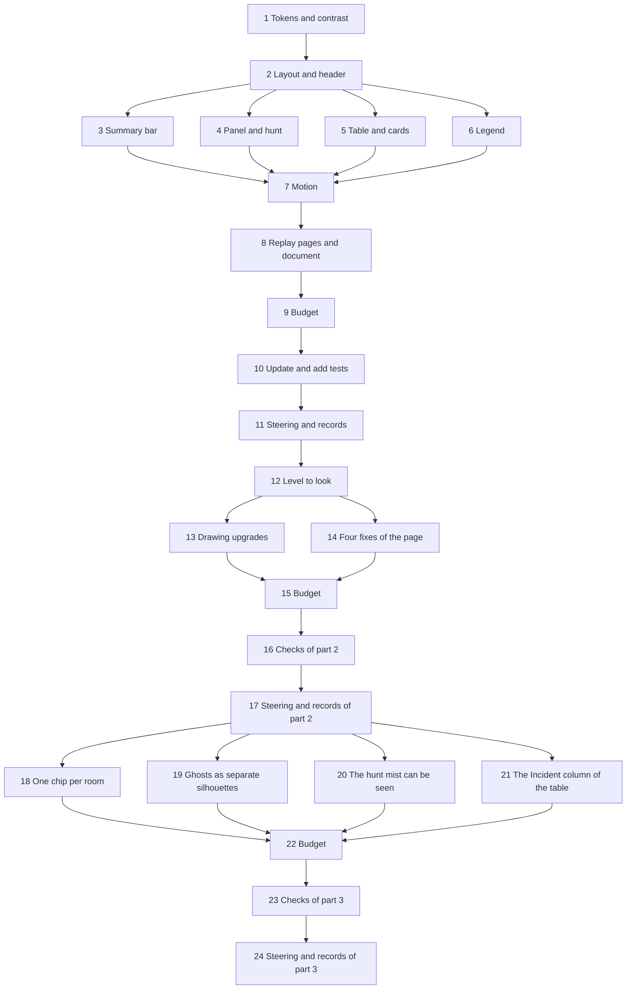

# Implementation Plan: visual-refresh
## Overview
Make the page around the Scene modern and easy to read, in the look "a lantern in a dark house": design tokens, a two-column layout with a side Panel, a header with a short explanation, a Summary bar, the Hunt as a Timeline, a Legend, a table that becomes cards on a phone, restyled replay pages, and the document head. It is 11 top-level tasks in part 1 and tasks 12 to 17 in part 2 (the Scene and four fixes of the page). Property tests are their own sub-tasks, marked `*`, and carry the comment `// Feature: visual-refresh, Property N`. Tasks 1 to 11 touch `apps/web/src/scene/` only in the `bg` and `focus` values of `palette.ts`; tasks 12 to 17 are the PixiJS scene. Nothing here touches the API, a server, GitHub or the real `kiro-cli`, and no test makes a network call.
## Tasks
- [x] 1. Design tokens and contrast
  - [x] 1.1 Replace the colours of `:root` in `apps/web/src/styles.css` with the new tokens and add the type, scale, spacing, radius and shadow tokens; every colour outside `:root` stays a custom property
    - _Requirements: 1.1, 1.2, 1.3_
  - [x] 1.2 Change only `bg` (and `focus` if it changed) in `apps/web/src/scene/palette.ts` so `model.test.ts` still holds
    - _Requirements: 1.4_
  - [x] 1.3 Update `CONTRAST_PAIRS` and the CSS pairs in `a11y/contrast.test.ts` for every new text and background pair and the focus ring; adjust the lightness of any failing token and record the ratios under "Contrast results" in the design
    - _Requirements: 1.5, 1.6, 10.4_
  - [x]* 1.4 Property test: every contrast pair passes its threshold (Property 1)
    - _Requirements: 1.1, 1.4, 1.5, 1.6_
- [x] 2. Layout and header
  - [x] 2.1 Add the Icon module `apps/web/src/components/icons.tsx` (inline SVG paths, `aria-hidden`, a neutral fallback)
    - _Requirements: 4.2, 4.7, 9.2_
  - [x] 2.2 Restyle `Header.tsx` (name in `--font-display`, the explanation line, the connection pill, the quiet mode switch); the Skip link and the switch keep their order
    - _Requirements: 2.5, 2.6_
  - [x] 2.3 Add the two-column grid in `App.tsx` and `styles.css` (Scene or table on the left, `<aside aria-label="Incident">` 360 px on the right at 64rem, one column below), with no horizontal overflow
    - _Requirements: 2.1, 2.2, 2.3, 2.4_
- [x] 3. Summary bar
  - [x] 3.1 Add the pure `summarize` (`summary.ts`) and `SummaryBar.tsx`: counts worst first with level marks, the Hunt state from `HuntSummary`, no live region; first block of the Panel and before the table in Accessible mode
    - _Requirements: 3.1, 3.3, 3.4, 3.5_
  - [x] 3.2 Unit and component tests: the count text, levels with no service omitted, each Hunt state, no hunt, no "of", not a live region
    - _Requirements: 3.1, 3.3, 3.4_
  - [x]* 3.3 Property test: the summary counts add up and match the levels (Property 2)
    - _Requirements: 3.1, 3.2_
- [x] 4. Panel and hunt
  - [x] 4.1 Restyle `HuntSection.tsx`: the Timeline with a tool icon, time and summary for each step, the diagnosis card (culprit, summary, "AI generated"), the compact evidence list, the Proposal card with a status pill and the button-styled pull request link
    - _Requirements: 4.1, 4.2, 4.3, 4.4, 4.5, 4.7_
  - [x] 4.2 Add the empty state of one sentence when there is no Hunt
    - _Requirements: 4.6_
  - [x] 4.3 Component tests: one Timeline item per step, icons `aria-hidden`, the diagnosis card, the Proposal pill and link, the empty state
    - _Requirements: 4.2, 4.3, 4.5, 4.6, 4.7, 10.2_
- [x] 5. Table and cards
  - [x] 5.1 Restyle `TableMode.tsx` (sticky header, row hover and focus, right-aligned `--font-num` numbers, the level as a pill with mark and word) and add `data-label` and explicit roles to the cells; DOM, columns and focus order unchanged
    - _Requirements: 5.1, 5.2, 5.3, 5.5_
  - [x] 5.2 Add the card mode below 40rem in CSS only, with no sideways scroll
    - _Requirements: 5.4_
  - [x] 5.3 Component test: `data-label` equals each column header and the table roles stay present in card mode
    - _Requirements: 5.3, 5.5, 10.2_
  - [x]* 5.4 Property test: every cell is labelled by its column and keeps its role (Property 4)
    - _Requirements: 5.1, 5.3, 5.5_
- [x] 6. Legend
  - [x] 6.1 Add `legend-state.ts` (`readLegendOpen`, `writeLegendOpen`, a throwing storage ignored) and `Legend.tsx` (`<details>` "What am I looking at?", the rows, original inline SVG glyphs, the five levels with their marks); place it in the Panel
    - _Requirements: 6.1, 6.2, 6.3, 6.4_
  - [x] 6.2 Component tests: open on a first visit, the stored choice is kept, a throwing storage, every row and level present
    - _Requirements: 6.2, 6.3, 10.2_
  - [x]* 6.3 Property test: the Legend remembers its state (Property 3)
    - _Requirements: 6.2_
- [x] 7. Motion
  - [x] 7.1 Add the hover, focus and open transitions (under 200 ms) and the one soft pulse on the "Hunt running" pill; turn all off under `prefers-reduced-motion` and in Accessible mode (extend `styles.css:187-198`); add a style test for both rules
    - _Requirements: 7.1, 7.2_
- [x] 8. Replay pages and document
  - [x] 8.1 Restyle `ReplayApp.tsx`: the list as cards (title, scenario pill, date, duration) and the empty state with a link back to live; keep the banner
    - _Requirements: 8.1, 8.2, 8.4_
  - [x] 8.2 Restyle `ReplayControls.tsx` as one toolbar with icon and text buttons and a styled range input; the button names do not change
    - _Requirements: 8.3, 8.5_
  - [x] 8.3 Add the description, `theme-color` `#0B0A12` and the inline SVG favicon to `apps/web/index.html`
    - _Requirements: 8.6_
- [x] 9. Budget
  - [x] 9.1 Build the web app, run `node scripts/check-scene-bundle.mjs` once, and raise `BUDGETS.entry` to 94 KiB at most only if the measured entry needs it; write the measured entry and replay numbers and the reason in the script comment and under "Budget record" in the design
    - _Requirements: 9.1, 9.2, 8.5_
- [x] 10. Update and add tests
  - [x] 10.1 Update the unit and component tests that the layout breaks, by changing selectors only: `App.test.tsx`, `table.test.tsx`, `focus.test.tsx`, `hunt.test.tsx`, `accessible-mode.test.tsx`, `replay.test.tsx`, `a11y.test.tsx`; keep the Accessible mode rules (one live region, focus order, Escape, parity, `?mode=accessible`, no Scene)
    - _Requirements: 9.3, 10.1_
  - [x] 10.2 Update the end-to-end tests `accessible.spec.ts`, `replay.spec.ts`, `no-webgl.spec.ts` and `scene.spec.ts` by changing selectors only
    - _Requirements: 9.3, 10.1_
  - [x] 10.3 Add `apps/web/e2e/layout.spec.ts`: `scrollWidth <= 390` at 390×844 on `/?demo=1`, `/?mode=accessible&demo=1` and `/replays`; the Panel beside the Scene at 1440×900
    - _Requirements: 2.1, 2.4, 10.3_
  - [x] 10.4 Extend `e2e/gallery.spec.ts` with screenshots only if it is cheap
    - _Requirements: 10.5_
  - [x] 10.5 Run `pnpm typecheck`, `pnpm lint` and only the test files created or changed (the full suite is the orchestrator's)
    - _Requirements: 10.6_
- [x] 11. Steering and records
  - [x] 11.1 Add the tokens and the contrast rule to `.kiro/steering/a11y-perf.md`; in `.kiro/steering/structure.md` insert `10. visual-refresh` and renumber `spatial-audio` to 11 and `submission-kit` to 12; add one README sentence on the Legend if useful
    - _Requirements: 11.1, 11.2_
  - [x] 11.2 Add one `2026-11-16 | visual-refresh/N | …` line per finished task to `docs/KIRO_USAGE.md` (the file ends with a newline); delete helper files; run the spec validator
    - _Requirements: 11.3, 11.4, 11.5_
- [x] 12. Level to look
  - [x] 12.1 Add the table `LEVEL_LOOK`, `lookOf` and `ghostFloor` to `apps/web/src/scene/model.ts`; `RoomVisual` gets `look` and `mist`; `light` is the glow of the look; no ghost when calm, a floor of ghosts for possessed; no dust in Low quality; add the scene colours to `palette.ts` (`danger`, `ecto`, `fog` cyan, `moon`, `floorFar`, `wallInner`) and their contrast pairs
    - _Requirements: 12.1, 12.2, 12.3, 12.5, 12.6_
  - [x] 12.2 Update `model.test.ts` and `model.property.test.ts` to the new rule and add unit tests of the table, the mist and the dust
    - _Requirements: 12.1, 12.2, 12.5, 17.2_
  - [x]* 12.3 Property test: the light follows the trouble (Property 5)
    - _Requirements: 12.1, 12.2, 12.6_
  - [x] 12.4 Add to the Animator and the Frame the tint, the cold edge, the danger outline, the mist, the glow pulse (`glowPulse`, one cycle of 2 s, one start per second at most) and the new surface drawing of the levels in `pixi-surface.ts`
    - _Requirements: 12.1, 12.4, 12.5_
  - [x] 12.5 Unit tests of the pulse (one cycle, at most one change of direction per second, none at first sight, for a fall, a dark room, Low quality or Reduced motion) and of the frame of each level
    - _Requirements: 12.4, 17.2_
- [x] 13. Drawing upgrades
  - [x] 13.1 Draw the ghost silhouette and three noise textures once in `textures.ts`
    - _Requirements: 13.1, 13.3, 13.6_
  - [x] 13.2 Ghost motion: golden-ratio spread in `particles.ts`, sine sway and eased fade in the Animator
    - _Requirements: 13.1, 13.2_
  - [x] 13.3 Fog layers: three drifting noise sprites per room, at different speeds, inside the floor
    - _Requirements: 13.3, 12.3_
  - [x] 13.4 Sky: horizon bands, far stars, near stars and the moon, with the parallax of the focused room; the roof on its own layer that fades while a room is focused
    - _Requirements: 13.4, 14.1_
  - [x] 13.5 Rooms: floor gradient, inner wall panels and one icon per service on the back wall (`shapes.ts`, `pixi-surface.ts`)
    - _Requirements: 14.1, 14.2_
  - [x] 13.6 Labels: the room name at 14 px or more under 640 px, the row boxes keep the 11 px rule (`layout.ts`)
    - _Requirements: 14.3_
  - [x] 13.7 Low quality and Reduced motion: parallax, fog layers beyond the first, dust and pulse off; static ghosts, fog and mist; every level look stays
    - _Requirements: 15.1, 15.2_
  - [x]* 13.8 Property test: reduced motion freezes every animated offset (Property 6)
    - _Requirements: 15.2, 15.3_
  - [x] 13.9 Update `layout.test.ts`, `animator.test.ts`, `pixi-surface.test.ts` and `art.test.ts` to the new rules and add the art tests (floor detail, icons, roof split, star layers)
    - _Requirements: 13.1, 14.1, 14.2, 14.3, 17.2_
- [x] 14. Four fixes of the page
  - [x] 14.1 Panel: `huntSectionService` also picks the service of the most recently finished Hunt (`latestFinishedService`), the Summary bar uses the same one; say "Diagnosed. The steps and evidence are shown in live mode." for a diagnosed Hunt with no steps and no API; tests of both
    - _Requirements: 16.1_
  - [x] 14.2 Level pill tokens `--level-calm` to `--level-dark` in `styles.css`; the calm pill does not use `--lantern`; contrast pairs and a style test in `contrast.test.ts`
    - _Requirements: 16.2_
  - [x] 14.3 Desktop table: `table-layout: fixed` with explicit column widths and tabular numbers; `layout.spec.ts` asserts equal header widths at t=0 and t=20 s at 1440 and 1024 px
    - _Requirements: 16.3_
  - [x] 14.4 Mobile order under 64rem by CSS `order`; `layout.spec.ts` asserts the visual order at 390×844
    - _Requirements: 16.4_
- [x] 15. Budget
  - [x] 15.1 Build the web app, run `node scripts/check-scene-bundle.mjs` once and write the measured numbers under "Budget record, part 2" in the design; add no import to `apps/web/src/scene/hooks.ts`
    - _Requirements: 17.1_
- [x] 16. Checks of part 2
  - [x] 16.1 Run `pnpm typecheck`, `pnpm lint` and only the test files created or changed (the full suite and the end-to-end run are the orchestrator's)
    - _Requirements: 17.3_
- [x] 17. Steering and records of part 2
  - [x] 17.1 Update `.kiro/steering/scene-rendering.md` with the level to look table and the new layers; add one `2026-11-17 | visual-refresh/N | …` line per finished task to `docs/KIRO_USAGE.md` (the file ends with a newline); run the spec validator
    - _Requirements: 17.4, 17.5_
- [x] 18. One chip per room
  - [x] 18.1 Layout: replace the label, badge and incident boxes with `chipAt`, `chipBox`, `chipBand` and `chipReserve` (one chip under the room, top in the bottom 20 %, the rest below the front corner, the fit keeps the overhang inside the canvas); the Exorcist figure stands above the chip
    - _Requirements: 18.3, 18.4, 18.6_
  - [x] 18.2 Drawing: `chipLayout` in `shapes.ts` in place of `plaqueLayout`; `pixi-surface.ts` draws one pill with the level mark and name and a `!` in `--danger` while an incident is open, and no badge or incident word; `levelMark` in the model and the contrast pair of the `!`
    - _Requirements: 18.1, 18.2_
  - [x]* 18.3 Property test: one chip per room, in the band under it, no two overlap, for any room set and width from 320 to 1920 (Property 7)
    - _Requirements: 18.1, 18.3, 18.4, 18.5_
  - [x] 18.4 Update `layout.test.ts`, `layout.property.test.ts` (rectGap and Property 15), `art.test.ts`, `hunt-scene.test.ts` and `animator.test.ts` to the single chip
    - _Requirements: 18.5, 18.6, 22.2_
- [x] 19. Ghosts as separate silhouettes
  - [x] 19.1 `particles.ts`: ghost sites on a hex lattice inside the band 0.25 to 0.8, seeded order, size 0.5 to 0.8, small drift, `ghostMinDistance` and `ghostDistance`; remove `GHOST_BACK_LIMIT`
    - _Requirements: 19.1, 19.3_
  - [x] 19.2 Ghost alpha at most 0.7 in the model, and a ghost texture with a cold body, a dark outline and deeper eye holes
    - _Requirements: 19.3, 19.4, 19.5_
  - [x]* 19.3 Property test: ghosts keep their distance and stay in the room for any seed and level (Property 8)
    - _Requirements: 19.1, 19.2, 19.3_
  - [x] 19.4 Update `model.test.ts`, `model.property.test.ts` and `animator.test.ts` to the new opacity and band
    - _Requirements: 22.2_
- [x] 20. The hunt mist can be seen
  - [x] 20.1 Write the failing test first in `pixi-surface.test.ts` (mist visible, ecto tint, alpha 0.6 or more, above the floor and the glow, at least 60 % of the room width) and run it: it fails on alpha 0.5
    - _Requirements: 20.1, 20.2_
  - [x] 20.2 Fix the cause: a dense `fog` puff for the first mist sprite, alphas 0.92 and 0.78, a slow breath of 4 s (`mistBreath`) with a swing of 0.12, Low quality with one layer; write the cause in the design
    - _Requirements: 20.2, 20.3, 20.4, 20.5_
  - [x] 20.3 Tests of the breath (cycle, swing, floor of 0.6), Reduced motion (still and visible), Low quality (one layer) and `mistBreath` zero in Property 6
    - _Requirements: 20.3, 20.4, 22.2_
- [x] 21. The Incident column of the table
  - [x] 21.1 `styles.css`: widths 6.5, 9.5, 7, 5.5, 4.5, 3.5, 10, 9.5, 6 rem, `min-width: 62rem` with the total in a comment, `overflow-wrap: break-word`
    - _Requirements: 21.1, 21.2, 21.4_
  - [x] 21.2 `layout.spec.ts`: at 1440×900 and demo second 20, every Incident cell is at most two lines high; the stable-width and no-clip tests keep passing at 1440 and 1024
    - _Requirements: 21.3_
- [x] 22. Budget
  - [x] 22.1 Build the web app, run `node scripts/check-scene-bundle.mjs` once and write the measured numbers under "Budget record, part 3" in the design; add no import to `apps/web/src/scene/hooks.ts`
    - _Requirements: 22.1_
- [x] 23. Checks of part 3
  - [x] 23.1 Run `pnpm typecheck`, `pnpm lint`, only the test files created or changed, `e2e/layout.spec.ts` once and the spec validator (the full suite and the whole end-to-end run are the orchestrator's)
    - _Requirements: 22.3_
- [x] 24. Steering and records of part 3
  - [x] 24.1 Update `.kiro/steering/scene-rendering.md` with the chip rule and the ghost spacing rule (two lines); add one `2026-11-17 | visual-refresh/N | …` line per finished task to `docs/KIRO_USAGE.md` (the file ends with a newline)
    - _Requirements: 22.4, 22.5_
## Notes
- Scope: tasks 1 to 11 are part 1 of the refresh; `apps/web/src/scene/` changes there only in `palette.ts` (`bg`, and `focus` if it changed). Tasks 12 to 17 are part 2: the PixiJS scene (rooms, ghosts, fog, sky) and four fixes of the page. There is no zoom in the Scene; the camera of the parallax and of the roof is the focused room.
- Entry chunk before this spec: 90.4 of 92 KiB gzip (`check-scene-bundle.mjs`; the 92 KiB comes from `accessible-mode/design.md`). The budget may rise to 94 KiB at most, only on a measured need. Replay chunk: 5665 bytes, budget 6800 bytes.
- `HuntSummary.stepCount` is the number of steps done; there is no total, so the Web never shows "x of y".
- Card mode keeps the table semantics by writing the roles as attributes, because `display: block` on table elements can remove the table role in some engines.
- Checks while building: `pnpm typecheck`, `pnpm lint`, the touched test files, `pnpm --filter @haunted-ops/web build`, `node scripts/check-scene-bundle.mjs`, the spec validator. Not run: the full suite, `pnpm test` three times, `test:scripts`, `check:build`, `db:drift`, the whole Playwright run.
- Part 3 (tasks 18 to 24): the chip, the ghosts, the hunt mist and the Incident column, written in a third prompt. The mist test is written first and fails on alpha 0.5 before the drawing is fixed. Checks while building: `pnpm typecheck`, `pnpm lint`, the created or changed test files, `e2e/layout.spec.ts` once, the build with `check-scene-bundle.mjs` once, the spec validator.
- Out of scope: spatial audio, any API change, any new dependency, a font file, CSS-in-JS.
## Task Dependency Graph

```json
{
  "waves": [
    { "id": 0, "tasks": ["1.1", "1.2", "2.1"] },
    { "id": 1, "tasks": ["1.3", "2.2", "2.3"] },
    { "id": 2, "tasks": ["1.4", "3.1", "4.1", "5.1", "6.1"] },
    { "id": 3, "tasks": ["3.2", "3.3", "4.2", "5.2", "6.2", "6.3"] },
    { "id": 4, "tasks": ["4.3", "5.3", "5.4", "7.1"] },
    { "id": 5, "tasks": ["8.1", "8.2", "8.3"] },
    { "id": 6, "tasks": ["9.1"] },
    { "id": 7, "tasks": ["10.1", "10.2", "10.3", "10.4"] },
    { "id": 8, "tasks": ["10.5"] },
    { "id": 9, "tasks": ["11.1"] },
    { "id": 10, "tasks": ["11.2"] },
    { "id": 11, "tasks": ["12.1"] },
    { "id": 12, "tasks": ["12.2", "12.3", "12.4", "13.1", "14.1", "14.2", "14.3", "14.4"] },
    { "id": 13, "tasks": ["12.5", "13.2", "13.3", "13.4", "13.5", "13.6"] },
    { "id": 14, "tasks": ["13.7", "13.8", "13.9"] },
    { "id": 15, "tasks": ["15.1"] },
    { "id": 16, "tasks": ["16.1"] },
    { "id": 17, "tasks": ["17.1"] },
    { "id": 18, "tasks": ["18.1", "19.1", "20.1", "21.1"] },
    { "id": 19, "tasks": ["18.2", "19.2", "20.2", "21.2"] },
    { "id": 20, "tasks": ["18.3", "18.4", "19.3", "19.4", "20.3"] },
    { "id": 21, "tasks": ["22.1"] },
    { "id": 22, "tasks": ["23.1"] },
    { "id": 23, "tasks": ["24.1"] }
  ]
}
```
