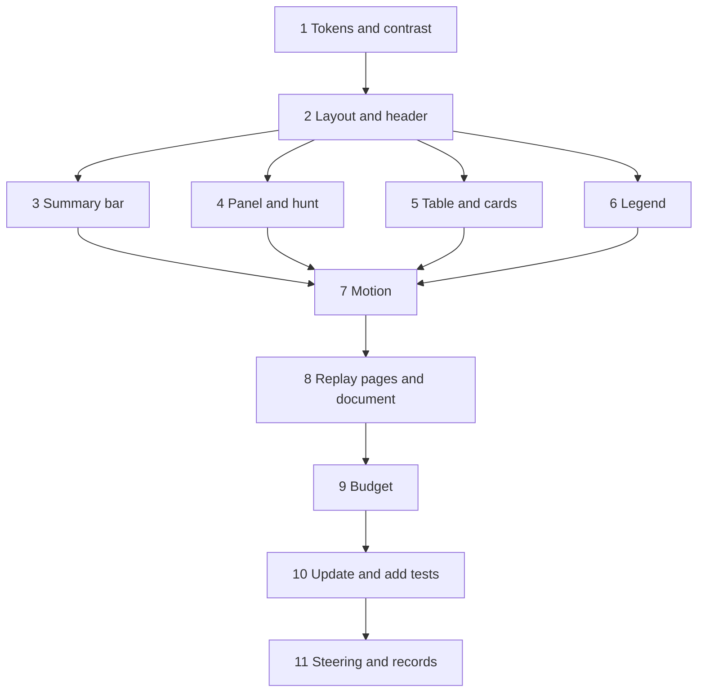

# Implementation Plan: visual-refresh
## Overview
Make the page around the Scene modern and easy to read, in the look "a lantern in a dark house": design tokens, a two-column layout with a side Panel, a header with a short explanation, a Summary bar, the Hunt as a Timeline, a Legend, a table that becomes cards on a phone, restyled replay pages, and the document head. It is 11 top-level tasks. Property tests are their own sub-tasks, marked `*`, and carry the comment `// Feature: visual-refresh, Property N`. Part 2 (the PixiJS scene) is a later prompt: nothing here touches `apps/web/src/scene/` except the `bg` and `focus` values of `palette.ts`. Nothing here touches the API, a server, GitHub or the real `kiro-cli`, and no test makes a network call.
## Tasks
- [x] 1. Design tokens and contrast
  - [x] 1.1 Replace the colours of `:root` in `apps/web/src/styles.css` with the new tokens and add the type, scale, spacing, radius and shadow tokens; every colour outside `:root` stays a custom property
    - _Requirements: 1.1, 1.2, 1.3_
  - [x] 1.2 Change only `bg` (and `focus` if it changed) in `apps/web/src/scene/palette.ts` so `model.test.ts` still holds
    - _Requirements: 1.4_
  - [x] 1.3 Update `CONTRAST_PAIRS` and the CSS pairs in `a11y/contrast.test.ts` for every new text and background pair and the focus ring; adjust the lightness of any failing token and record the ratios under "Contrast results" in the design
    - _Requirements: 1.5, 1.6, 10.4_
  - [x]* 1.4 Property test: every contrast pair passes its threshold (Property 1)
    - _Requirements: 1.1, 1.4, 1.5, 1.6_
- [x] 2. Layout and header
  - [x] 2.1 Add the Icon module `apps/web/src/components/icons.tsx` (inline SVG paths, `aria-hidden`, a neutral fallback)
    - _Requirements: 4.2, 4.7, 9.2_
  - [x] 2.2 Restyle `Header.tsx` (name in `--font-display`, the explanation line, the connection pill, the quiet mode switch); the Skip link and the switch keep their order
    - _Requirements: 2.5, 2.6_
  - [x] 2.3 Add the two-column grid in `App.tsx` and `styles.css` (Scene or table on the left, `<aside aria-label="Incident">` 360 px on the right at 64rem, one column below), with no horizontal overflow
    - _Requirements: 2.1, 2.2, 2.3, 2.4_
- [x] 3. Summary bar
  - [x] 3.1 Add the pure `summarize` (`summary.ts`) and `SummaryBar.tsx`: counts worst first with level marks, the Hunt state from `HuntSummary`, no live region; first block of the Panel and before the table in Accessible mode
    - _Requirements: 3.1, 3.3, 3.4, 3.5_
  - [x] 3.2 Unit and component tests: the count text, levels with no service omitted, each Hunt state, no hunt, no "of", not a live region
    - _Requirements: 3.1, 3.3, 3.4_
  - [x]* 3.3 Property test: the summary counts add up and match the levels (Property 2)
    - _Requirements: 3.1, 3.2_
- [x] 4. Panel and hunt
  - [x] 4.1 Restyle `HuntSection.tsx`: the Timeline with a tool icon, time and summary for each step, the diagnosis card (culprit, summary, "AI generated"), the compact evidence list, the Proposal card with a status pill and the button-styled pull request link
    - _Requirements: 4.1, 4.2, 4.3, 4.4, 4.5, 4.7_
  - [x] 4.2 Add the empty state of one sentence when there is no Hunt
    - _Requirements: 4.6_
  - [x] 4.3 Component tests: one Timeline item per step, icons `aria-hidden`, the diagnosis card, the Proposal pill and link, the empty state
    - _Requirements: 4.2, 4.3, 4.5, 4.6, 4.7, 10.2_
- [x] 5. Table and cards
  - [x] 5.1 Restyle `TableMode.tsx` (sticky header, row hover and focus, right-aligned `--font-num` numbers, the level as a pill with mark and word) and add `data-label` and explicit roles to the cells; DOM, columns and focus order unchanged
    - _Requirements: 5.1, 5.2, 5.3, 5.5_
  - [x] 5.2 Add the card mode below 40rem in CSS only, with no sideways scroll
    - _Requirements: 5.4_
  - [x] 5.3 Component test: `data-label` equals each column header and the table roles stay present in card mode
    - _Requirements: 5.3, 5.5, 10.2_
  - [x]* 5.4 Property test: every cell is labelled by its column and keeps its role (Property 4)
    - _Requirements: 5.1, 5.3, 5.5_
- [x] 6. Legend
  - [x] 6.1 Add `legend-state.ts` (`readLegendOpen`, `writeLegendOpen`, a throwing storage ignored) and `Legend.tsx` (`<details>` "What am I looking at?", the rows, original inline SVG glyphs, the five levels with their marks); place it in the Panel
    - _Requirements: 6.1, 6.2, 6.3, 6.4_
  - [x] 6.2 Component tests: open on a first visit, the stored choice is kept, a throwing storage, every row and level present
    - _Requirements: 6.2, 6.3, 10.2_
  - [x]* 6.3 Property test: the Legend remembers its state (Property 3)
    - _Requirements: 6.2_
- [x] 7. Motion
  - [x] 7.1 Add the hover, focus and open transitions (under 200 ms) and the one soft pulse on the "Hunt running" pill; turn all off under `prefers-reduced-motion` and in Accessible mode (extend `styles.css:187-198`); add a style test for both rules
    - _Requirements: 7.1, 7.2_
- [x] 8. Replay pages and document
  - [x] 8.1 Restyle `ReplayApp.tsx`: the list as cards (title, scenario pill, date, duration) and the empty state with a link back to live; keep the banner
    - _Requirements: 8.1, 8.2, 8.4_
  - [x] 8.2 Restyle `ReplayControls.tsx` as one toolbar with icon and text buttons and a styled range input; the button names do not change
    - _Requirements: 8.3, 8.5_
  - [x] 8.3 Add the description, `theme-color` `#0B0A12` and the inline SVG favicon to `apps/web/index.html`
    - _Requirements: 8.6_
- [x] 9. Budget
  - [x] 9.1 Build the web app, run `node scripts/check-scene-bundle.mjs` once, and raise `BUDGETS.entry` to 94 KiB at most only if the measured entry needs it; write the measured entry and replay numbers and the reason in the script comment and under "Budget record" in the design
    - _Requirements: 9.1, 9.2, 8.5_
- [x] 10. Update and add tests
  - [x] 10.1 Update the unit and component tests that the layout breaks, by changing selectors only: `App.test.tsx`, `table.test.tsx`, `focus.test.tsx`, `hunt.test.tsx`, `accessible-mode.test.tsx`, `replay.test.tsx`, `a11y.test.tsx`; keep the Accessible mode rules (one live region, focus order, Escape, parity, `?mode=accessible`, no Scene)
    - _Requirements: 9.3, 10.1_
  - [x] 10.2 Update the end-to-end tests `accessible.spec.ts`, `replay.spec.ts`, `no-webgl.spec.ts` and `scene.spec.ts` by changing selectors only
    - _Requirements: 9.3, 10.1_
  - [x] 10.3 Add `apps/web/e2e/layout.spec.ts`: `scrollWidth <= 390` at 390×844 on `/?demo=1`, `/?mode=accessible&demo=1` and `/replays`; the Panel beside the Scene at 1440×900
    - _Requirements: 2.1, 2.4, 10.3_
  - [x] 10.4 Extend `e2e/gallery.spec.ts` with screenshots only if it is cheap
    - _Requirements: 10.5_
  - [x] 10.5 Run `pnpm typecheck`, `pnpm lint` and only the test files created or changed (the full suite is the orchestrator's)
    - _Requirements: 10.6_
- [x] 11. Steering and records
  - [x] 11.1 Add the tokens and the contrast rule to `.kiro/steering/a11y-perf.md`; in `.kiro/steering/structure.md` insert `10. visual-refresh` and renumber `spatial-audio` to 11 and `submission-kit` to 12; add one README sentence on the Legend if useful
    - _Requirements: 11.1, 11.2_
  - [x] 11.2 Add one `2026-11-16 | visual-refresh/N | …` line per finished task to `docs/KIRO_USAGE.md` (the file ends with a newline); delete helper files; run the spec validator
    - _Requirements: 11.3, 11.4, 11.5_
## Notes
- Scope: this is part 1 of the refresh. The PixiJS scene (rooms, ghosts, fog, sky) is part 2 and a later prompt; `apps/web/src/scene/` changes only in `palette.ts` (`bg`, and `focus` if it changed).
- Entry chunk before this spec: 90.4 of 92 KiB gzip (`check-scene-bundle.mjs`; the 92 KiB comes from `accessible-mode/design.md`). The budget may rise to 94 KiB at most, only on a measured need. Replay chunk: 5665 bytes, budget 6800 bytes.
- `HuntSummary.stepCount` is the number of steps done; there is no total, so the Web never shows "x of y".
- Card mode keeps the table semantics by writing the roles as attributes, because `display: block` on table elements can remove the table role in some engines.
- Checks while building: `pnpm typecheck`, `pnpm lint`, the touched test files, `pnpm --filter @haunted-ops/web build`, `node scripts/check-scene-bundle.mjs`, the spec validator. Not run: the full suite, `pnpm test` three times, `test:scripts`, `check:build`, `db:drift`, the whole Playwright run.
- Out of scope: the Scene, spatial audio, any API change, any new dependency, a font file, CSS-in-JS.
## Task Dependency Graph

```json
{
  "waves": [
    { "id": 0, "tasks": ["1.1", "1.2", "2.1"] },
    { "id": 1, "tasks": ["1.3", "2.2", "2.3"] },
    { "id": 2, "tasks": ["1.4", "3.1", "4.1", "5.1", "6.1"] },
    { "id": 3, "tasks": ["3.2", "3.3", "4.2", "5.2", "6.2", "6.3"] },
    { "id": 4, "tasks": ["4.3", "5.3", "5.4", "7.1"] },
    { "id": 5, "tasks": ["8.1", "8.2", "8.3"] },
    { "id": 6, "tasks": ["9.1"] },
    { "id": 7, "tasks": ["10.1", "10.2", "10.3", "10.4"] },
    { "id": 8, "tasks": ["10.5"] },
    { "id": 9, "tasks": ["11.1"] },
    { "id": 10, "tasks": ["11.2"] }
  ]
}
```
